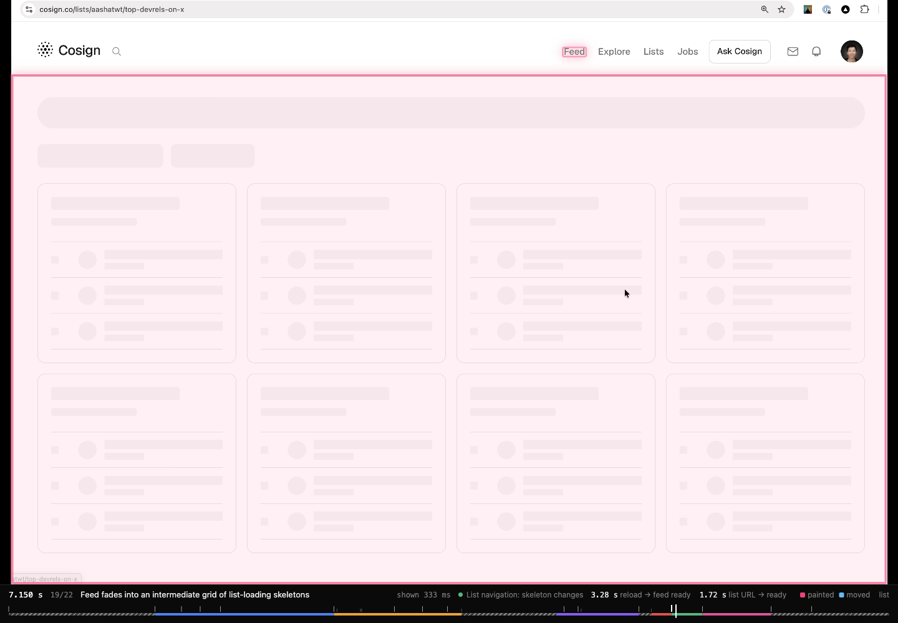
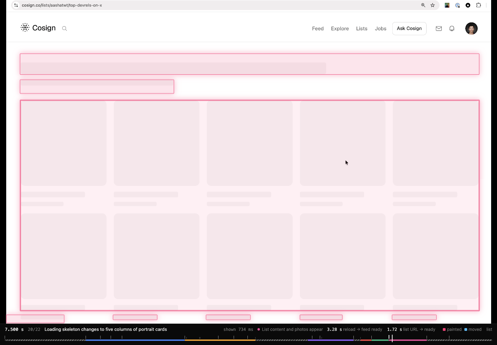
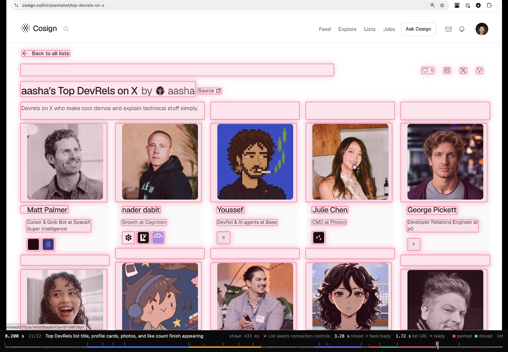
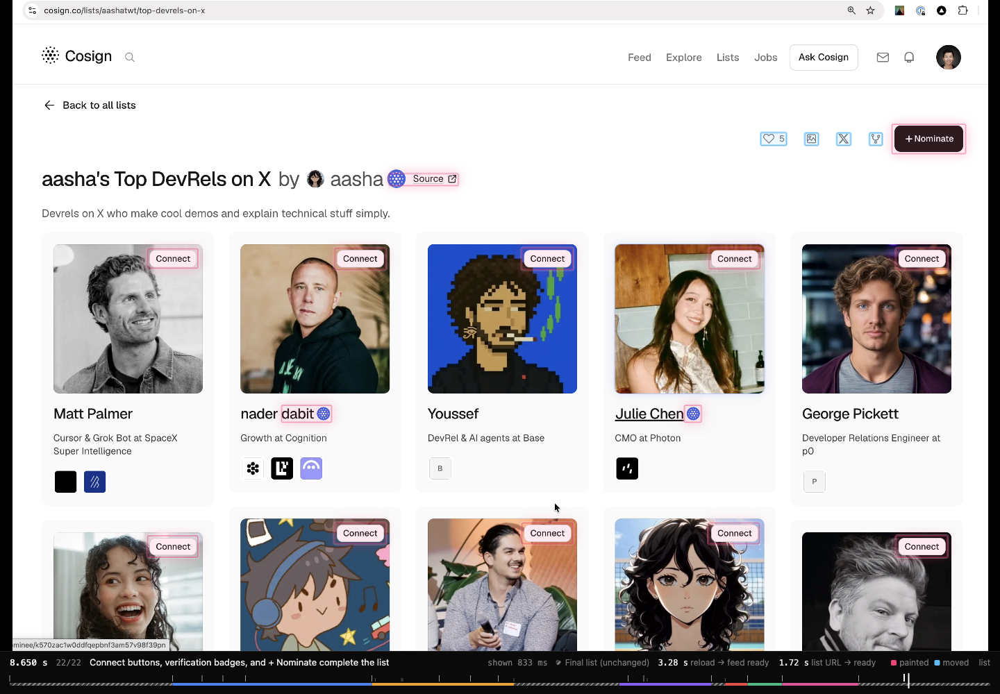
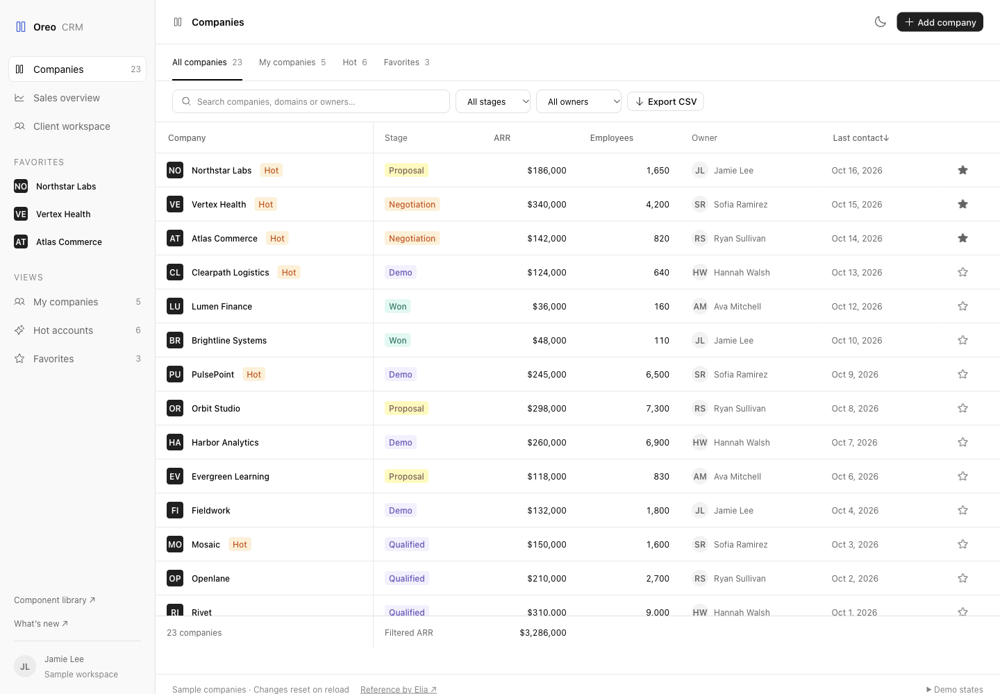
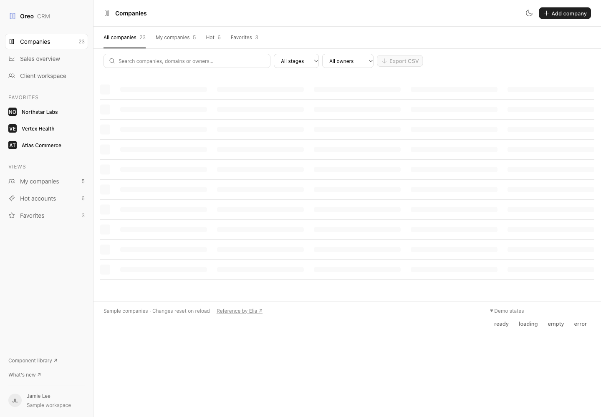
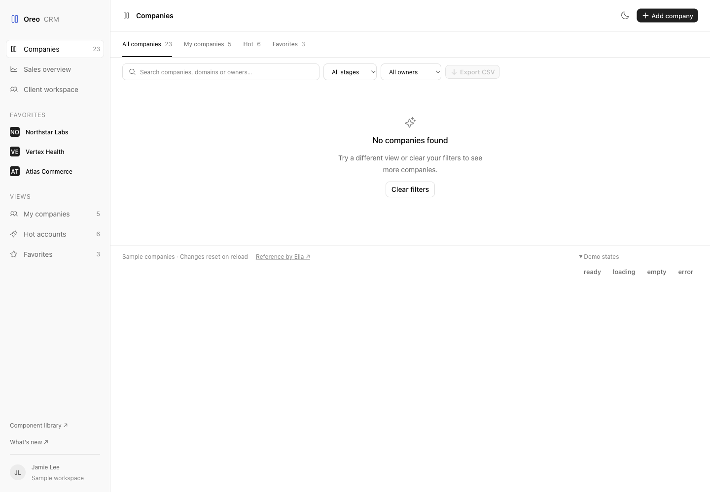
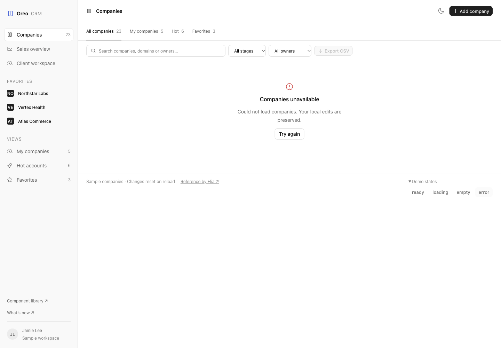
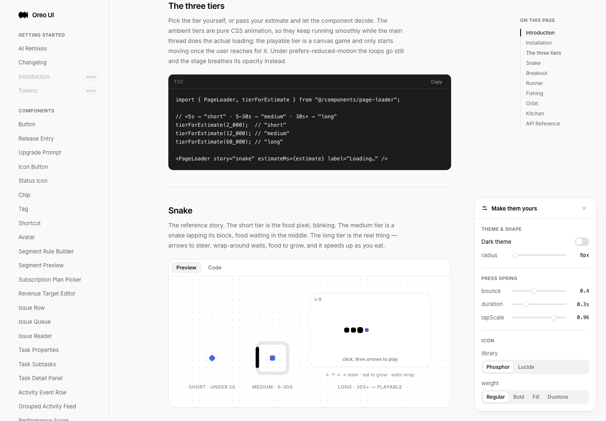

> 历史研究归档：正文结论、日期和验证限制来自原分析；本次只迁移文件并将本包媒体链接改为相对路径。历史“当前/已交付/待完成”等表述均以原日期为准。

# Cosign 视频与 Oreo UI 分析

日期：2026-10-20（Asia/Shanghai）。范围：只读分析；未修改 Oreo UI 产品代码、分支或已有 WIP。

## 证据与边界

- [更新帖](https://x.com/andrewqu/status/2112292205696344120)：已通过浏览器读取完整正文。
- [被引用的原帖](https://x.com/andrewqu/status/2111493582540710124)：已读取完整正文；其中 32 秒视频未做逐帧全量分析。
- [更新帖的交互审查页](https://cosign-ui-review-2.vercel.app/)：已读取 HTML/JS、22 条标注，查看 0、1.90、7.15、7.50、8.20、8.65 秒的实际画面；非逐帧全量人工重审。
- [工具作者仓库](https://github.com/rauchg/skills) 与 [流程定义](https://github.com/rauchg/skills/blob/main/skills/ui-recording-timeline/SKILL.md)：已核对。
- Oreo 在线实物：Page Loader、Company Table Playground、Company Directory。后两者是组件示例和本地数据模板，不是生产账号或真实网络性能证据。
- 浏览器：Playwriter，Chrome，桌面 1440×1000 CSS px，浅色，英文；组件局部截图尺寸随容器内容而变化。
- 当前本地工作树 HEAD：f63171f4d0f8097d98ca9606a7d6760f7871bf79，分支 codex/settings-language-lab，有大量既有未提交更改，未触碰。
- 补充源代码来自本地 origin/main 快照 229636a63080c0197fb373549f98205a51c8bc58。刷新远端失败：GitHub TLS SSL_ERROR_SYSCALL；不能声称该快照是当前远端最新版本，在线部署 SHA 也未确认。

## 视频表达的内容

原帖按数据性质划分：能静态的直接静态；大家相同的动态数据缓存；个性化数据先呈现布局，再局部填充，不能让请求阻塞整个导航。
更新帖说导航已有改善，但静态顶栏应该属于布局，减少频繁弹出、消失和挤动，把注意力留给内容。

审查页标注（时间从录屏起点算，精度声明为 ±1 帧）：

| 时间 | 变化 | 启发 |
| --- | --- | --- |
| 1.567 s | 刷新后内容被通用骨架替换 | 刷新计时始于画面 reset，不是按键或网络起点 |
| 2.050 / 2.267 s | 基础顶栏、登录态顶栏先后出现 | 固定导航与用户数据边界应拆开 |
| 6.883 s | URL 变为列表页 | 本例列表计时起点 |
| 7.100 s | 四列通用列表骨架 | 与最终卡片结构不符 |
| 7.433 s | 换成五列人物骨架 | 多了一次没有任务价值的视觉变化 |
| 8.167 s | 标题、人物、图片出现 | 主内容可读 |
| 8.600 s | Connect、认证标记、Nominate 出现 | 操作区随后补入，又挤动既有工具栏 |

刷新到最终 feed 3.28 秒；列表 URL 改变到最终状态 1.72 秒；列表主要内容出现后再等 0.433 秒才补齐连接操作。这里的 ready 是录屏视觉完成标注，不是经点击验证的可交互性能指标，也不是 LCP/INP 或网络瀑布证据。

### 同一次录屏的状态对照（不是修改前后）

四列骨架，7.15 s：

五列人物骨架，7.50 s：

人物内容出现，8.20 s：

操作补齐并挤动工具栏，8.65 s；粉色标新变化，蓝色标移动：

## 审查工具怎么实现

公开工具 ui-recording-timeline 使用 ffmpeg/ffprobe 抽取带真实时间戳的帧，Python 脚本寻找变化候选；agent 查看接触表并判断有效变化，剔除鼠标、hover、光标闪烁和 spinner 自转，标注阶段、指标和结束帧。动画整体作为一次变化处理。

接着计算变化区域：通过模板匹配区分原有内容移动与新内容绘制，合并到完整文字、控件等视觉块，并人工检查/纠正。它分析像素，不能从视频确认 React 重渲染、请求串行、组件树或浏览器真实 paint event。

实际页面是静态 HTML/CSS/JS + MP4 + 缩略图。内嵌 D 数据含 paints、phases、regions、metrics；video.currentTime 驱动播放头和高亮；绝对定位 div 叠加归一化矩形；ResizeObserver 对齐视频 letterbox；键盘逐条跳转、拖动时间轴、缩略图 hover、#t= 时间深链接。它既是一个可复用审查工作流，也能抽成通用视频时间轴 UI。

## 映射到 Oreo UI

| 参考中的角色 | Oreo 现有同角色实现 | 建议与界限 |
| --- | --- | --- |
| 固定布局与可变内容 | DocsPage / DocsLayout；SettingsShell | SettingsShell 已将 nav 放在 keyed 内容之外。App 的 keyed Page 子树包含 DocsPage，跨文档可能重建布局与局部设置；这是源码已见的结构，不代表已证明线上闪烁。优先验证主题、侧栏滚动和焦点是否需要跨页保留，再决定上移共享壳层 |
| 列表内容 loading | CompanyTable；CompanyDirectoryPage | 在线已验证筛选/页标题/侧栏保留；表头和排序入口消失。共享 owner 是 CompanyTable，应保留表结构和排序行，让 tbody 占位与最终列宽/行高对齐。汇总值是否保留要区分初始加载与同查询刷新 |
| 长任务等待 | PageLoader | 故事图标、场景、小小游戏已有成品；适用于真正不可避免的长任务，不应因“预计小于 5 秒”就成为普通路由默认载入方式 |
| 品牌开场 | LoadingSequence | 源码明确是固定时长装饰 intro；不代表数据 readiness。适用于主动选择的展示，避免替代产品加载状态 |
| 空 / 错误 / 恢复 | AgentWorkspaceState，被 CompanyTable 复用 | 在线验证同区域展示、不同文案与清空筛选/重试；重试在 fixture 中返回 ready，不证明真实网络重试 |
| 可视化审查 | 现有任务 REVIEW + 原始录屏 | 建议追加可点击时间轴，不新增独立竞争记录；保留源视频、帧时间戳、人工标注、自动区域与修订证据 |

### Oreo 实物状态比较

Company Directory 正常态（在线 fixture）：

加载态（同视口、浅色、同数据来源；Demo states 折叠面板在此已展开）：

外壳和筛选保持稳定，这是可保留的模式。加载态表头与排序操作消失，需由 CompanyTable 统一处理，不在页面再复制一套表头。

空状态：

错误状态：

已点击 Try again，快照确认恢复 23 companies；恢复截图已保留，未作为额外视觉质量结论。

已有 Page Loader 实物：

## 六项审查覆盖

| Lens | 结果 | 证据 / 缺口 |
| --- | --- | --- |
| Entry behavior | 部分 checked / unverified | 参考视频 URL 切换与等待可见；Oreo 文档跨页状态持久性仅源码分析，未做匹配导航录屏 |
| Loading | mismatch / checked | 参考骨架换形；Oreo CompanyTable ready/loading 与模板对照，表头消失已复现；未测真实慢网 |
| Empty states | checked（限定展示） | 同一 CompanyDirectory 内容区 empty/error，以及共享 AgentWorkspaceState；并非全库一致性证明 |
| Actions | checked / mismatch | 导出 loading 时禁用；筛选仍可见；排序头消失；恢复按钮已执行。未检验全部键盘/点击时序 |
| Titled scroll surfaces | unverified | 表头 sticky 与不透明背景在代码中存在；未覆盖顶部/中间/底部实际滚动，不能宣称验证完成 |
| Icons/color | checked（限定展示） | 现有模板普通操作图标中性、错误图标红色，与状态语义一致；品牌图标为例外；未做全库继承链与暗色检查 |

## 建议优先级

1. 先形成加载行为规则：固定壳层、立即选中、局部 loading、同查询刷新保留内容、一次稳定骨架到内容、图片和晚到操作预留几何空间。等待更短不等于视觉更稳定。
2. 以 CompanyTable + CompanyDirectory 做一套完整异步模板：首次进入、筛选、刷新、空结果、失败重试、快速连续切换。请求排序/取消应由数据层处理，组件消费明确状态；不要强制延迟数据展示来凑动画。
3. 将 ui-recording-timeline 引入现有审查包：记录点击到反馈、目标 shell、主内容出现、视觉稳定、布局移动、反馈能否被再次操作打断。录屏判断问题，浏览器性能轨迹/网络记录定位原因。
4. 若沉淀为 Oreo 组件，可拆 TimelineTrack、FilmstripPreview、ChangeOverlay 与完整 Review Timeline 模板；媒体分析脚本独立于 React 组件。优先复用原作者 MIT 工具流程，无需先重写像素分析算法。

实施/交付：分析完成，产品未修改；截图是现有状态与外部参考，不能当作修复后的对比。
