> 历史研究归档：正文结论、日期和验证限制来自原分析；本次只迁移文件并将本包媒体链接改为相对路径。历史“当前/已交付/待完成”等表述均以原日期为准。

# Spacing rules & playground

## Scope and baseline

User authorized layout rules and a spacing playground. No global restyling of existing templates. Implementation checkout: `/Users/ziye/Documents/Project/Research/oreo-ui-spacing-20261019`. Baseline: `b89172c92fbd2f4043f8b988dd2dfad18bbd2c09`, freshly fetched main. The original dirty checkout is preserved.

Reference: https://x.com/recentdesign/status/2111763882507149567?s=20. Inspected frames at 0.1, 3, 6 and 9 seconds: sidebar 184→248, page inset 20→40, section gap 20→48, card gap 20→12, card padding 12→24. The gray content is a spacing illustration, not proof of a loading state.

Environment: local real React components, Chrome via Playwriter session 9, localhost:5184, 1440×1000, light, English. Fixture content only. The original analysis examined an older dirty checkout; implementation evidence uses current main instead.

## Before editing: reuse map

| Target | Peer inspected | Owner / decision |
|---|---|---|
| Page and inspector | rendered `/button`, `src/docs/playground/ComponentPlayground.tsx` | Reuse Sidebar, PropertyControl (range + normalized number), Button, Switch, existing theme tokens; make a dedicated full-page layout playground because component preview's max-width cannot show page geometry. |
| Group hierarchy | rendered `/settings`, SettingsSection and settings.variants.ts | Preserve title-to-group proximity and constrained reading width. New opt-in layout variables; no global overrides. |
| Dashboard composition | dashboard-suite source, prior review-workspace rendering | Existing dashboard cards hardcode independent inner paddings; build a small spacing teaching fixture around new reusable LayoutScope / LayoutSection / LayoutGrid / LayoutCard, using Oreo's surface/radius/type tokens. Source comparison only for dashboard-suite. |
| Reference | video keyframes | Adopt relative hierarchy, reject universal numeric prescription; retain exact reference values only as a labeled preset. |

## Six lenses

- Entry: baseline `/spacing` is absent and normalizes to `/`; add normal Getting Started links and direct routes. Before captured below.
- Loading: not applicable; synchronous local layout/fixture, no requests or invented loader.
- Empty: not applicable to spacing values; page always has fixture content. Copy failure/recovery to verify.
- Actions: use existing Button variants, PropertyControl, Switch. Verify keyboard controls and reset.
- Titled scrolling: inspector opaque sticky heading; preview has its own labeled horizontal overflow. Verify no title/content collision.
- Icons/color: canonical Icon/currentColor; overlay colors map to Oreo palette and have text labels. Verify light/dark.

## Baseline evidence

No previous spacing page or control existed. Direct `/spacing` resolved to the default Button playground; it is captured as the actual missing-route result, not a prior version of the new page.

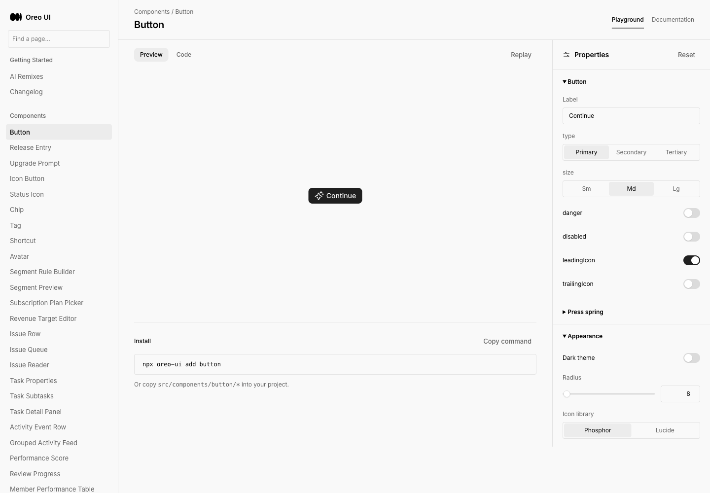

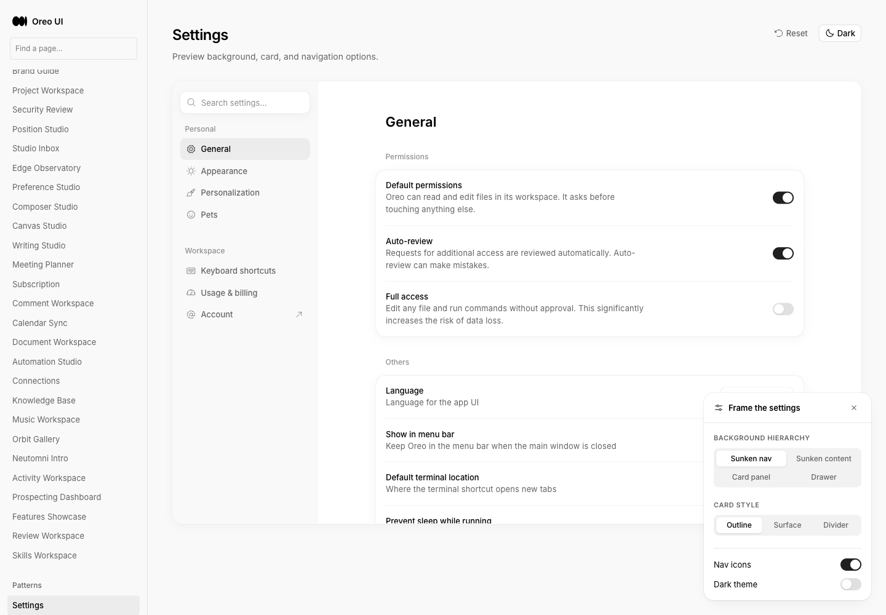

Implementation and after evidence: pending.

## Delivered implementation

Source reviewed: `67fcbe1cf95612ac276c250ef7a6821be62e7ecc`. Eleven task-scoped files: two routes and Getting Started entries, reusable layout-spacing primitives/values, the interactive fixture, and the layout guide. Existing template defaults and the original dirty checkout are unchanged.

The guide distinguishes control spacing from composition spacing, defines the five semantic roles, maps Balanced values to the existing Tailwind scale, explains family-specific density and responsive ownership, and provides a composition example. Values and recipes have one owner (`model.ts`). CSS exports can be applied using `LayoutScope className="my-layout"` without the values prop; the guide and source README explain consuming the scoped variables.

### Exact-source review

Reviewed route registration/metadata, input and baseline state ownership, exported CSS precedence, focus/keyboard paths, shared Button/PropertyControl reuse, local theme inheritance, bounded overflow and reference attribution. Corrected two issues during review: CSS export now supports a LayoutScope without inline values, and dark overlays now mix existing palette colors with the base surface instead of painting saturated solid colors. No remaining blocking finding in this scope. GitHub reported the exact head as mergeable with no registered status checks; local validation is reported separately, not as CI success.

### Validation

- Production build + TypeScript passed on final source (existing bundle-size warning remains).
- Preset numbers, independent baseline, baseline capture/restore, current-only reset passed.
- Number out-of-range clamping, 4px snapping, empty-field recovery and keyboard slider adjustment passed.
- Actual clipboard copy succeeded. Simulated clipboard rejection retained visible selectable CSS and a recovery message; the test restored the browser clipboard method afterward.
- Direct routes, site entry, guide and return navigation passed.
- Inspected 1440×1000, 768×1024 and 390×844 in light and dark; inspected long-content and baseline comparison states. At 390px the page remained 390px wide; the 800px desktop specimen scrolls inside its labeled region. 1199/1200 inspector breakpoint checked without page overflow.
- Browser extension errors about ethereum/session were present on baseline and external pages too. No new application failure was observed during these focused interactions; this is not a claim that the browser console was empty.
- `checks.json` records interaction assertions. Initial test scripts were corrected for the sandbox assert import and a stale HMR highlight state; the full interaction checks then passed.

## Before / after: site entry

Same `/button` route, viewport and light theme. The only intended change here is adding the two Getting Started entries.

| Before | After |
|---|---|
|  | 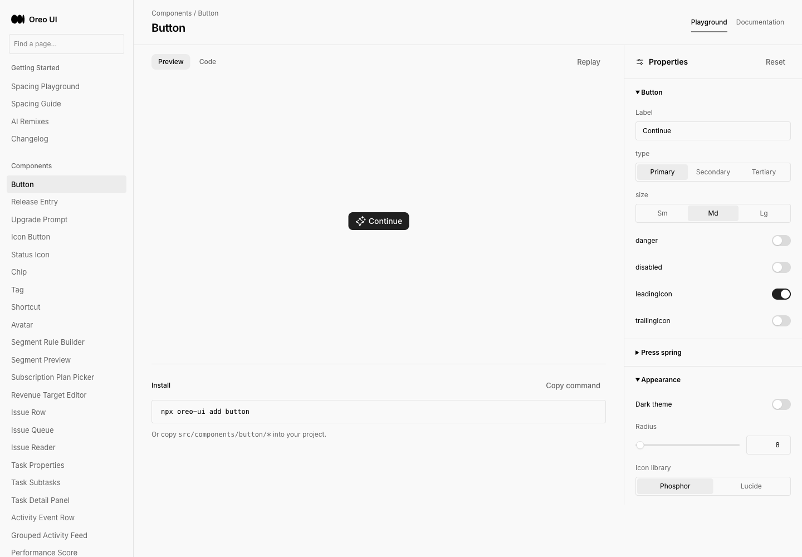 |

## Before / after: new spacing destination

Before, `/spacing` was unregistered and normalized to `/`. There was no prior spacing playground. After, it opens the complete dedicated page in context. Do not treat the old Button page as a spacing implementation.

## Highlighting and frozen comparison

Compared against the video: the same five geometric relationships are adjustable; the example uses Oreo tokens, real content and accessible controls instead of treating the video's gray illustration as loading UI. Compared against rendered Oreo Button playground / Settings: neutral surfaces, canonical controls, distinct group spacing, and an opaque inspector heading are retained. The teaching fixture is intentionally a fixed desktop specimen, not a responsive dashboard template.

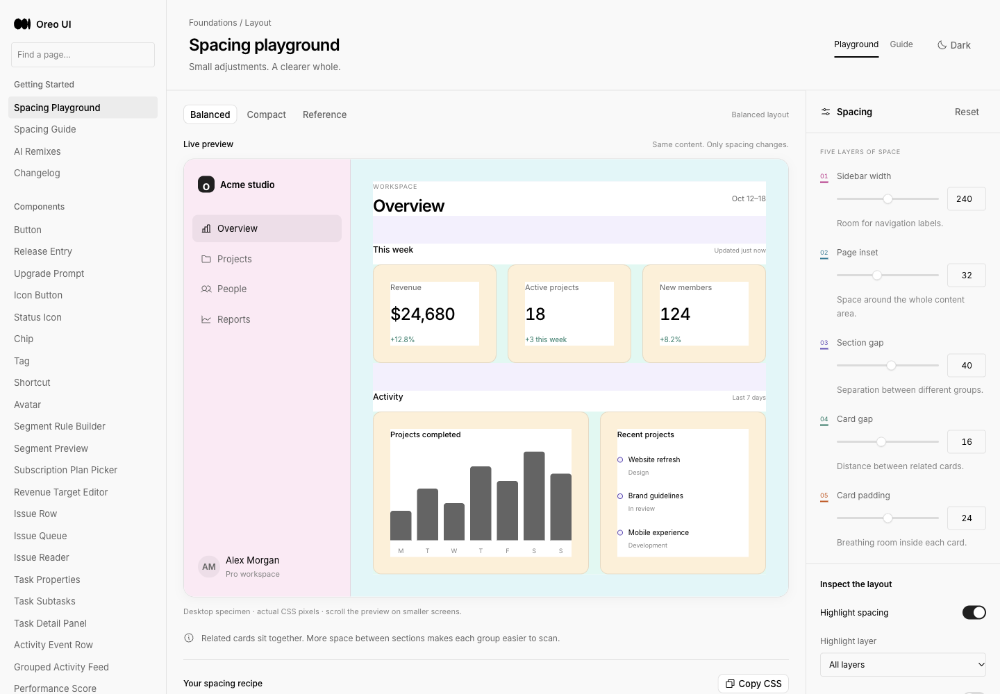
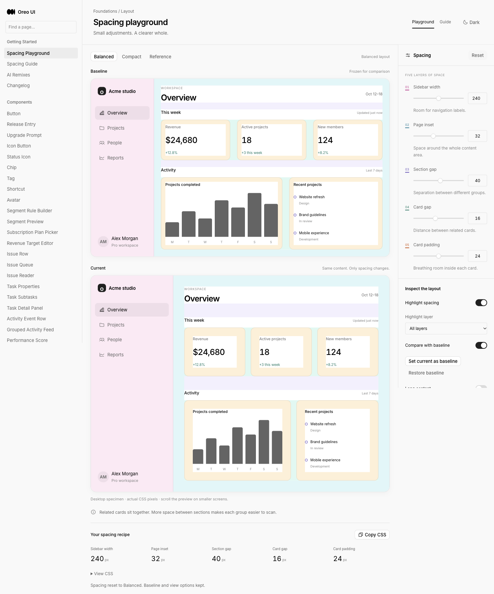

## Guide

New page; baseline had no equivalent guide. The previous site entry is shown above.

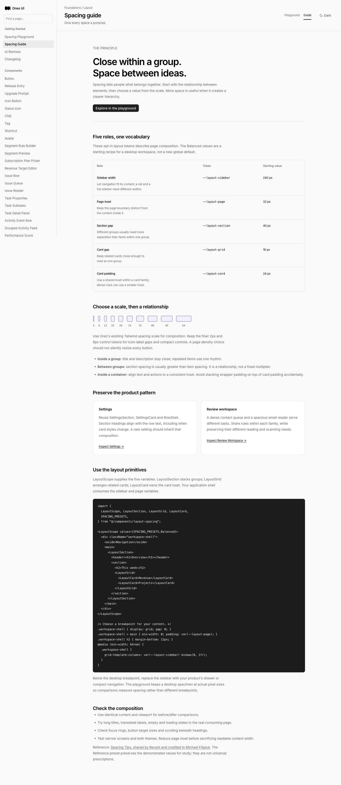

## Dark correction, responsive and recovery evidence

`after-dark-final.png` is superseded: review found saturated dark overlays. Retained as historical evidence. The r2 capture below is the corrected source. Light results remained unchanged. `after-tablet-dark.png` and `after-long-content.png` also precede the dark-overlay correction; use them only as historical long-content evidence.

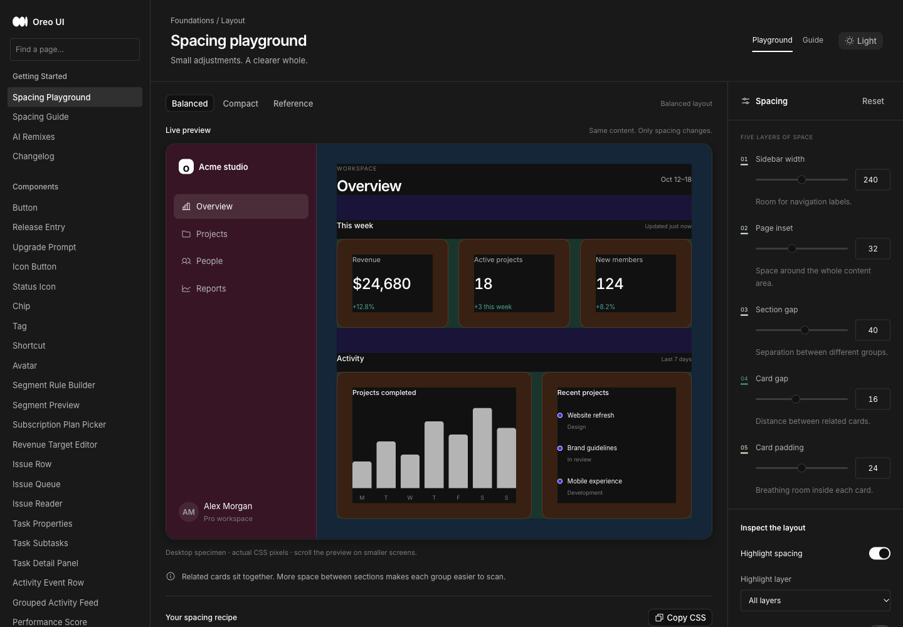
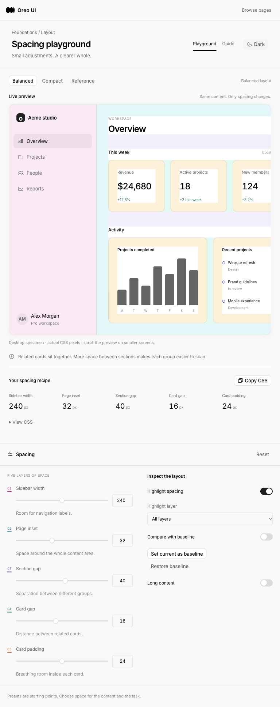
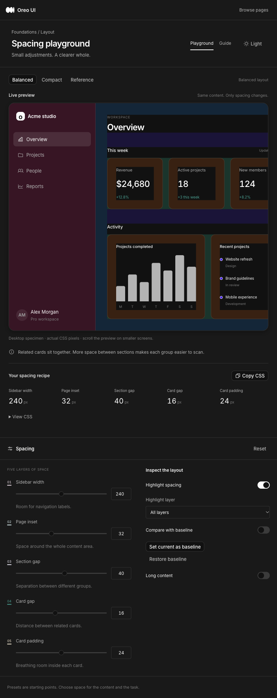
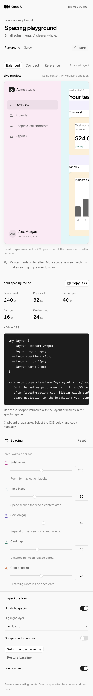
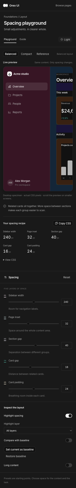
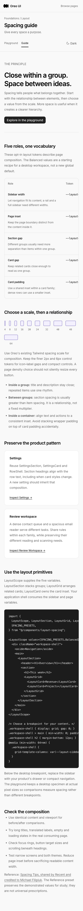

## Six-lens final pass and limits

- Entry: checked, both normal links and direct routes. Mobile uses existing site navigation.
- Loading: not applicable, synchronous static fixture.
- Empty: not applicable, no data loading or empty dataset in this page. Copy-error recovery checked explicitly.
- Actions: checked, canonical Button / PropertyControl / Switch, keyboard numerical adjustment, reset/preset state semantics.
- Titled scrolling: checked at source and rendered desktop/compact layouts. Inspector has an opaque sticky header; the specimen scroll region is separate. No new fading edge is needed.
- Icons/color: checked, canonical Icon/currentColor, labeled overlay selection and theme-derived colors; corrected overly strong dark highlights.

Recording is missing: Chrome rejected `recording.start` because the extension was not invoked for this tab (activeTab capture permission). The exact user action to unblock is to click the Playwriter extension icon once on the task-owned `http://localhost:5184/spacing` tab. Baseline had no spacing interaction to record. Screenshots/assertions prove the inspected states and state changes, not animation timing. This evidence gap does not block integration.

Local fixtures do not verify production serving. The interactive preview server is left available on localhost:5184. All originals and manifest checksums are retained in this directory.

## Integration result

[PR #102](https://github.com/oreo-design/oreo-ui/pull/102) merged into main at 2026-10-19 14:45:49 Asia/Shanghai. Merge commit: `b99f9068e7bfb494ae17aad8d5e4b9e86b3f13b8`. GitHub main readback returned tree `19b610634814d84f394cbb86773fc05be0230df4`, identical to the reviewed local source tree. The first post-merge Git fetch had a transient TLS error; independent GitHub API readback confirmed the result, followed by a fetch retry using the canonical repository URL. This is integration verification, not production-serving verification.
