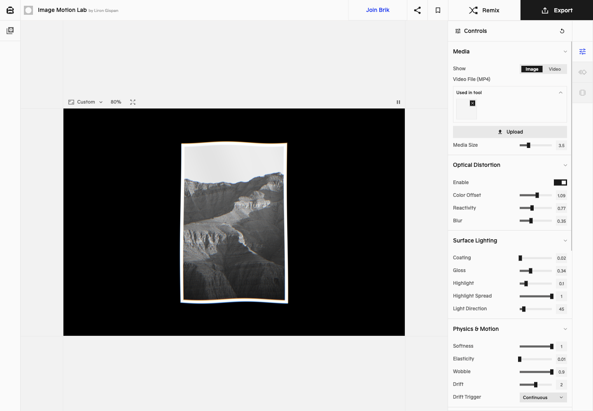

# Brik：从视觉素材到可调节、可复用的小工具

[返回参考索引](../README.md)

- 原分析日期：2026-10-09
- 分类：邻近参考
- 归档日期：2026-10-20
- 原聊天：分析 Brik Space 网站（`01a11ece-e18e-7b53-90f4-39ac65b7988e`）

## 来源

- [来源 1](https://brik.space/home)
- [来源 2](https://brik.space/gallery)
- [来源 3](https://brik.space/product)

## 核心结论

首页、工具库、主题合集和编辑器形成“发现效果→打开真实工具→调参数→产出”的路线。原分析面向 Offloop、产品视频与 Voxel Icon；归入 Oreo 邻近参考，不把它改写成已批准的 Oreo 方向。

## 当时看到了什么

- 实际打开 Image Motion Lab：中央画布，右侧分组参数，Motion / Presets 与 Remix / Export。
- 作品库按用途和视觉行为筛选；主题合集帮助没有明确目标的用户探索。
- 点击 Export 出现登录要求，未验证导出质量或 AI 生成效果。

## 对 Oreo UI 的参考

- Oreo Playground 可以让用户操控真实组件，并把当前配置作为可复用产物。
- 自然语言适合描述意图，结构化控件适合重复精调。
- 用途导航、组件目录和主题模板服务不同的发现任务。

## 采用状态

邻近产品研究；Oreo 映射为归档整理时的关联，不代表既定路线。

## 证据与限制

公开页面与工具界面已看；生成成功率、导出、账号流程、商用许可未验证。

[详细报告或历史原文](../evidence/brik-20261009/REVIEW.md)。媒体与原始报告使用原分析的日期和环境；本次未重新执行其 UI 验证。

