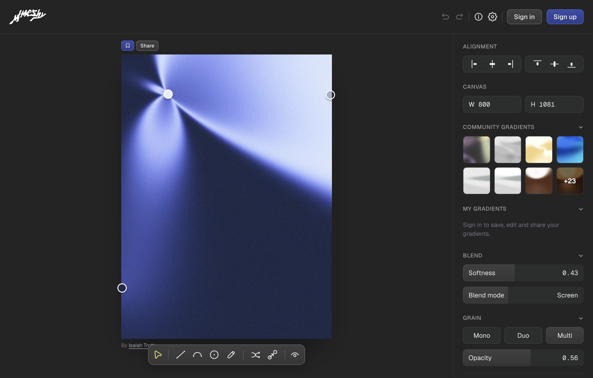

# mmeshy：颜色影响场、shader 与可调视觉工具

[返回参考索引](../README.md)

- 原分析日期：2026-10-13
- 分类：邻近参考
- 归档日期：2026-10-20
- 原聊天：研究 Meshy 工具（`01a134cd-b9d0-74f3-9fee-15cc1a60a310`）

## 来源

- [来源 1](https://mmeshy.com/)
- [来源 2](https://mmeshy.com/src/shader.js)
- [来源 3](https://mmeshy.com/src/renderer.js)
- [来源 4](https://mmeshy.com/src/view.js)

## 核心结论

核心画面由 WebGL / GLSL 逐像素计算颜色影响场；SVG 用于编辑手柄和辅助线。原分析包含源码原理与动态化路线，属于视觉工具技术参考。

## 当时看到了什么

- 节点位置、形状、颜色、宽度、硬度等传入 GPU；全屏矩形的片元 shader 计算距离、权重和混色。
- 普通节点权重大致为 (1 / (1 + d²))^k，归一化加权混色形成光束、柔光和明暗折面；这不等于真实三维光照。
- 遮挡节点单独使用 smoothstep 羽化与透明覆盖；最后调色，再用坐标哈希生成颗粒。
- 当时实测无需登录导出 PNG；当前版本与授权未重新核查。

## 对 Oreo UI 的参考

- 动效可先逐帧更新位置、角度和宽度等参数，保留固定颗粒以减少闪烁。
- 分开原始设计状态、动画临时状态与自动保存，避免每帧触发持久化。
- Oreo 如加入此类工具，应作为有明确用途的素材/效果工作台；不据此改变基础组件定位。

## 采用状态

源码分析和动态化建议；该线程没有实现动态版。

## 证据与限制

未验证账号保存、发布、移动端或社区作品商用许可；原分析未看到代码/视频导出。

[详细报告或历史原文](../evidence/mmeshy-20261013/README.md)。媒体与原始报告使用原分析的日期和环境；本次未重新执行其 UI 验证。

