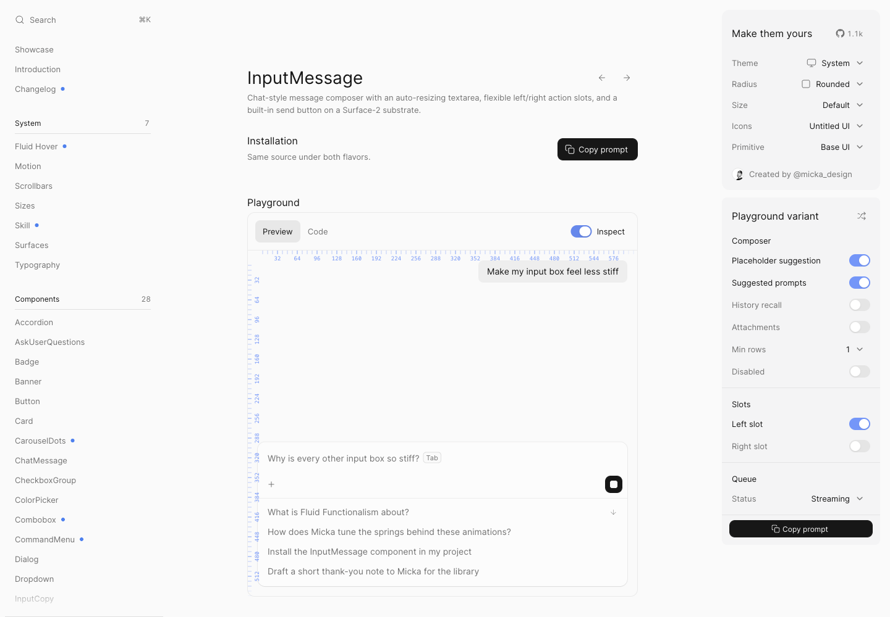
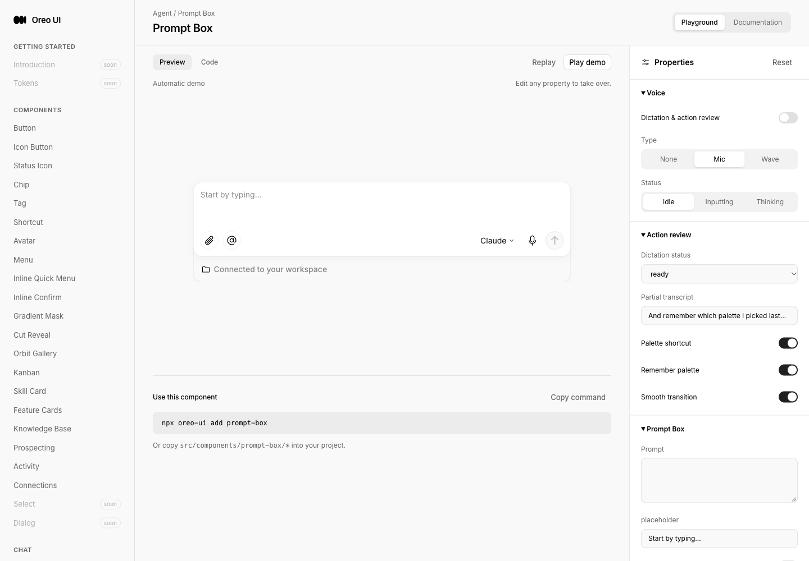

# Fluid Functionalism：可分享配置与 AI 接入上下文

[返回参考索引](../README.md)

- 原分析日期：2026-10-14
- 分类：Playground
- 归档日期：2026-10-20
- 原聊天：对比 X 功能与 Playground（`01a139d5-aef2-7012-8cf4-3ad5fd24bde3`）

## 来源

- [来源 1](https://x.com/alibey_10/status/2110028700313948603)
- [来源 2](https://www.fluidfunctionalism.com/docs/command-menu)
- [来源 3](https://www.fluidfunctionalism.com/docs/input-message)

## 核心结论

把 Playground 的当前状态变成可恢复、可安装、可解释的交付物。参考的 Copy prompt 不只是复制一段 JSX。

## 当时看到了什么

- CommandMenu 调整 Filters 后 URL preset 改变，刷新仍保留配置。
- Copy prompt 包含 preset 安装 URL、组合用法、API、依赖条件和回链。
- InputMessage 支持合法配置随机化，Inspect 显示标尺；对照 Oreo Button / Prompt Box 的真实预览。

## 对 Oreo UI 的参考

- 优先统一配置序列化与校验，支持分享/恢复，再生成当前配置的 prompt。
- 使用现有 schema 的合法选项随机化；条件控制项应随父选项隐藏或禁用。
- 标尺、密度、窄屏与命名场景预设分开评估；命名预设是建议，不冒充已验证参考功能。
- 公共 owner 应是 ComponentPlayground / PropertyControl / schema，避免每个组件重复实现。

## 采用状态

该轮为只读差距分析。后续 Playground 工作是否已覆盖每项，需看其实施记录；本档不将旧差距当作当前缺陷。

## 证据与限制

未运行复制出的安装命令；未完整覆盖移动端、深色主题、慢网和所有组件。

[详细报告或历史原文](../evidence/fluid-playground-20261014/REVIEW.md)。媒体与原始报告使用原分析的日期和环境；本次未重新执行其 UI 验证。

