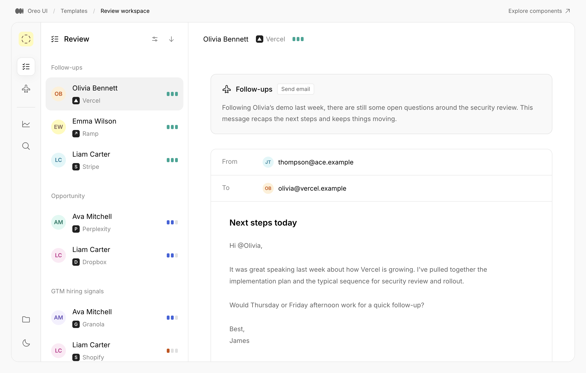

# Agent-Native：人和 Agent 操作同一份工作对象

[返回参考索引](../README.md)

- 原分析日期：2026-10-15
- 分类：Agent 工作流
- 归档日期：2026-10-20
- 原聊天：解析视频概念及 Oreo UI 启发（`01a13dc1-a414-7491-8f2e-73f5deac5435`）

## 来源

- [来源 1](https://x.com/Steve8708/status/2110401500044472729)
- [来源 2](https://github.com/BuilderIO/agent-native)
- [来源 3](https://www.builder.io/blog/introducing-agent-native)
- [来源 4](https://www.agent-native.com/docs/context-awareness/)

## 核心结论

人类直接编辑与 Agent 委托围绕同一数据、动作和上下文协作；Oreo 应区分构建时 AI 使用设计系统与运行时人机协作。

## 当时看到了什么

- 视频 30–45 秒展示幻灯片与 Agent 活动，用户可直接改标题；50–55 秒的 UI 任务带溢出尺寸和画布上下文。
- 同一动作可由 UI、Agent、API、CLI、MCP 等调用；框架自己也有 UI Toolkit。
- 实际查看 Oreo ReviewWorkspace 和 Confirmation 的本地组件 fixture；未调用邮件或模型服务。

## 对 Oreo UI 的参考

- 使用 ContextBar / PromptBox 传递选中对象与作用范围，让可编辑产物成为主工作区。
- Confirmation 管许可，ToolCall / Plan 展示执行，业务层协调状态；允许执行不等于执行成功。
- 以“选对象→生成→人工修改→局部重写→确认→执行结果/恢复”的完整模板验证组合价值。
- 保留人工编辑，并明确取消、部分完成与结果未知的处理；不强塞成一个万能组件。

## 采用状态

研究建议；不代表真实 Agent 执行、邮件投递或整个工作流已完成。

## 证据与限制

视频采样而非完整音轨转写；Confirmation 当时只验证 pending，后续受控属性操作超时。

[详细报告或历史原文](../evidence/agent-native-20261015/REVIEW.md)。媒体与原始报告使用原分析的日期和环境；本次未重新执行其 UI 验证。

