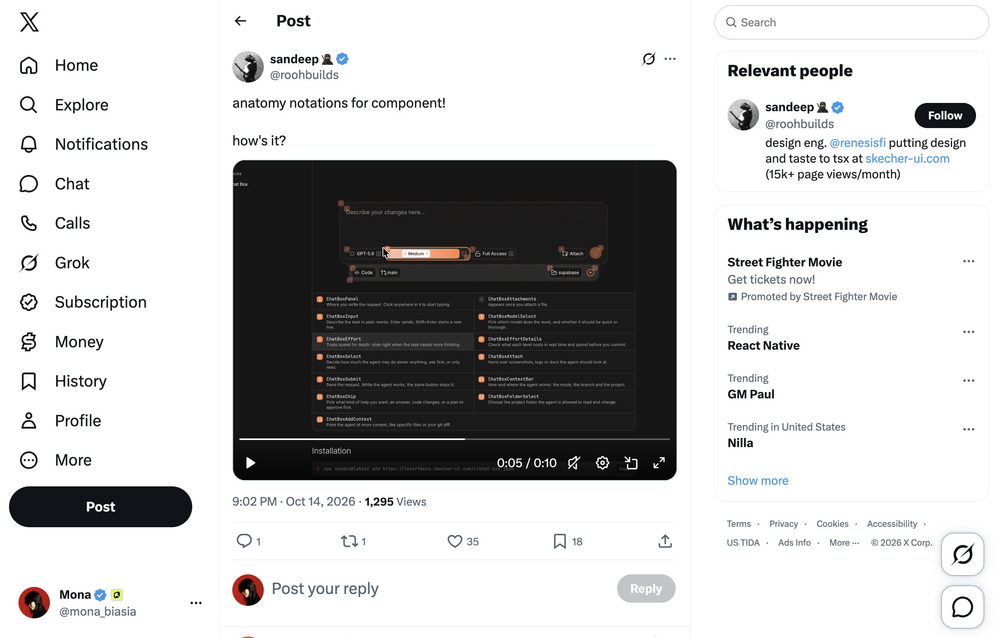
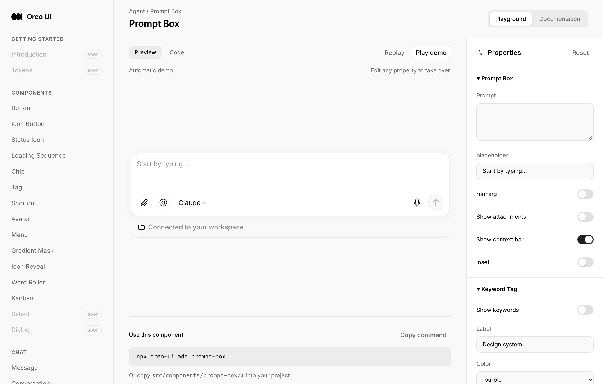

# Annotation 模式：让预览解释组件的构成

[返回参考索引](../README.md)

- 原分析日期：2026-10-15
- 分类：Playground
- 归档日期：2026-10-20
- 原聊天：将视频模式加入 Oreo annotation（`01a13dc8-0e18-7f23-9f65-50a213c94a96`）

## 来源

- [来源 1](https://x.com/roohbuilds/status/2110355509622837281)

## 核心结论

用户提出把视频中的标注模式加入 Oreo：在真实预览上指出各部分名称、作用及其代码关系。

## 当时看到了什么

- 参考用编号、边界和说明解释界面结构；已有 Oreo Preview / Code 是最接近的承载面。
- 分析比较了参考画面与 Oreo 当前组件截图，并保留证据。

## 对 Oreo UI 的参考

- Preview / Annotation / Code 共享当前配置；部位与说明双向高亮。
- 进入标注模式可暂停自动演示，保留当前状态，避免说明对象在讲解时移动。
- 共享 overlay 承担定位，组件提供 parts 定义；处理嵌套、重叠标签、popover 与 resize。
- 先以 PromptBox 等组合组件验证，再扩展；隐藏部位要说明前置条件，不伪造可见元素。

## 采用状态

用户明确提出功能方向；该线程只完成分析，没有实现或交付证明。

## 证据与限制

现有截图证明参考与当时预览；不能证明 hover、键盘、焦点、动效或全库适用。

[详细报告或历史原文](../evidence/annotation-20261015/REVIEW.md)。媒体与原始报告使用原分析的日期和环境；本次未重新执行其 UI 验证。

