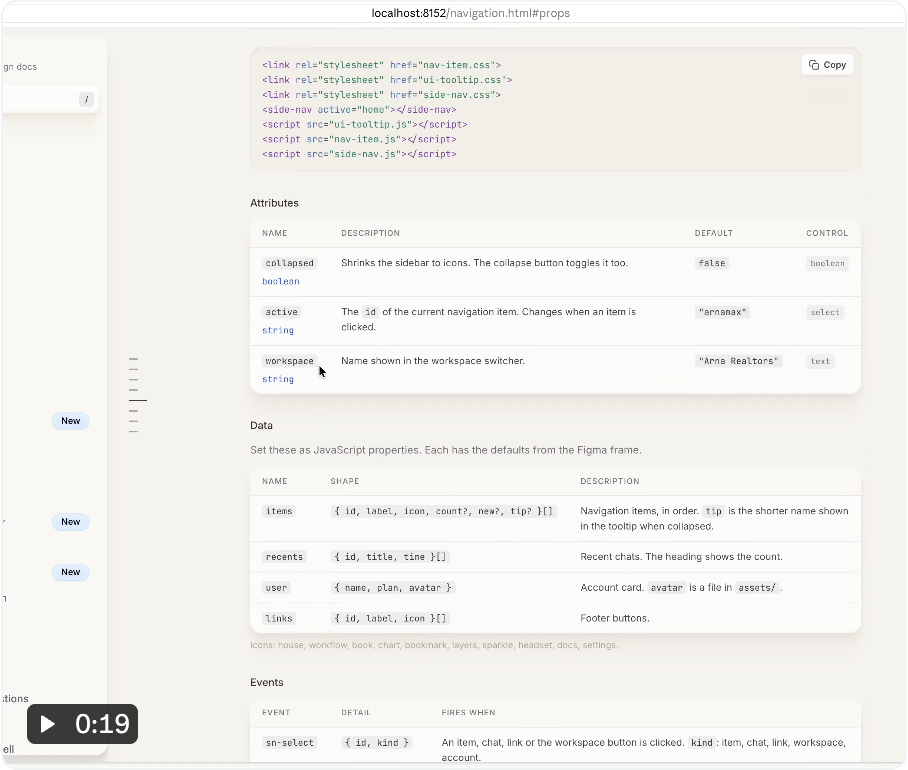

# Disha Shah：设计系统保存产品决策与理由

[返回参考索引](../README.md)

- 原分析日期：2026-10-15
- 分类：规则与评测
- 归档日期：2026-10-20
- 原聊天：解析视频概念及 Oreo UI 启发（`01a13dc1-a414-7491-8f2e-73f5deac5435`）

## 来源

- [来源 1](https://x.com/dishashah66/status/2110344368141869345)

## 核心结论

组件库能表达外观和交互，但产品情境、允许的组合和选择理由也需要可复用记录。

## 当时看到了什么

- 三段视频展示导航折叠/展开与状态组合、基础控件、Tooltip 在折叠侧栏的真实使用。
- 文档包含 owner、版本、Figma、API、tokens 和 Built from；不仅是孤立的组件图片。

## 对 Oreo UI 的参考

- 区分 primitive 通用保证、pattern 任务组合、host 产品权限和业务规则。
- 规则应说明何时使用、为何如此、什么组合非法、替代方案是什么。
- AI 审批/执行的连接规则属于工作流；一个 primitive 缺少枚举不自动构成全局 bug。

## 采用状态

建议先完善一个完整工作流契约，再推广；该轮没有改库。

## 证据与限制

作者收入/规模案例不是独立验证的阈值。视频无法证明可访问性、真实 AI 状态覆盖或交付成本下降。

[详细报告或历史原文](../evidence/agent-native-20261015/REVIEW.md)。媒体与原始报告使用原分析的日期和环境；本次未重新执行其 UI 验证。

