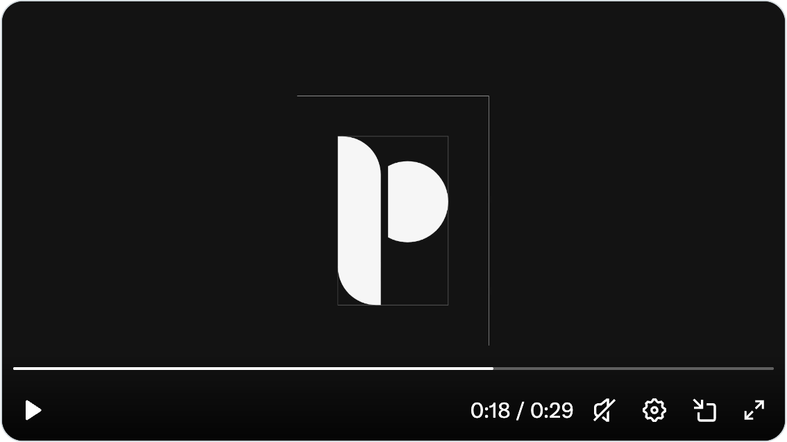

# PanelUI：API 事实生成、版本化 skill 与分发入口

[返回参考索引](../README.md)

- 原分析日期：2026-10-15
- 分类：定位与分发
- 归档日期：2026-10-20
- 原聊天：解析视频概念及 Oreo UI 启发（`01a13dc1-a414-7491-8f2e-73f5deac5435`）

## 来源

- [来源 1](https://x.com/KhalidDevLog/status/2110385439219581365)
- [来源 2](https://panelui.dev/)
- [来源 3](https://panelui.dev/docs/skills)
- [来源 4](https://github.com/panel-ui/PanelUI)

## 核心结论

原帖视频是 Logo 几何构造动画；真正的组件与分发信息来自官网及源码文档。

## 当时看到了什么

- 约 29 秒动画由参考线、几何轮廓到填色标志与字标，不能据此判断使用了哪个制作工具。
- 文档介绍从 TypeScript 生成组件 API、版本化插件、任务组合和读取 registry 的 MCP。
- 原生库与 Web 集合范围不同，开源库与托管 Studio 也需区分。

## 对 Oreo UI 的参考

- 让 API 事实尽量从类型/源码生成；设计理由与选择边界仍由人维护。
- 组件代码、文档、skill 和 registry 用版本关联，减少 Agent 读取旧接口。
- 提供完整使用任务，不用组件数量或“AI ready”口号代替可用性证明。

## 采用状态

识别产品与分发机制；未安装或接入 PanelUI。

## 证据与限制

没有组件运行测试、性能/a11y 审计或 Logo 动画制作工具证据；历史组件数未当作当前数量。

[详细报告或历史原文](../evidence/agent-native-20261015/REVIEW.md)。媒体与原始报告使用原分析的日期和环境；本次未重新执行其 UI 验证。

