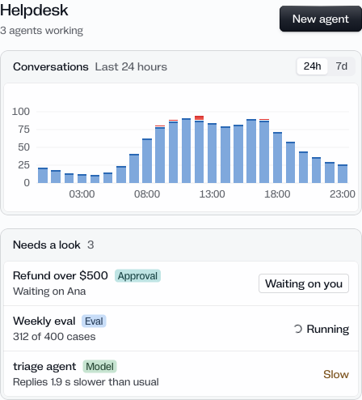

# Quartz：把设计决策与组件一起交给 Agent

[返回参考索引](../README.md)

- 原分析日期：2026-10-15
- 分类：规则与评测
- 归档日期：2026-10-20
- 原聊天：解析视频概念及 Oreo UI 启发（`01a13dc1-a414-7491-8f2e-73f5deac5435`）

## 来源

- [来源 1](https://x.com/arlanoska/status/2110425467996209244)
- [来源 2](https://design.how/systems/quartz)
- [来源 3](https://github.com/arla6ka/skills/tree/main/systems/quartz)

## 核心结论

组件、theme、规则、工作流与有限的 lint 一起分发，支持 Agent 在构建时沿用设计系统。

## 当时看到了什么

- 读过公开 skill、lint 配置、审批示例与 registry；查看 Workspace、Agent run、Live activity 的实物。
- 主题 registry 引用 skill 与 portal；审批示例以 timeout 模拟完成，不能证明真实退款。

## 对 Oreo UI 的参考

- 交付源码时补齐选择理由、组合方式、状态行为与实际预览证据；短 agent 入口指向权威文档。
- 继续利用 Oreo Settings 实验中的设计关系与扩展记录，不为追随参考新造一套页面语言。
- Quartz 对 pill、居中空状态、shimmer 等限制是它的风格，不是跨产品定律。
- 用独立生成对照实验评估规则，而非看到 lint 文件就宣称设计已可自动验证。

## 采用状态

该轮为分析。仓库另有 quartz 命名的实现审查，必须核对其具体来源，不能仅凭同名认定本研究已全部落地。

## 证据与限制

未安装外部 skill、执行 lint 或验证其误报；没有生产率提升证据。

[详细报告或历史原文](../evidence/agent-native-20261015/REVIEW.md)。媒体与原始报告使用原分析的日期和环境；本次未重新执行其 UI 验证。

