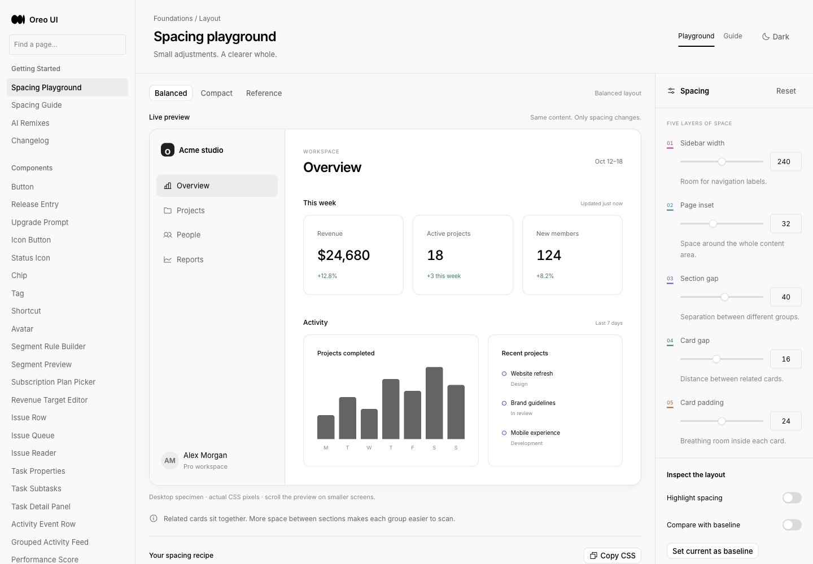

# Spacing：用间距表达层级与归属

[返回参考索引](../README.md)

- 原分析日期：2026-10-19
- 分类：布局与交互
- 归档日期：2026-10-20
- 原聊天：分析视频对 Oreo UI 的帮助（`01a152a6-2f05-7533-809d-d1bebc046aec`）

## 来源

- [来源 1](https://x.com/recentdesign/status/2111763882507149567)
- [来源 2](https://github.com/oreo-design/oreo-ui/pull/102)

## 核心结论

参考同时放大页面与区块间距、缩小卡片之间的距离，说明重点是关系和层级，而非所有地方都增加留白。

## 当时看到了什么

- 视频中 sidebar 184→248、page inset 20→40、section gap 20→48、card gap 20→12、card padding 12→24。数值只是该参考的一组示例。
- 用户授权规则和 Playground；已有记录给出 /spacing、/spacing-guide 和 reusable LayoutScope / LayoutSection / LayoutGrid / LayoutCard。

## 对 Oreo UI 的参考

- 区分控件内部间距、组内关系、区块关系和页面边界；不要使用一个全局 density 控制一切。
- 把参考数字标为示例预设；实际值映射到 Oreo tokens/Tailwind scale。
- 固定对照基线、长内容、间距高亮和 CSS 导出让规则可以被体验和检验。

## 采用状态

历史交付记录确认 PR #102 已合并，merge b99f9068e7bfb494ae17aad8d5e4b9e86b3f13b8；本次归档基线包含相应源文件。未核实当前线上部署。

## 证据与限制

原录屏因浏览器扩展 capture 权限缺失；截图与交互断言不代替动效证明。复用完整原审查记录并保留该缺口。

[详细报告或历史原文](../evidence/spacing-20261019/REVIEW.md)。媒体与原始报告使用原分析的日期和环境；本次未重新执行其 UI 验证。

[现有间距指南](../../spacing/README.md) · [值模型](../../../src/components/layout-spacing/model.ts) · [Playground 页面](../../../src/pages/spacing/SpacingPage.tsx)。

