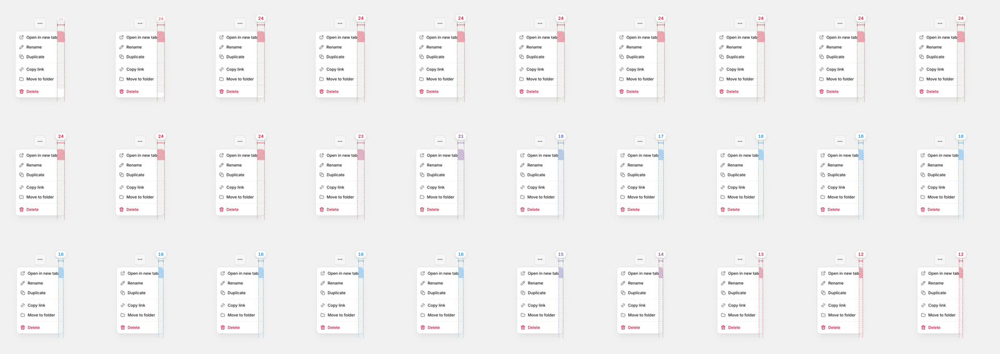
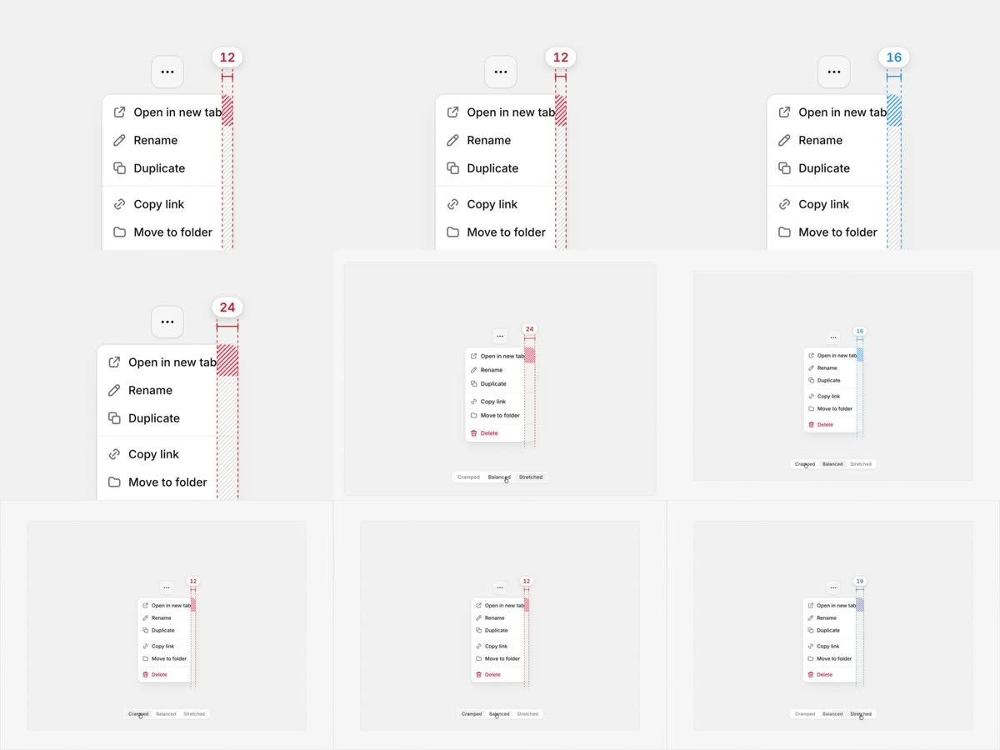

# Spacing redlines：标注随主题与配置一起动

[返回参考索引](../README.md)

- 原分析日期：2026-11-05
- 原始来源 URL：https://x.com/keviduk/status/2117975138541146303
- 作者／产品：@keviduk（X 视频，15.3s，2880×2160@60fps）
- 分类：Playground

## 讲了什么／实际看到了什么

视频画面（逐帧拆解，2fps 总览 + 30fps 过渡段）：

- 一个「…」触发的下拉菜单，底部分段控件 Cramped / Balanced / Stretched 切换菜单的右内边距。
- 菜单右侧有一条间距标注：顶部白色胶囊数字（24 / 16 / 12），下方尺寸括号 |—|，两条虚线导轨贯穿菜单高度，导轨之间是斜纹填充；定义这段距离的那一行（最长的 “Open in new tab”）是强斜纹，其余行是浅灰斜纹。
- 颜色有语义：16（Balanced）为蓝，12 和 24 为红。
- 切换时菜单宽度过渡约 170–200ms（30fps 下 5–6 帧）、ease-out；数字逐帧经过中间值（24→23→21→18→17→16，16→15→14→13→12），颜色同步经紫色插值。标注首次出现约 100ms 淡入。
- 推断：数字是实时测量值而不是插值动画，因为中间值与菜单宽度逐帧一致。

## 实现方式

原作者实现未公开；以上均为画面观察。Oreo 的实现见下方采用状态。

## 对 Oreo UI 的启发

- 目标：Playground Annotation 原本只有静态选框、编号和右栏文字数值，属性或主题切换时组件直接跳变，标注不跟随。
- 同角色现有能力：Annotation（`PreviewStage`）负责测量真实 DOM；全站 Style 过渡（`src/lib/theme/transition.ts`）负责主题属性插值。复用二者，不新增依赖。
- 采用：画布上的间距红线（斜纹带、导轨、括号、数字胶囊、强/弱斜纹区分“定义这段距离的内容”）；数字取实时测量；颜色在过渡开始就朝终态插值。
- 语义改写：参考里的红/蓝是作者对“是否平衡”的主观判断。Oreo 改为可验证的事实——蓝 = 落在实时 `--spacing` 的半步刻度上，红 = 原始像素值或文字行高造成的偏差；切换密度时，写死 px 的距离会变红。
- 不照搬：参考的分段控件是该 demo 的配置；Oreo 直接使用已有的主题预设、Theme settings 和组件属性面板。

## 采用状态

已实施（2026-11-05，分支 `claude/spec-motion-20261105`）。实现与验证证据在任务 REVIEW：`/Users/ziye/Documents/Project/Research/output/playground-spec-motion-20261105/REVIEW.md`。

## 证据与验证限制

参考帧来自原视频，仅用于说明观察；Oreo 的 before/after、过渡逐帧采样和录屏都在任务 REVIEW。未覆盖：body portal 弹出的菜单内容（Annotation 原本就不测量预览外的 portal 内容）。

## 后续修订

（暂无）
