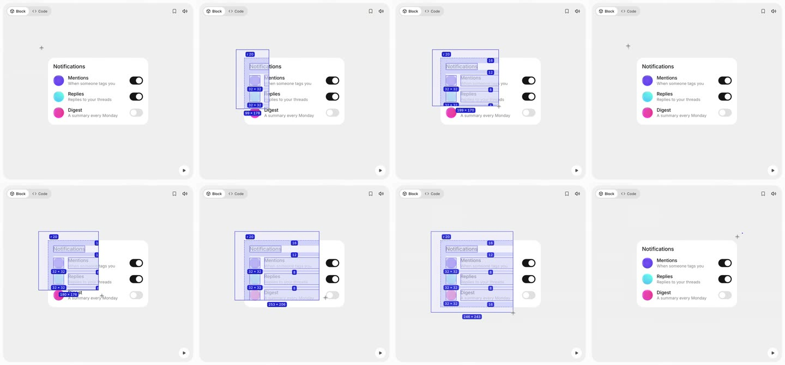
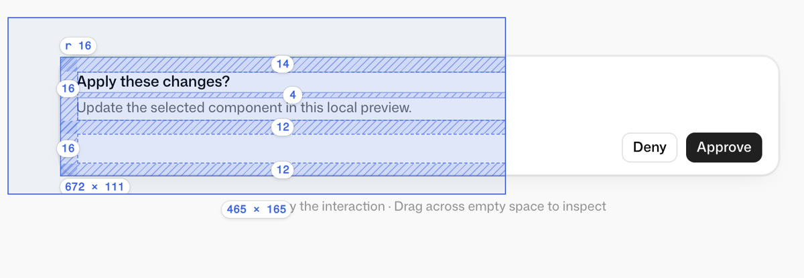
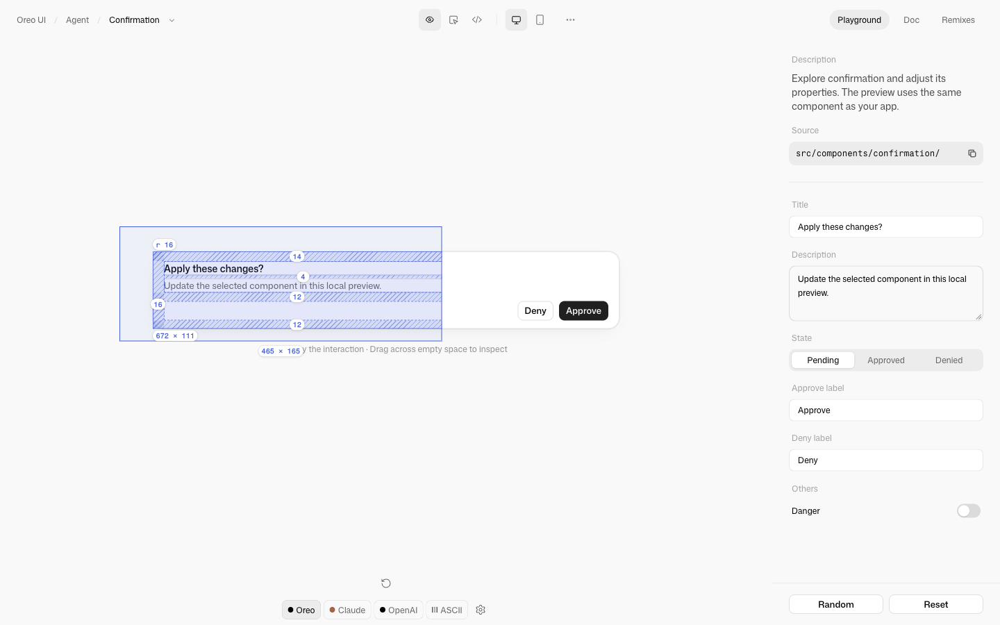

# Inspector：拖框直接看 spec

[返回参考索引](../README.md)

- 原分析日期：2026-11-09
- 原始来源 URL：https://x.com/cabralorenzo/status/2119070365653868727
- 作者／产品：Lorenzo Cabra（@cabralorenzo，bencho.dev），推文标题 “Inspector Interactive Component”；X 视频 20.5s，1420×1322
- 分类：Playground

## 讲了什么／实际看到了什么

视频画面（1.5fps 逐帧拆解）：

- 一张 Notifications 卡片放在画布中央，画布上是十字光标。从卡片外的空白处按住拖出矩形，矩形内的元素实时露出 spec：头像 32×32、开关 40×24 的描边与尺寸胶囊，文字的描边，卡片 `r 20` 圆角，padding 16、标题到列表 12、行间 8 的斜纹带与数字，虚线内容边。
- spec 只在矩形内显示，矩形外的组件保持原样，像透镜扫过；矩形底部显示自身尺寸（如 199 × 260）。
- 松手后整层消失；全程不需要切换模式。
- 推文正文只有标题和 bencho.dev 链接，没有实现说明。

## 实现方式

原作者实现未公开；以上均为画面观察。

## 对 Oreo UI 的启发

- 目标：Playground 已有 Annotation（点选部件、右栏数值、画布红线），但要先切模式。用户希望在 Preview 里直接看 spec。
- 同角色现有能力：Annotation 的 `PreviewStage` 坐标换算（含手机外框缩放与滚动）、红线语义（蓝 = 落在 `--spacing` 刻度，红 = 原始值）与 `pg-spec-badge` 胶囊。复用这些，不新增依赖。
- 采用：空白画布起拖的透镜式框选；元素尺寸、圆角、padding（含虚线内容边）、子元素间距；框尺寸；松手淡出、Esc 取消。
- 语义差异：框选测量的是声明的布局（计算出的 padding、子元素盒子之间的距离），跳过 `space-between`/`flex-1` 留出的空白；Annotation 仍测“到最近内容”的视觉距离。
- 不照搬：参考的实心蓝胶囊与紫色调；Oreo 沿用现有红线配色与白色胶囊，保持和 Annotation 一致。

## 采用状态

已实施（2026-11-09，分支 `claude/marquee-spec-20261109`）。实现与验证证据在任务 REVIEW：`/Users/ziye/Documents/Project/Research/output/playground-marquee-spec-20261109/REVIEW.md`。

## 证据与验证限制

参考帧来自原视频，仅用于说明观察；Oreo 的 before/after、交互检查与录屏都在任务 REVIEW。未覆盖：触摸设备（框选只响应鼠标/触控笔，触摸保留原生滚动）；body portal 弹出层（与 Annotation 一致不测量）。

## 后续修订

2026-11-10：复审修复圆角补偿、display:contents 遍历、贴合/重叠元素的虚假 gap、组件 cursor 继承及 lens 边缘标签截断。18 项单元测试、25 项浏览器交互与 9 项浏览器测量回归通过；最终前后截图与录屏延续同一 REVIEW，历史图保留。

