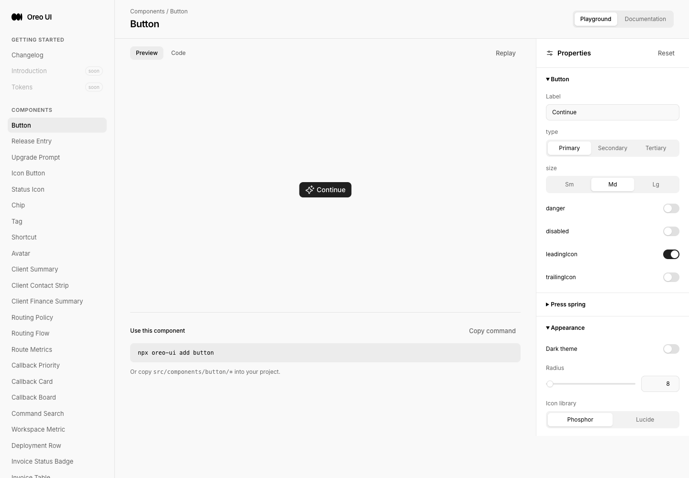
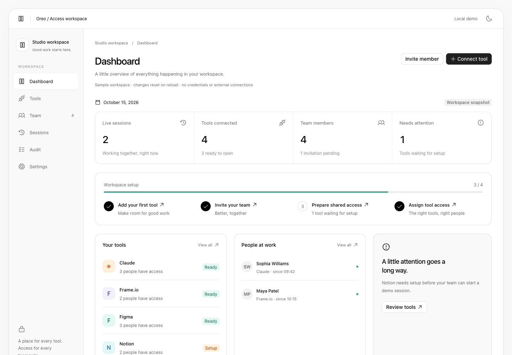

# Access Workspace — review record

Reference: [Marcel Kargul / UniOps](https://x.com/marcelkargul/status/2110467790343737666), [case study](https://kargul.studio/work/uniops). Delivery: [PR #57](https://github.com/oreo-design/oreo-ui/pull/57). Preview: http://localhost:5231/access-workspace.

## Revisions and capture environment

- Baseline: `4816f212605fc36fbfa7728c44edcef54b0096d9` (main, Client Workspace #56).
- Product source: `aa8c99f9afc3b8b55ee8333d1f347a5738d0a4a6`. Later commit adds this evidence and the Changelog entry only. The exact reviewed PR head and remote merge are recorded in the PR delivery readback and final task reply.
- Playwriter session 64, task-owned Chromium tabs, localhost:5231, English, desktop 1440×1000; mobile viewport 390×844. Local fixture dated October 15, 2026. Session start/end actions use the browser clock. Light and dark use Oreo theme variables. Full-page mobile images extend vertically beyond the viewport.
- No real account, credentials, email, native app, server authorization or production deployment was exercised. Fixture state resets on reload.
- Original reference media: [dashboard](reference-1.png), [settings](reference-2.png), [team](reference-3.png), [invitation](reference-4.png), [public metadata](reference-metadata.json). These are reference captures, not product before evidence.

## Scenario map

The previous `/access-workspace` route did not exist and redirected to the Button playground. [Before entry](before-entry.png) captures that actual behavior before editing. There was no prior access dashboard, team editor or invitation flow. The same missing route is the desktop entry baseline for the new template; no fabricated downstream states are substituted. A matching mobile missing-route baseline was not captured; its exact source revision is retained above.

| Scenario | Before | After and observations |
| --- | --- | --- |
| Entry → dashboard | [Missing route → Button playground](before-entry.png) | [Final dashboard](after-dashboard-final.png). 210px sidebar; grouped four metrics; setup checklist; three lower panels. Counts derive from current tools/members/sessions. |
| Team and grants | No previous access team page | [Team](after-team.png), [empty search](after-team-empty.png). Removing Maya’s Frame.io grant ends her matching session; her status becomes Available. Search matches name/email. |
| Invitation | No previous invitation page | [Light accepted](after-invitation-accepted.png), [dark pending](after-invitation-dark.png), [duplicate error](after-invite-error.png). Acceptance adds exactly one member and removes the pending invite. Duplicate email rejected, corrected email succeeds. |
| Tools | No previous shared-tool page | [Connected tools](after-tools.png), [prepared access](after-tools-ready.png). Adding Linear increases tool count and assigns its owner; preparation changes readiness. No credentials are captured. |
| Sessions | No previous session page | [Final sessions](after-sessions-dark-final.png), [limit rejection](after-session-limit.png). Duplicate, removed grant and saved per-member limit rejected; permitted session starts; End session updates the list and audit. |
| Settings | Existing canonical SettingsRow source | [Dark settings](after-settings-dark.png), [mobile settings](after-mobile-settings.png). Save applies defaults, Discard restores them; existing grants/live sessions unchanged. New invite inherits Admin + all tools after saving defaults. |
| Audit | No previous access audit page | [Audit](after-audit.png). Actual local action messages, newest first; no simulated server log. |
| Responsive | Desktop missing-route baseline above; mobile baseline gap | [Dashboard](after-mobile-dashboard.png), [team](after-mobile-team.png), [invitation](after-mobile-invitation.png), [editor](after-mobile-invite-editor.png). 390px body has no horizontal overflow. Member table scrolls independently; navigation scrolls horizontally. |
| Components and docs | Existing Button playground layout | [Invitation playground](after-component-invitation.png), [expired state](after-component-expired.png), [member playground](after-component-members.png). Four routes render; expired/empty invitation and generated JSX checked. |
| Changelog | [Before](before-changelog.png) | [After](after-changelog.png). Access Workspace links to the template and PR #57. |
| Interaction recording | No previous access flow | [Original-timing browser recording](access-flow.mp4), [original frames + timestamps](access-flow-frames.json.xz). Invite acceptance → team → edit access → save. 1440×1000, 13.2s. Actions occur rapidly near the end; inspect screenshots/logs for readable state detail. |

## Consistency review

Compared actual Oreo Agent Connections rendering ([peer](peer-connections.png)), the Button playground baseline and the new template. Source owners inspected: Button/IconButton, Avatar, Tag, WorkspaceMetric, StepProgress, SettingsRow/RowShell and AgentWorkspaceState. This is an Oreo Web comparison, not a cross-product or native-app audit.

| Lens | Equivalent surfaces / canonical owner | Result and evidence |
| --- | --- | --- |
| Entry behavior | Agent Connections setup → workspace actions; standard docs entry → four new playgrounds | Shared Button and Base UI Dialog. Escape closes; return focus inspected on originating action. Saved defaults populate new invitation. Full screen-reader journey not captured. |
| Loading | Immediate local fixture → Agent Connections local fixture | Not applicable: no async fetch, fake refresh or fabricated network success. Real backend loading/recovery is out of scope. |
| Empty state | Team search and pending invites → AgentWorkspaceState | Shared empty title/description pattern; empty search and accepted invitation states checked. [Empty live sessions](after-sessions-empty.png) verified after ending both remaining sessions; unprepared Notion access also rejected. |
| Actions | Connect/invite/save/cancel → canonical Button/IconButton | Primary/secondary/tertiary variants and leading/trailing icon slots. Dialog focus and native labels checked. Revoking a pending local invite is immediate; it sends no message. No real-data destructive action is represented. |
| Titled scroll surfaces | Member table and modal body → existing table/editor conventions | Semantic table with caption and focusable horizontal scroll region. Dialog header/footer remain visible while body scrolls. Mobile images show bounded layout; actual mobile hardware not tested. |
| Icon/color inheritance | Neutral dashboard/settings + tool identities → Icon and palette tokens | Icons use currentColor and standard size names. Tool marks use existing mint/orange/purple/blue palette variables in both themes. No third-party logo files or raw brand colors added. |

Reference-specific differences: the original native Mac browser chrome becomes a web workspace frame. Native download progress is replaced with an explicit local invitation action. Tool marks are text identities, not copied brand assets. Timed usage charts are omitted because the source is a static image and this fixture does not measure time spent in external apps. Existing Oreo neutral action styling is retained instead of introducing another primary-button system.

## Verification and corrections

- `npm run build` passed (TypeScript + Vite); [build log](build.log). Existing large-bundle advisory remains.
- `git diff --check` passed.
- [Browser action record](browser-checks.jsonl): duplicate invitation/recovery; acceptance; grant removal and ended session; duplicate/access/readiness/limit rejection; allowed session; tool preparation/creation; session ending; settings save/discard/default propagation; Escape closure; reload resets data. Console logs after stable preview actions contain no application errors.
- Initial development logs contained Vite-restart and duplicate-React transient errors during module cache restart. Fresh navigation recovered. Writing evidence JSONL initially triggered Vite reloads; the task-only preview configuration now ignores evidence files. Product configuration was not changed.
- Native `recording.start` failed because the extension had not been invoked on the new tab (activeTab permission). Fallback remained inside Playwriter using CDP screencast pixels, with original timestamps retained. FFmpeg encoded those original frames; ffprobe verified dimensions/duration. Original frames and decoded video frames were inspected. No new custom timing animation is claimed; canonical Button owns press motion.
- Visual fixes: use Button icon slots instead of placing block SVGs inside its text span; map tool identity colors to Oreo palette variables; scope session-row flex growth to the identity text so Avatar stays circular; invitation columns adapt to their available width.
- Historical captures retained: `after-dashboard-initial.png` and `after-dashboard.png` are superseded by `after-dashboard-final.png`; `after-sessions-dark.png` is superseded by `after-sessions-dark-final.png`; initial light invitation screenshot predates icon-slot cleanup, use the final dark/mobile captures. No historical originals overwritten.
- Evidence gaps: exact mobile pre-change route; full keyboard traversal/screen-reader audit; native device rendering; exhaustive empty/expired combinations across all themes. These are distinct from implemented behavior and authorized merge status.

## Key before / after

