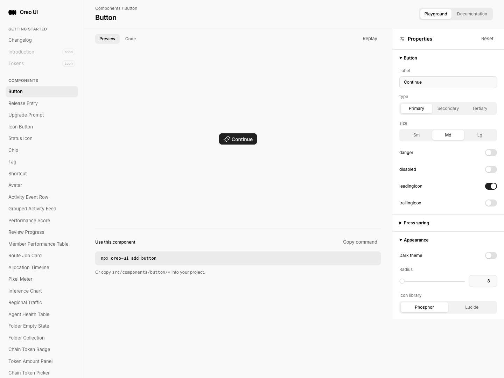
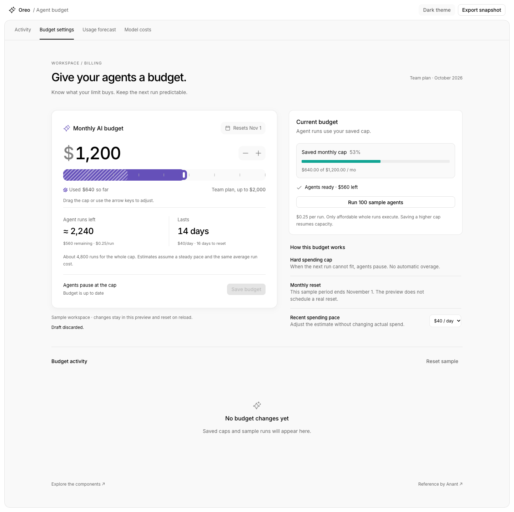

# Agent Budget — reference and UI review

Baseline `bf836c1bd747f91efe38328ef406855aa8b1bf2f` (fresh origin/main). Separate checkout preserves settings-language-lab WIP. Local fixture preview: localhost:5262; English, Chromium / Playwriter session 10, 1440×1080 unless named otherwise. Session retains the previously documented direct connection after extension limitation.

Reference: https://x.com/HeyAnantJ/status/2110652330110779622. X returned 403; public FxTwitter metadata exposed the original video, inspected in-browser at 3/15/26 seconds. Light/dark compact card, dollar cap, stepper, violet rail with hatched spent segment, upper/lower boundary explanations, runs/days estimates and Save. Source movie is 36 seconds. Stills are actual video frames, not recreated reference. No exact font/color copying.

## Before editing / comparison map
| Target | Peer / owner | Decision and evidence |
| --- | --- | --- |
| Editable cap | `activity/BudgetMeter`, `model-usage/ModelTrendChart` native range | BudgetMeter is read-only usage, keep its public API unchanged and reuse for saved cap. New controlled BudgetCapControl is the smallest interactive composition; native range supplies touch/keyboard semantics, standard IconButton step controls. Source inspected; activity peer captured. |
| Budget estimates | `usage-forecast/UsageProjection`, forecast model | Explicit units/assumptions, unavailable or zero-rate state. New BudgetOutcome summarizes money→remaining runs/days. Reference total/remaining distinction is ambiguous; label remaining estimates and separately show whole-cap run estimate. |
| Card | `activity/ActivityCard`, shared Button/Icon | Existing semantic background, border, radii and typography. New MonthlyBudgetCard composes cap/outcome/save; purple token denotes selected allowance, neutral operation icons. |
| Full page | ActivityWorkspaceShell, RowShell/RowLabel | Reuse existing shell, BudgetMeter and settings primitives. Local budget settings with reset, save/cancel, sample usage, pause behavior, JSON export and dark/light themes. |
| Invalid / empty | `automation/AgentWorkspaceState` | Canonical centered state for invalid numeric inputs, explicit no-recent-spend estimate for zero pace. |

[Before new route](before-entry.png): absent route reaches Button docs. [Existing activity peer](peer-activity.png). No prior cap editor or budget template exists at this route. Narrow baseline and peer interactive recordings not captured; baseline commit retained. Before screenshots captured prior to product edits.

## Interaction plan
Integer USD cents internally. Clamp proposed cap between spent amount and plan maximum, explain both bounds; offer a native slider and step buttons; Home and End reach exact limits. Estimate from remaining allowance, no rounding overclaims. Draft is separate from saved cap; run simulator uses saved cap, consumes only affordable whole runs, never overspends. Preferences and simulation local only, reset on reload. Functional numeric feedback stays immediate (no rolling/blur animation); record slider/boundary/save interaction. No network loading is involved.

## Implemented and verified
Three exported components: BudgetCapControl, BudgetOutcome, MonthlyBudgetCard. Complete `/agent-budget` template, three docs/playground entries, metadata and navigation. Reuses ActivityWorkspaceShell, ActivityCard, BudgetMeter, RowShell/RowLabel, Button/IconButton and AgentWorkspaceState. Shared component source unchanged.

| Before | After | Why |
| --- | --- | --- |
| No editable budget family | Hatched spent floor, bounded native range and +/- controls | Explain the available allowance while keeping keyboard/touch semantics |
| Reference shows total runs/days even after spend | Remaining runs/days prominent, whole-cap runs secondary | Avoid counting spent dollars as future capacity |
| Custom shadow and dark thumb | Existing shadow-default and text-on-accent thumb | Reuse elevation and keep the handle visible in dark mode |
| Playground numeric grid started at 64,000 in 5,000 steps | Property grid uses 1,000 steps; component increments remain 5,000 | Preserve exact 120,000 → 125,000 when exercising the controlled callback |
| Empty-state wrapper inherited title-row justification | Title-row styling targets its first child only | Preserve canonical centered icon/title/description grouping |

## Evidence and six-lens review
| Lens / scenario | Result | Evidence / limits |
| --- | --- | --- |
| Entry / return | Checked | Absent route [before](before-entry.png), new complete page [light](after-light-v2.png) / [dark](after-dark-v2.png). Docs → playground → code exercised. Cancel restores saved cap; Reset restores fixtures. Existing linked sibling routes verified in site registry; not every link followed. |
| Loading | Not applicable | Synchronous local data; no simulated network loading or new load animation. |
| Empty / error | Checked | Canonical history empty state in light/dark template. [Invalid estimate](after-invalid.png) via zero run cost; disabling invalid toggle recovers. Zero daily pace shows No recent spend. |
| Actions | Checked | Shared Button/IconButton, tapScale=1; native keyboard/pointer controls and named focus outline. Home clamps to $640, End to $2,000; increase at maximum stays bounded. [Paused](after-paused.png), [plan bound](after-plan-boundary.png). Disabled playground slider and both step controls asserted inert. |
| Titled scrolling | Checked / partial | Normal document flow; no overlay titles. History list has its own max-height scroll below title; long-history scroll not recorded. Medium/narrow reflow inspected. |
| Icons / color | Checked | Canonical sparkle/check/prohibit/calendar, neutral +/- controls. Purple budget segments use palette tokens. Dark handle changed to text-on-accent. Reference image values mapped to existing tokens. |
| Responsive | Checked | [390×844 light](after-mobile-light.png), [390×844 dark](after-mobile-dark.png), [900×1000 light](after-medium.png). Full-page captures preserve content; narrow dark capture precedes final thumb contrast correction only. No physical device testing. |
| Component API | Checked | [Card playground](after-card-playground-v2.png), [cap disabled playground](after-cap-playground.png), [docs](after-api.png). Increasing $1,200 gives $1,250 and Save stores 125000 in controls. Generated JSX uses public import and serialized inputs, with host-handler placeholder per existing generator. |
| Local model and export | Checked | Saving $640 pauses; attempting 100 runs spends nothing. Save $690, run 100 at $0.25: actual spend becomes $665 and remaining $25. Draft $2,000 does not alter saved $690. Cancel restores $690. [Downloaded JSON](budget-snapshot.json) checked for saved/draft 69000, spent 66500, pace 0, correct units. |
| Pointer interaction | Checked, recording gap | Real mouse drag from 60% to 80% produced $1,600; Cancel returned $1,200. Numeric feedback stays immediate; no rolling/blur/spring effect added. Current Playwriter direct CDP session does not support chrome.tabCapture recording. A connected extension tab (click Playwriter extension icon) is needed to recover a recording; this does not block delivery. Stills do not prove timing. |
| Changelog | Checked | [Before](before-changelog.png), [after](after-changelog.png): Agent Budget / PR #90; 55 → 56 entries. |

Validation: TypeScript/Vite build passed ([log](build.txt)), six focused model tests passed ([results](tests.txt)): remaining math, invalid inputs, zero pace/exhaustion, exact bounds, partial batches without overspend and resumption after raising the cap. Existing bundle-size warning remains. No dependency changes. Local fixture validation does not establish real billing, reset jobs, live charges or production deployment.

Historical captures: `after-light.png` precedes empty-state selector correction; `after-dark.png` was captured during the inherited Button color transition and before final thumb/shadow correction; `after-card-playground.png` precedes property-grid correction. Superseded by matching v2 captures; originals retained. Remaining gaps: recording, physical device, exhaustive screen-reader traversal, Firefox runtime and exact breakpoint-edge matrix. Reference additionally inspected at 9 and 19 seconds; the lower-bound clip shows $650 after attempted under-spend with $640 already spent.

## Before / after

## Delivery record
PR: https://github.com/oreo-design/oreo-ui/pull/90. Initial implementation revision: `36a80a71745681e63a8fd22778c44fd20c9eb6bc`. Final follow-up includes the changelog entry and evidence manifest. [Manifest](manifest.json) records source/media hashes. Remote merge status is verified separately before delivery.
