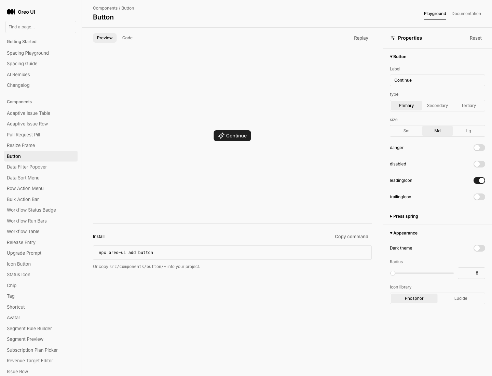
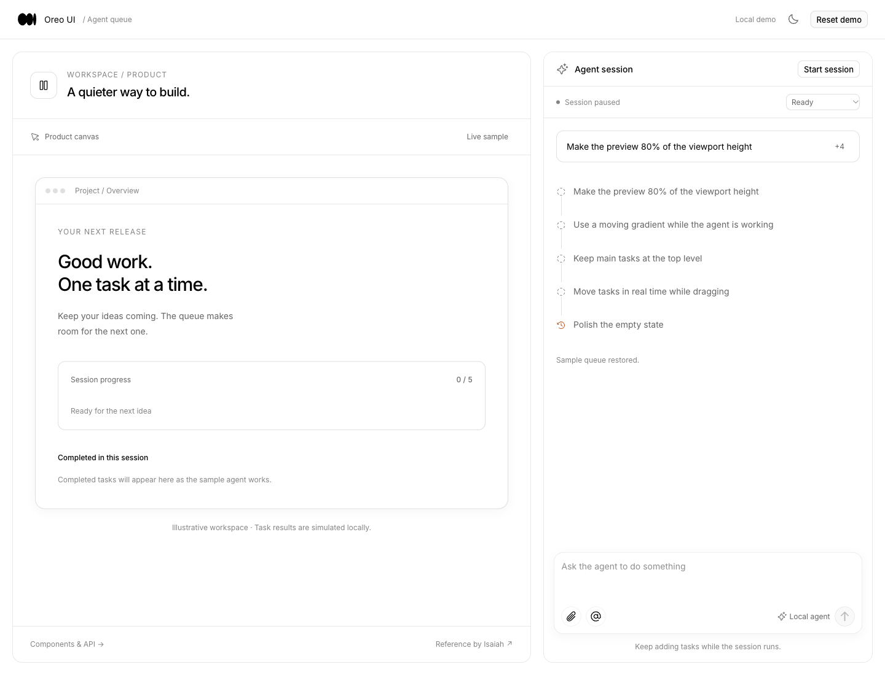
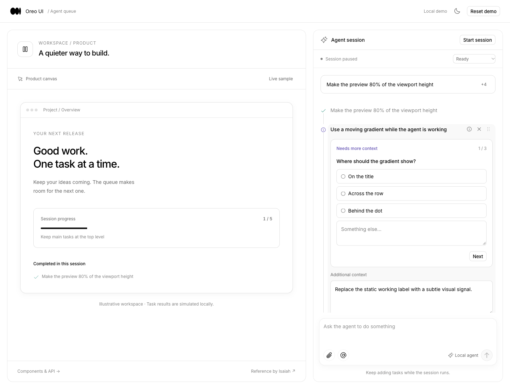

# Continuous Agent Queue — review record

Reference: [Isaiah (@eyexayuh)](https://x.com/eyexayuh/status/2112042083536236933). Source text describes continuously queued tasks, reordering, pausing, adding context and skipping requests needing input while the session continues. Actual 47.466-second video inspected at 3, 10, 18, 21, 26, 34 and 43 seconds. Originals are retained in this directory.

Baseline: `3d204a3b0eee8a8aadf2124ff04bf76160a1ec0f`. New route `/agent-queue-workspace` previously redirected to Button playground; wide and narrow captures saved before implementation. No prior queue interaction exists to record.

## Grounding before edits

- Target queue → rendered Agent Inbox (`peer-agent-inbox.png`) and `src/components/agent-inbox/` → canonical agent statuses/actions, dnd-kit interaction family and AgentWorkspaceState. New flat, connected sequence is justified by a single agent's ordered queue rather than the peer's independent status columns. No nesting or silent cross-group drop.
- Agent workspace/composer → rendered Thinking Workspace (`peer-thinking-workspace.png`) and `src/patterns/thinking-workspace/` → reuse PromptBox, AgentWorkspacePanel, shared Button/IconButton and Icon; preserve task/composer context and bounded scrolling. Preview remains a local fixture rather than a connected coding agent.
- Working-title shimmer → existing ShimmerText used by tool/reasoning labels. Reuse this owner and reduced-motion treatment instead of another gradient animation.
- Clarification → searched ask-analytics, automation, task-editor and agent-handoff. No same-role multi-step clarification owner found. Introduce the smallest controlled question card with native choices, custom answer, explicit next/back and commit; source frames 18/21 ground its layout.
- Initial loading → SkeletonReveal with shape-matched queue rows. Empty/failure → AgentWorkspaceState, centered within its queue region.
- Component catalog → reuse existing registered components directly in Playground (its export serializer cannot accept unregistered demo wrappers). Complete composition goes into Templates. Shared fixed-top-demo/scrolling-options preference is recorded separately from this task's scoped additions; no global Playground rewrite.

## Scope and capture plan

Four reusable components: task row, task queue, clarification card, request stack. Complete template with local sequential execution, reorder, pause/resume, inline context, deletion/undo, questions that do not block later tasks, and append while running. Verify stale timer actions, answer persistence, one-running-task invariant, keyboard/pointer ordering, reduced motion, dark/light, 390/900/1440 widths and normal/loading/error/empty recovery. One durable index and original evidence here.

## Final implementation and evidence

Final source revision: `ec3196611417a5ea539b4b75669a69fb47ee4223`. Main interaction and final-layout captures use `d3dc3fd6fdfe6659cd07f6abba34d253b270c488`; the final source only changes the loading skeleton contrast, captured separately below. Four public components, a tested local scheduler and complete `/agent-queue-workspace`, registered independently in Components/Playground and Templates. [Component contracts](../../../src/patterns/agent-task-queue/README.md) · [Verification details and limits](verification.md) · [Source/media manifest](manifest.json).

| Surface / state | Before / grounding | After | Outcome |
| --- | --- | --- | --- |
| Complete template, wide | [Actual prior route redirect](before-wide.png), rendered thinking workspace | [Light](review-wide.png), [dark](review-wide-dark.png) | Existing workspace/panel/composer reused; local progress canvas contextualizes the queue |
| Complete template, narrow | [Actual prior route redirect](before-narrow.png) | [Light](review-narrow.png), [dark](review-narrow-dark.png) | Agent comes first; canvas follows; opaque bounded scrolling |
| Medium layout | No separate medium baseline | [Light](review-medium.png), [dark](review-medium-dark.png) | Two columns, wrapping titles/actions |
| Clarification and context | Reference frames 18/21/26/34; no previous equivalent | [Wide](review-clarification-wide.png), [narrow middle](review-clarification-narrow-middle.png), [narrow end](review-narrow-end.png), [step 3](clarification-step3.png) | Options/custom text, next/back/save, independent context editor |
| Request summary | Reference frames 3/10 | [Expanded narrow](requests-expanded-narrow.png) | Expand/collapse, full first title when expanded |
| Initial loading | Shared SkeletonReveal owner; peer normal-state capture only | [Loading light](review-loading-wide.png), [dark](review-loading-dark.png) | Shape-matched skeleton |
| Error and recovery | Shared AgentWorkspaceState; no route baseline | [Error](error-wide.png), [recovered normal](review-wide.png) | Retry preserves queue, no replacement fixture |
| Empty and recovery | Shared AgentWorkspaceState | [Empty](empty-wide.png) | Restore sample and LIFO undo; focus recovery |
| Composer validation | Existing PromptBox owner | [501-character rejection](composer-validation.png) | Explicit validation without losing draft |
| Task row / queue / clarification / request stack docs | New routes; individual pre-change captures unavailable | `docs-*.png`, `playground-*.png` | Four independent examples, props, rules and generated JSX; copied callbacks remain host-owned |
| Continuous execution, questions, context and undo | No pre-existing queue motion | [Actual interaction](interaction.mp4), [original recording](interaction-original.mp4) | Real clicks and timers; no simulated animation inserted into evidence |
| Pointer and keyboard ordering | Source drag behavior | [Actual reordering](reorder.mp4), [original](reorder-original.mp4) | Pointer move, keyboard move, Escape cancellation |

### Matched baseline / final

Before (same new-template entry path):

After:

### Capture chronology and limits

All originals are retained. `initial-implementation.png`, `after-*.png`, `clarification-narrow.png` and `final-*.png` are earlier rounds, superseded for final presentation by `review-*`. The earlier narrow round demonstrates the shared `overflow-visible` defect; final round fixes it locally. `final-*` already contains that fix but predates small shadow/summary refinements. Earlier wide loading/error/empty/validation and docs captures retain valid state evidence; final changes do not alter those behaviors. Docs sample code was subsequently corrected per route.

Native tab recording returned an activeTab authorization error. Used Playwriter's CDP screencast on the same task-owned tab. Original 1440×1100 video and frame timestamps retained; presentation video crops the top 96px containing the extension toolbar to 1440×1004, 30fps, with actual frame intervals preserved. Raw frames remain local and ignored by Git; both original and cropped videos are versioned. See manifest for durations/hashes. Contact sheets were visually inspected. Screenshots alone are not used to claim motion behavior.

English local fixture, Chrome, matching wide/narrow viewport and light theme against baseline; added dark and medium coverage. No production or real-agent validation. Physical mobile, screen-reader and live async/backend behavior remain outside captured coverage. Missing individual component-route baselines are recorded separately from completed implementation/delivery.

Final capture correction: the first loading screenshot exposed white skeleton fills on a white surface. Replaced those two fills with the shared border token; `review-loading-*` supersedes `loading-wide.png`. No scheduling or other layout changes.
