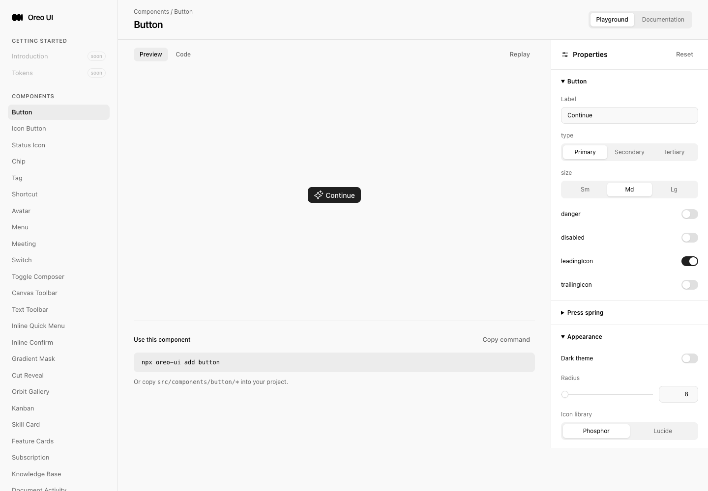
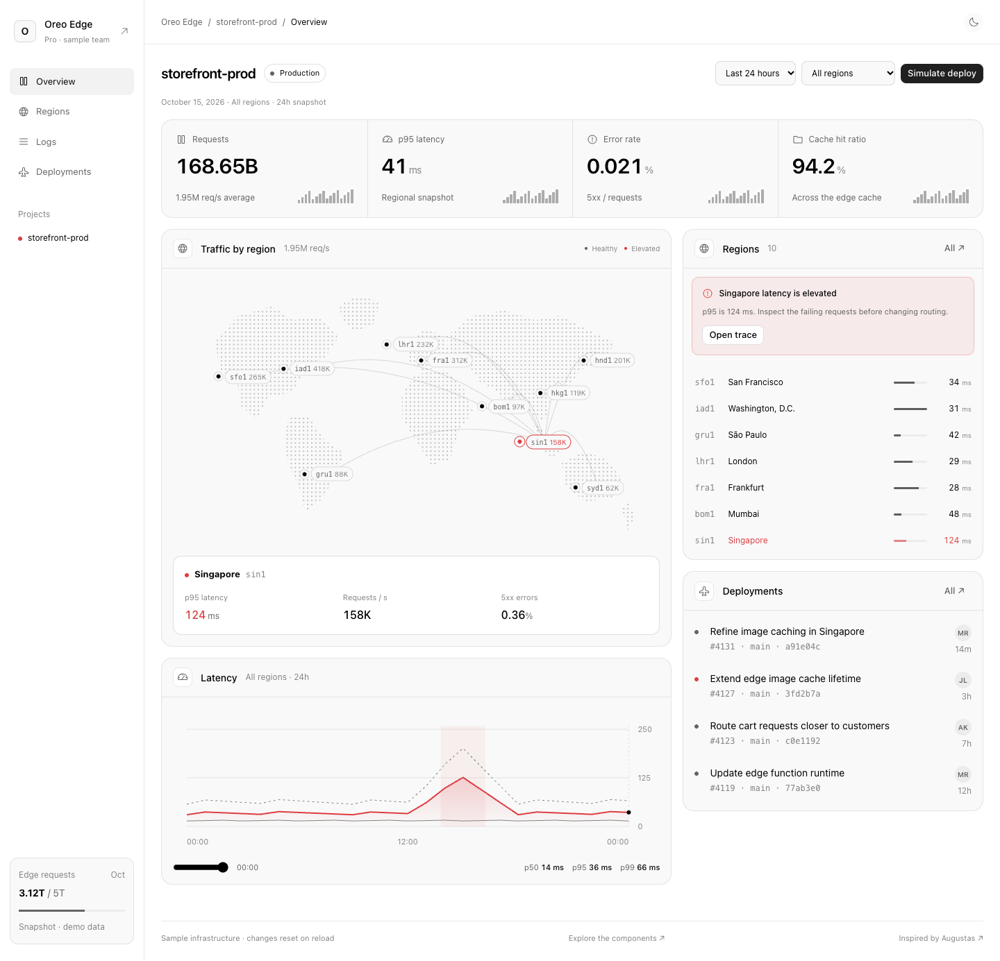
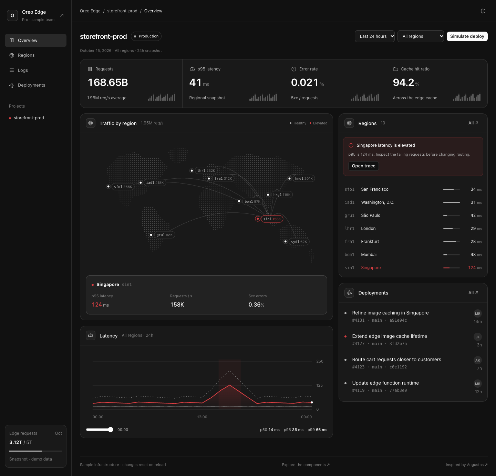

# Edge Monitor / Edge Observatory review

## Source and extraction

[Augustas, @augustasdesign](https://x.com/augustasdesign/status/2110393766754341153) shared three static slices of a dark infrastructure dashboard. All three images were inspected in the actual X carousel through Playwriter. Source captures: [post](reference-post.png), [left](reference-left.png), [center](reference-center.png), [right](reference-right.png). The browser captures include X chrome/extension artifacts; they are original reference evidence, not product screenshots.

Extracted family:

- **EdgeMetric:** compact KPI, unit, context and miniature ActivityBars.
- **MonitorPanel:** shared titled card/header for this dense monitor family.
- **RegionTrafficMap:** original dotted schematic map, regional markers, routes and selected region details.
- **RegionHealthList:** selectable region rows with request-relative bars and p95 latency.
- **LatencyChart:** p50/p95/p99 series, peak context and keyboard sample scrubber.
- **DeploymentFeed:** release title, commit, author, time and attention state.
- **Edge Observatory:** `/edge-observatory`, four working views (Overview, Regions, Logs, Deployments), shared region filter, period selection, theme toggle, trace filtering, empty recovery and simulated local releases.
- **Docs/playground:** `/edge-monitor`, registered in existing navigation and metadata.

The map uses independent schematic continent geometry, not copied artwork or a GIS dataset. Source hierarchy/density and red incident emphasis are mapped to Oreo's existing tokens. Actions and data behavior are authored fixture behavior; the screenshots do not prove how the original product behaved. No animation was inferred from the static reference, and no dependency was added.

## Revisions and environment

- Baseline: `00d813aedd735404d4b1304523b9039c1e6b44ed`.
- Reviewed implementation: `f8fb13b84072e1e2b57f7a74507ffd41fd5369a6`.
- Date: 2026-10-15, Asia/Shanghai. Local Vite at `http://localhost:5210`, local fixture only, English.
- Product QA: Playwriter session 45, managed Chromium; reference: authenticated Chrome session 39. Task-owned tabs only.
- Desktop 1440×1000, medium 1000×900, mobile 390×844. Boundary widths 1251/1250, 851/850, 601/600 at height 900. Full-page screenshots retain their actual content height.
- No real telemetry, repository deployment, routing mutation, backend/account workflow or production deployment verification. Simulate deploy only adds local history and a detail dialog; refresh restores the fixture.
- [manifest.json](manifest.json) records original image dimensions, SHA-256 hashes and supersession state. Earlier captures are preserved.

## Evidence matrix

| Scenario | Before / peer | After | Coverage |
| --- | --- | --- | --- |
| New template entry | [before-entry.png](before-entry.png): requesting `/edge-observatory` reached Button home because the route did not exist | [after-light-default-final.png](after-light-default-final.png), [after-desktop-final.png](after-desktop-final.png) | Light baseline paired with light final, same 1440×1000 viewport. New default is dark, matching source. No prior monitor existed. |
| Existing metrics/dashboard peer | [before-activity-peer.png](before-activity-peer.png), real Activity Workspace | New KPI strip/chart/trace states | Existing ActivityBars, Button and Avatar reused; money-specific UsageChart not repurposed for latency. Peer owner remains unchanged. |
| Region/period selection | No old monitor; baseline entry above | QA logs and [after-trace.png](after-trace.png) | Map→select, list→select, period→volume and chart; incident→Singapore errors. 3 matching errors checked. |
| No matching requests / recovery | No old monitor | [after-empty.png](after-empty.png) | Shared centered AgentWorkspaceState, Show all requests restores 36 rows and clears region/status/search filters. |
| Deployment detail | Existing Activity Workspace dialog implementation inspected | [after-deployment-final.png](after-deployment-final.png) | Shared Base UI Dialog, close, Escape, focus return to Simulate deploy and detail→trace verified. |
| Local simulated release | No old monitor | [after-medium.png](after-medium.png), QA logs | Next release #4132 added to local history; no actual deployment. |
| Responsive | No prior monitor at these sizes | [after-medium.png](after-medium.png), [after-mobile-final.png](after-mobile-final.png), [after-mobile-dark.png](after-mobile-dark.png) | Desktop/medium/mobile inspected. Boundary checks show no root horizontal overflow. Mobile navigation uses horizontal keyboard arrows. |
| Mobile logs | No prior monitor | [after-mobile-logs.png](after-mobile-logs.png) | Table intentionally scrolls horizontally within its named focusable region; page stays 390px wide. |
| Component docs | No prior Edge Monitor route | [after-docs.png](after-docs.png) | Existing DocsPage with live specimens and API. |
| Playground / empty | Existing Playground shell in baseline | [after-playground.png](after-playground.png), [after-playground-empty.png](after-playground-empty.png) | Existing properties shell; controlled selection and empty→populated recovery checked. |

Inspected final desktop, light, medium, mobile, docs, playground, empty and corrected deployment captures. Mobile dark, trace and full mobile log media are retained alongside behavioral checks; not every pixel of every capture was independently inspected. There is no continuous recording. This task adds static-reference UI with immediate state changes, not a new animation; timing/frame-rate claims are not made.

## UI consistency review

| Lens | Target → peer → canonical owner | Result | Evidence / gap |
| --- | --- | --- | --- |
| Entry | Edge views → Activity tabs → Base UI Tabs; component entry → existing DocsPage/Playground | Checked | Live Activity peer, source inspection, docs→playground navigation, arrow activation in vertical desktop/horizontal mobile tabs. |
| Loading | Monitor snapshot → synchronous local fixture | Not applicable | No asynchronous request, artificial loading delay or refresh spinner. Future live data loading is not implemented. |
| Empty | Search/no region data → existing agent empty state → AgentWorkspaceState | Checked | Centered title/description/action; real empty search recovery and playground empty state. Existing owner reused; all other owner consumers were not replayed. |
| Actions | Trace/release/detail → Activity buttons/dialog → Button, IconButton, Base UI Dialog | Checked | Shared size/type conventions, immediate input, close/Escape/focus return. Dark backdrop correction follows existing Activity dialog. |
| Titled scroll surfaces | Monitor panels/logs → ordinary document flow | Checked / not applicable to overlay fade | Headers scroll with content, so content never passes underneath a fixed title. Log horizontal scrolling is local; dialog title scrolls within the same dialog. No decorative fade introduced. |
| Icon/color | Monitor → Activity/Settings icon vocabulary → Icon and semantic tokens | Checked with limit | Neutral operation icons and error-specific red; Phosphor runtime captured, Lucide mapping checked by typing/code only. No new icon names or colors. |

The supplied X reference is the focused external visual check: compact header/KPI hierarchy, dotted map, neutral controls and red incident emphasis were adopted. Source brand/nav destinations and nonfunctional controls were omitted. There is no claim of broad cross-product consistency from a single screenshot: the actual Activity peer plus shared owners and task runtime were inspected.

## Corrections and motion review

| Before | After | Why |
| --- | --- | --- |
| First draft fixed 900-unit latency SVG made mobile labels tiny | ResizeObserver measures chart content width, maintaining readable 11px axis labels and fixed plot height | Same readable chart role at each viewport; SVG coordinates are geometry, not a new typography scale. |
| First draft mobile nav wrapped three items plus one | Four equal mobile columns, with Base UI orientation following the 850px breakpoint | Preserves one selected tab and expected arrow keys; no separate mobile navigation logic. |
| 40px sparkbar area with 3px gaps erased narrow bars | 1.5px inter-bar gaps scoped to EdgeMetric | Existing ActivityBars owner unchanged; bars remain visible on mobile. |
| Dark `overlay-strong` produced a pale veil | Existing Activity dialog's `bg-black/50` backdrop | The global token inverts to white in dark mode; the same-role modal peer establishes the intended dark scrim. Only this template changed. |
| Reference contains static charts | Immediate selection, data and dialog state changes; all new Buttons use `tapScale={1}` | Frequently inspected data should not move for decoration. No new keyframes, transitions, hover movement or animation dependencies. |

**Motion verdict: Approve.** No new motion is introduced; reduced-motion selection remains functional, and keyboard actions are immediate. Existing shared control internals are not claimed to have been globally motion-audited. Layout follows existing spacing/radius/shadow tokens; monitor-specific breakpoints (1250/850/600px), map coordinates and chart geometry are explicit functional layout choices. The map details sit below the map to avoid obscuring regions and to work on touch screens.

## Validation

- TypeScript no-emit check passed; [typecheck.log](typecheck.log) is empty successful output.
- Production build passed; [build.log](build.log). Existing chunk-size warning remains.
- [qa-initial.log](qa-initial.log): map/list/period/trace assertions passed; run then timed out because the test used textbox for a searchbox. This was a test locator error, not a product failure.
- [qa-continue.log](qa-continue.log): corrected searchbox locator, empty recovery, deployment history, vertical/horizontal keyboard tabs, scrubber, themes, reduced motion and responsive checks passed. [qa.js](qa.js) contains the corrected complete scenario; [qa-continue.js](qa-continue.js) records the continuation used.
- [extra.log](extra.log): dialog Escape and restored focus, all breakpoint widths, local table scrolling, docs/playground navigation. [detail-final.log](detail-final.log): final backdrop capture and deployment→error trace passed.
- Playground empty/populated recovery passed in the interactive session; images preserved.
- `git diff --check` passed. No dependency or shared Activity component changes.
- Startup/resource 403s and development HMR/connection history appear in logs; final interactions passed. These resource failures were not attributed or claimed fixed. No clean-console, screen-reader speech, touch-device, Firefox/WebKit or live production claim.

## Historical evidence

`after-desktop-first.png`, `after-desktop.png`, `after-light.png`, `after-mobile.png`, and `after-deployment.png` are superseded for visual acceptance by the corresponding final captures. They preserve the earlier chart/mobile layout/veil states. `after-light-final.png` is a valid nondefault state (1h, new local release); `after-light-default-final.png` is the final default-data light comparison. Other captures differ deliberately by state as mapped above. Later corrections should extend this directory/index without overwriting originals.

## Paired entry

