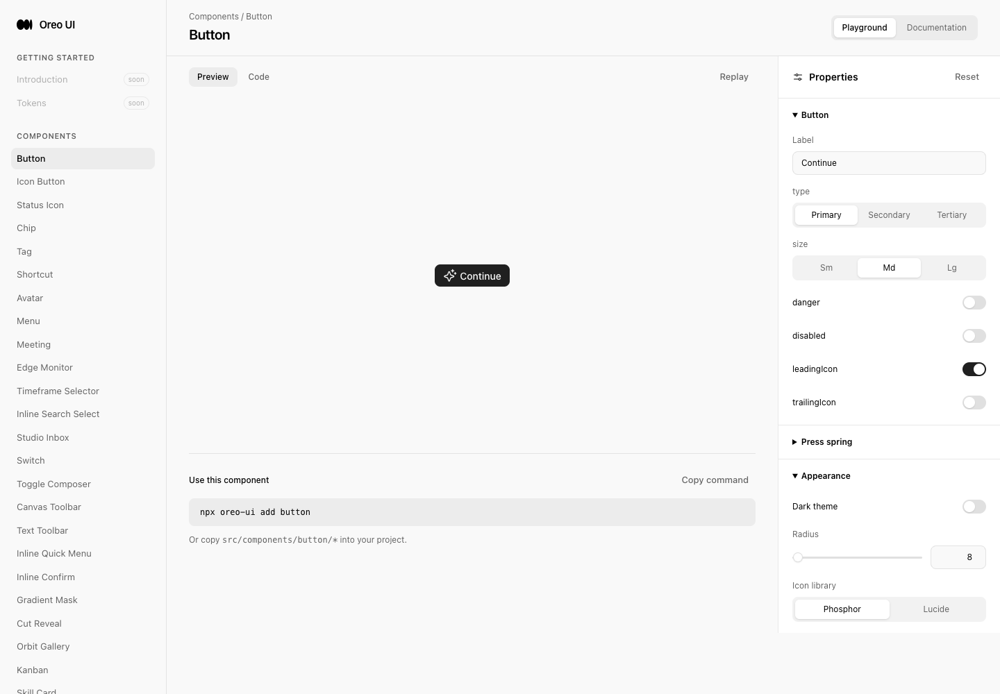
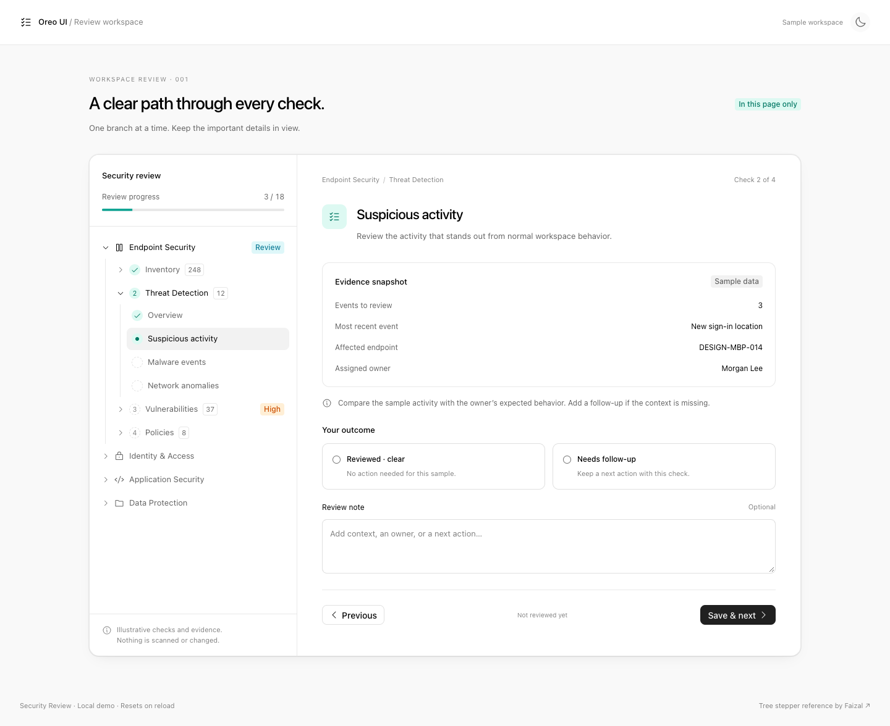
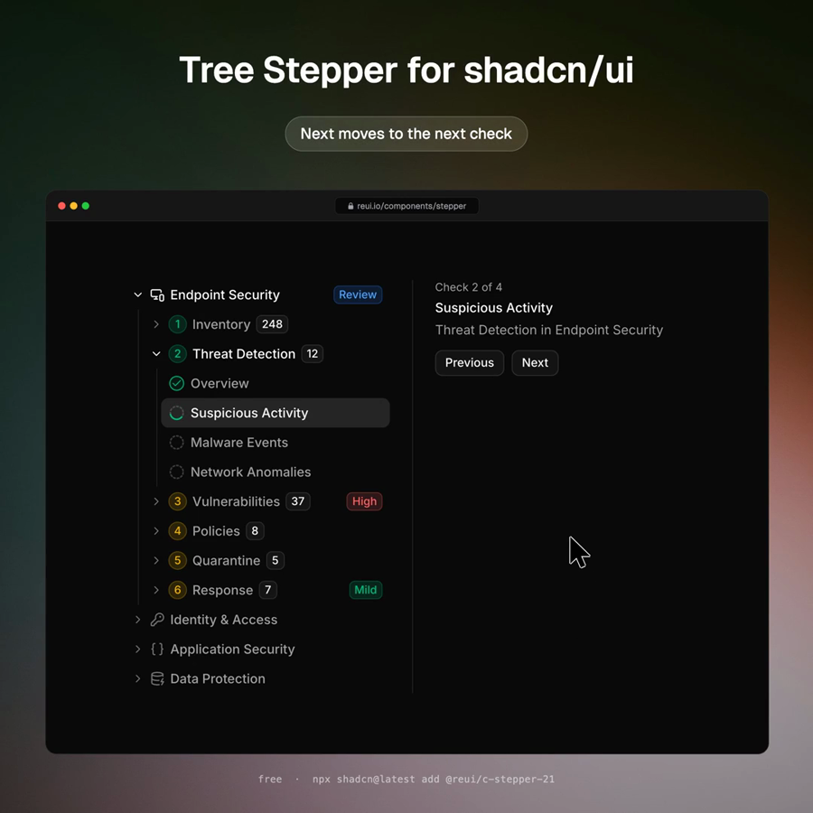
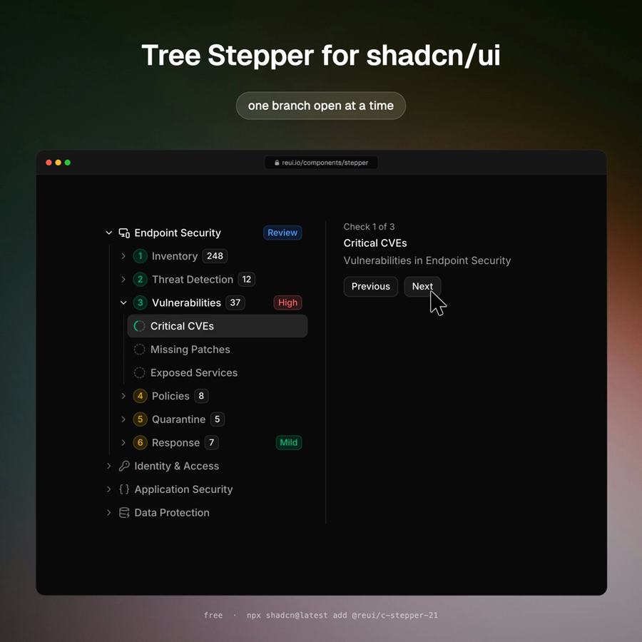
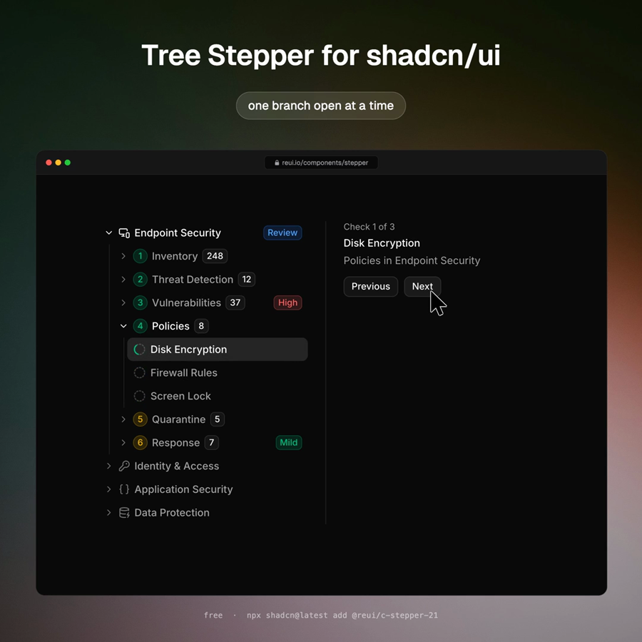

# Tree Stepper / Security Review

## Source and revisions

- Reference: [Faizal — branching checklist](https://x.com/FaizalSukaimi/status/2110366307787108463).
- Direct X access returned 403 and the authenticated Chrome extension disconnected. Public post metadata was recovered through `https://api.fxtwitter.com/FaizalSukaimi/status/2110366307787108463`. The 11.4-second public video was sampled at one-second intervals; frames 1, 3, 5, 7, 9 and 11 were inspected. Three source frames are retained below. No source implementation was copied.
- Baseline: `c9b08485978a7ade122a858d78a3a4d843692417`.
- Implementation: `8beaa33f60ea86eebd4da5d6366ea014640897e2`. Evidence-only commit follows this revision.
- Isolated branch: `codex/branch-stepper-20261015`; unrelated primary-checkout work preserved.
- Local preview: `http://localhost:5213/security-review`. Chromium through Playwriter session 45, English, local sample data. Full-page captures preserve original dimensions; desktop viewport 1440×1000, tablet 768×1024, phone 390×844. Component playground captures use the browser's 756px viewport.

## Delivered surfaces

`/tree-stepper` provides controlled nested navigation, completed/current/pending/follow-up states, disabled and empty states, and a depth-first leaf helper. Base UI Accordion owns disclosure and keyboard behavior. `/step-progress` provides a labeled, accessible count and track, including zero and clamped totals. Both have existing Oreo playgrounds, docs and sidebar entries.

`/security-review` combines them into a complete local template: 18 checks, evidence cards, outcomes, per-check notes and unsaved drafts, validation, previous/next navigation, missing-check recovery, summary and restart. The reference's active branch expansion is retained; the template adds a real review flow rather than decorative next buttons. Sample evidence is explicitly identified and reload resets the page. There is no scan, persistence service or production integration.

## Evidence map

| Page / state | Before | After | Change / coverage |
| --- | --- | --- | --- |
| New route entry, desktop light | [Actual previous entry](before-entry.png) | [Complete template](after-desktop-light.png) | At baseline the unavailable route reached the Button playground. Same 1440×1000 browser, English, light theme. No prior wizard existed. |
| Initial active branch, desktop dark | No comparable prior review page | [Dark initial state](after-desktop-dark.png) | 3/18 complete, Suspicious activity current, only Threat Detection expanded within Endpoint. |
| Required follow-up note / recovery | New local form; no prior state | [Validation error](after-required-note.png), [completion](after-complete.png) | Empty outcome blocked; empty follow-up note blocked and focused; entered note saved and restored on Previous. Final 17 clear / 1 follow-up. Recovery was exercised, not separately screenshot at its exact intermediate step. |
| Mobile closed / open tree | Narrow baseline not captured; baseline SHA retained | [Light](after-mobile-light.png), [open tree](after-mobile-tree.png), [dark selected check](after-mobile-dark.png) | 390×844, bounded 24rem tree, selection closes navigation. No horizontal overflow. |
| Tablet | No matched baseline capture | [Tablet](after-tablet.png) | 768×1024, 19rem sidebar, single-column outcomes, no horizontal overflow. |
| Reusable Tree Stepper / empty | Components did not exist at baseline | [Playground](after-tree-playground.png), [empty](after-empty.png) | Standard Oreo component preview and controls. Disabled headers and leaves verified through actual UI. |
| Step Progress / clamped total | Components did not exist at baseline | [Playground](after-progress-playground.png) | Completed=3,total=2 exposes 2/2; total=0 exposes “No checks”, aria-valuenow=0. |
| Disclosure and automatic next branch | No equivalent pre-change interaction | [Branch disclosure](branch-motion.mp4), [automatic next](auto-advance.mp4) | Actual browser interactions. 1440×920 derived clips, 4.5s / 2.7s. See capture history below. |
| Same-role comparison | [Existing Plan](before-plan-peer.png) | [Existing Review Workspace](peer-review-workspace.png) | Both real Oreo pages inspected along with shared source owners. These are comparison evidence, not falsely paired before/after implementations. |

### Entry pair

### Source frames

## Consistency review

| Lens | Owner / comparison | Result |
| --- | --- | --- |
| Entry | App route registry, PAGE_META, DocsPage, Sidebar, existing Plan playground and Review Workspace | Existing component playground/documentation split and template navigation retained. New standalone template uses Oreo theme and components. |
| Loading | Local synchronous data, Plan status semantics | Not applicable: no request or background work. Static active marker avoids implying processing. No invented loading state. |
| Empty / error / recovery | AgentWorkspaceState shared owner, local form | Empty tree reuses canonical empty state. Outcome and follow-up-note errors are live alerts; relevant control receives focus. Missing completion routes to the first unfinished/dirty check. |
| Actions | Button / IconButton shared owners, Review Workspace action hierarchy | Primary Save & next / Finish; secondary Previous; tertiary restart/theme. Native radios are form choices, not action buttons. Header disclosure and leaf selection use Base UI/native navigation semantics. |
| Titled scrolling | Review Workspace sidebar, template sidebar | Title/progress remain outside bounded scroll content; opaque background and dividers. Mobile tree is explicitly expandable with aria-expanded and aria-controls. No transparent title overlay. |
| Icons / color | Icon, Tag, palette and semantic status tokens; Plan progress | Existing icons inherit row color; icons and tags retain canonical theme mapping. Mint = current/completed, orange = follow-up; accessible text distinguishes states. Semantic borders/radii and spacing scale reused. Reference's marketing gradient is omitted from the reusable product UI. |

Scope is these Oreo surfaces, not a cross-product or native-platform audit. Shared owners were reused without unrelated changes. Playgrounds and template are the same-role consumers of TreeStepper and StepProgress.

## Focused validation

- TypeScript `tsc --noEmit`: passed after final source changes.
- Production Vite build: passed. Existing large-chunk advisory remains; no new dependency added.
- `git diff --check`: passed.
- UI: required outcome, required follow-up note, note recovery, saved answer recovery, unsaved draft retention when navigating away/back, sequential navigation, automatic sibling collapse, direct final-step jump guard, all 18 checks, correct summary counts and Start fresh (0/18, Previous disabled).
- UI: mobile Show/Hide, step selection closes mobile tree, light/dark, desktop/tablet/phone, disabled component, empty component, zero/clamped progress, documentation entry.
- Keyboard: Enter disclosure instant; ArrowDown from Vulnerabilities focuses Policies. Computed chevron transition is `none` after keyboard input. Reduced-motion panel computes `opacity 0.1s` only. Native button/radio focus and heading focus after selection inspected.
- No new console errors during interactions. Reloads expose a pre-existing resource 403 also seen on unchanged peer pages; old server/HMR disconnect logs were separated from fresh interaction checks. This is not a claim of a clean production network trace.

## Motion review

| Before | After | Why |
| --- | --- | --- |
| No branch component at baseline | `tree-stepper.css:107` uses measured height 200ms + opacity 180ms, exit 150ms, shared strong ease-out | Deliberate, bounded accordion exception from the repository's animate recipe. Transform-only would not reflow following tree siblings. No easy equivalent GPU-only replacement. |
| Reference advances through long checklist | `tree-stepper.css:135` removes disclosure/chevron transitions for keyboard; progress updates instantly | Frequent navigation must stay immediate. Pointer disclosure transitions can retarget. |
| Movement under accessibility preference | `tree-stepper.css:127` limits reduced motion to opacity 100ms | Removes geometry motion; hover feedback is fine-pointer gated. |

**Performance:** the small measured accordion is the sole layout animation. No animation is attached to form content, progress or page entry. No `transition: all`, scale-from-zero, ease-in or new long-running animation.

**Accessibility / timing:** keyboard and reduced-motion computed styles were verified; original and decoded motion frames inspected. The branch transition stays within 200ms. **Verdict: Approve**, with the documented accordion reflow exception. No mobile hardware performance or screen-reader session was recorded.

## Capture history and limits

- Native Playwriter recording failed with “Extension has not been invoked … activeTab permission”. The same Playwriter connection's CDP screencast was used, keeping browser automation in Playwriter.
- `motion-originals.zip` preserves all original JPEG frames, timestamps and concat manifests for three attempts. First attempt (756×413) is superseded: compositor dimensions clipped the tree. Second attempt begins with one 1440×787 setup frame, then 48 stable 1440×1000 frames. The setup frame is excluded from the disclosure clip, its initial idle hold capped at 1.2s, final hold 1s. Third automatic-advance capture is uniformly 1440×1000 and retains recorded timing plus a 1s final hold.
- Derived clips crop the top 80px to remove Playwriter toolbar chrome; originals retain it. Both clips were probed for dimensions/duration and decoded frames visually inspected. They are local-fixture interaction evidence, not source video or production footage.
- Screenshots hide automation overlays. Desktop entry pair is matched; new states have no prior equivalent. Missing mobile/other baseline captures, no old-wizard recording, and no real-device/screen-reader session are explicit coverage gaps, not implementation or merge blockers.
- Media integrity and dimensions are listed in `manifest.json`. All originals retained in this one task directory; no historical screenshot was overwritten.
