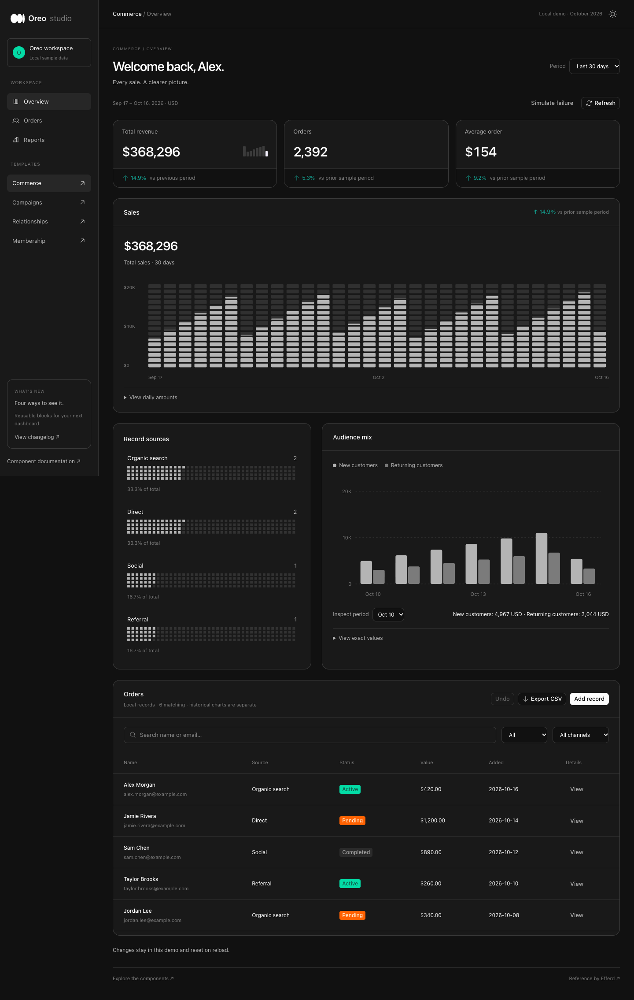
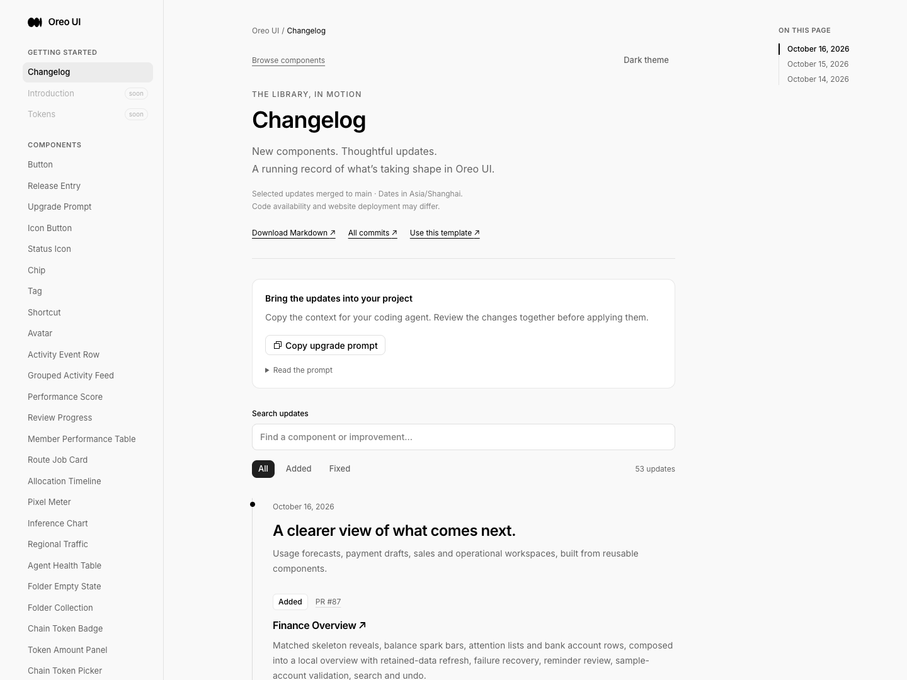
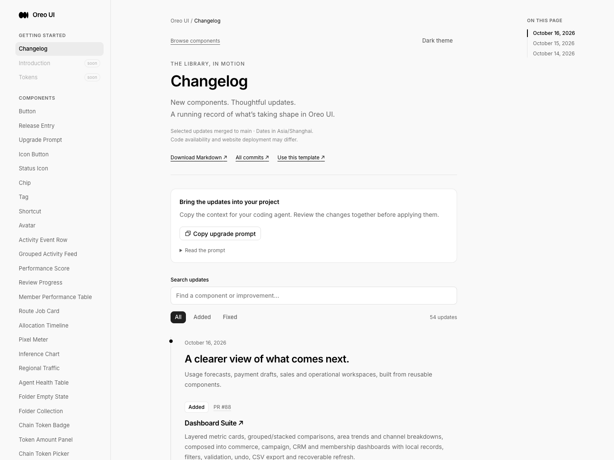

# Dashboard Suite — review index

## Pre-edit grounding
Reference: https://x.com/efferdco/status/2110800367026118933. All four actual images inspected and preserved as browser captures reference-1–4.png (1600×1360, source itself crops right/bottom). 1: dark commerce, sidebar, layered metric/footer cards, pixel sales columns, channel/category/hour modules. 2: light campaigns, header-tucked metric cards, stacked hourly bars. 3: dark CRM, filled metric surfaces, revenue area with selected value, grouped retention and lead funnel. 4: light membership overview, sparse revenue area, paired net/conversion panels, clients/renewals. These are static references; no original interactions can be inferred.

Baseline: 8bf59f73d4943ddc02d510f66c1566defebc1264 (fresh origin/main). Task isolated from primary checkout WIP. New /dashboard-suite route currently reaches Button documentation, captured before edits at 1440×1080, English, light. Other new routes have the same router fallback; separate narrow/component baselines not captured, exact revision preserved.

| Target | Existing peer / owner | Decision and evidence |
| --- | --- | --- |
| Commerce pixel bars and CRM funnel | sales/RevenueMatrix, sales/PipelineFunnel; rendered Sales Workspace | Reuse components unchanged. Values derive from selected period; existing exact-data disclosure stays available. |
| Metrics | command-search/WorkspaceMetric and Finance Overview bank totals | Existing simple three-line metric cannot express tucked header or footer comparison. New DashboardStatCard adds these two explicit layouts, with existing BalanceSparkBars for optional trend. Source-only metric comparison. |
| Channels | agent-observability/PixelMeter; rendered Agent Observatory | Reuse neutral PixelMeter for channel shares; add label/value/list composition. |
| Comparison and area charts | currency-finance/CashFlowBars, agent-observability/InferenceChart | Source inspected. New paired/grouped-or-stacked metric chart and plain area chart are smallest missing compositions; they share exact-data disclosures and keyboard selection approach, without dither or finance-specific currency coupling. |
| Shell, forms, records | sales-workspace index, finance-overview Dialog, shared Button/IconButton/Tag/AgentWorkspaceState | Reuse controls, titled opaque dialog boundaries and centered state hierarchy. Four route defaults compose shared local data/filters/dialogs with distinct arrangements. |

Plan: four template views (commerce/campaigns/CRM/membership), four new reusable components; period selection, chart inspection, local record search/filter/detail/add/delete/undo, CSV export and cancellable simulated refresh/failure. Original crops do not establish complete lower modules; these are functional local completions, not claimed pixel-exact copies. Reuse semantic surface/border/palette/radius/type tokens. No new animation: frequent dashboard operations switch immediately, shared buttons use tapScale=1.

Six lenses to verify: entry/return, initial vs retained refresh, empty/filter/failure recovery, canonical action hierarchy, titled scroll boundary, inherited neutral icons and semantic deltas. Visual evidence is local fixture evidence, not live CRM, revenue or deployment. Static references require no original motion comparison; real-device touch is unverified.

## Implemented scope
Four public exports in `src/components/dashboard-suite`: DashboardStatCard (header/footer/plain), ComparisonBarChart (stacked/grouped), TrendAreaChart (linear, zero baseline), ChannelBreakdown (controlled filtering). Four routes share one DashboardWorkspace: `/dashboard-suite`, `/campaign-dashboard`, `/crm-dashboard`, `/membership-dashboard`. API docs, editable playgrounds, source generation, sidebar, route metadata and changelog are included. No dependencies changed.

## Evidence map and coverage
All screenshots are original Playwriter session 10 captures of real local components and deterministic fixtures at localhost:5260, English. Default desktop viewport 1440×1080; full-page images exceed viewport height. Browser session used its already-established direct Chromium connection after extension disconnection; no user tabs were navigated. Fixture data is September 17–October 16, 2026. No live service or production deployment is claimed.

| Scenario | Before | After | Coverage |
| --- | --- | --- | --- |
| New route entry / commerce | [before-entry](before-entry.png), old router fallback to Button | [commerce](after-commerce-v2.png) | Same 1440×1080 fixture browser, English. Old fallback was light; new commerce intentionally defaults dark. |
| Campaigns light | Same missing-route fallback revision; no separate screenshot | [campaigns](after-campaigns-v2.png), [7 days](after-campaigns-7-days.png) | Full-page. 7-day total verified $86,175 in both card and chart. |
| CRM dark | Same missing-route fallback revision | [CRM](after-crm-v2.png) | Canonical funnel colors restored; shape order does not encode value (disclosed). |
| Membership light | Same missing-route fallback revision | [membership](after-membership-v2.png) | Full-page. Final v2 capture includes exact cents in record table. |
| Responsive | No narrow pre-change captures; baseline revision preserved | [campaigns 390×844](after-campaigns-mobile.png), [CRM 390×844](after-crm-mobile.png), [commerce 900×1000](after-commerce-medium.png), [mobile form](after-form-mobile.png) | Inspected representative shared layouts; not every template/viewport combination or physical touch device. Charts/tables have their own scroll region. |
| Forms / record recovery | New states, no prior implementation | [validation](after-validation.png), [detail](after-record-detail.png), [empty](after-empty.png), [CSV](records-export.csv) | Empty form rejected; Casey record added at $12.50, removed/undo restored; no-result search cleared; CSV one matching record with 12.5 exact numeric value. |
| Refresh failure | New state | [failure with retained data](after-refresh-failure.png) | Failure heading and retained $86,175 asserted; Try again clears error. |
| Public components / docs | Old fallback | [comparison exact table](after-comparison-playground.png), [single area point](after-area-single.png), [API](after-api.png) | Invalid/empty/zero states verified; source code contains public component import and current concrete data. Channel selected/cleared and empty verified. |
| Changelog | [before-changelog](before-changelog.png) | [after-changelog](after-changelog.png) | Existing release-entry pattern reused. |

## Consistency review outcome
- Entry and return: four dedicated routes plus shared records/reports navigation; Base UI Dialog Escape closes and final focus returns to Add record, verified in separate browser calls. Native period selection updates exact chart readout. Full keyboard traversal and screen reader announcement audit not covered.
- Loading: SkeletonReveal shared owner, `animate={false}`; retained-data refresh avoids empty chart replacement. Simulated 700ms loading is local. Continuous timing recording is not included; stills and state assertions do not prove timing or motion smoothness.
- Empty/error/recovery: AgentWorkspaceState reused for filter miss, invalid/empty chart data and refresh failure; clear/retry verified. Existing records survive refresh error.
- Actions: shared Button/IconButton/Tag, immediate operations, tapScale=1, primary Add record and destructive Remove record. Form and record owner are shared across four templates.
- Titled scroll surfaces: panel headers outside scroll bodies; opaque sticky table head, dialog header/footer outside scrollable form. Inspected desktop and narrow captures.
- Icon/color inheritance: project Icon uses currentColor; semantic delta tokens, neutral chart series; existing colored PipelineFunnel kept with matching legend. These are Oreo-only comparisons; no cross-product audit claimed.

## Corrections and historical originals
`after-commerce.png`, `after-campaigns.png`, `after-crm.png` are superseded by v2 captures: dark delta contrast improved, source meters use available width, CRM funnel color/legend restored. `after-validation.png` predates precision correction for record table values; `after-record-detail.png` verifies corrected $12.50. No historical originals deleted. New area charts use a 35rem minimum SVG within horizontal scroll for readable narrow labels. Flat 0% metric no longer shows an upward arrow.

## Validation
`npm run build` passed (TypeScript + Vite); existing large-bundle warning remains. Six Node model tests passed, including zero/invalid/overflow series, stacked/grouped scale, percentage zero baseline, intersected filters, decimal form validation, CSV quoting and formula neutralization. See [final build](build-final.txt), [tests](tests.txt). UI checks above are fixture evidence, not service integration tests. New charts do not animate, so original reference motion is not applicable; initial/refresh timing recording remains an explicit media gap. No before screenshot exists for each new form/chart state because those routes did not exist at the preserved baseline.

## Final source and capture record
PR: https://github.com/oreo-design/oreo-ui/pull/88. Main implementation revision `7b902d89d35020055292e1fbe33087c3c589b21b`; final follow-up changes only membership skeleton shape (remove absent metric slots), PR #88 changelog, and this evidence package. [manifest.json](manifest.json) records final product-file SHA-256 values and each original PNG dimensions/time/hash. Before captures belong to baseline `8bf59f73d4943ddc02d510f66c1566defebc1264`; v2 captures supersede the specific earlier images listed above.

Membership loading: [original](after-initial-loading.png) superseded by [v2](after-initial-loading-v2.png), paired with [ready](after-membership-v2.png). The final loading block omits three metrics which do not exist in membership layout. Both stills inspected, no continuous timing recording. Metric-card playground variant interaction could not be automated reliably (radio action timed out); all three variants rendered in the actual templates and code review covered the zero-delta arrow correction. Shared checkbox/selection controls on other three playgrounds were exercised.

## Representative pair
Previous new-route entry (fallback, light):

New commerce route (intentional dark default):

Changelog before and after (matched light/1440×1080):

