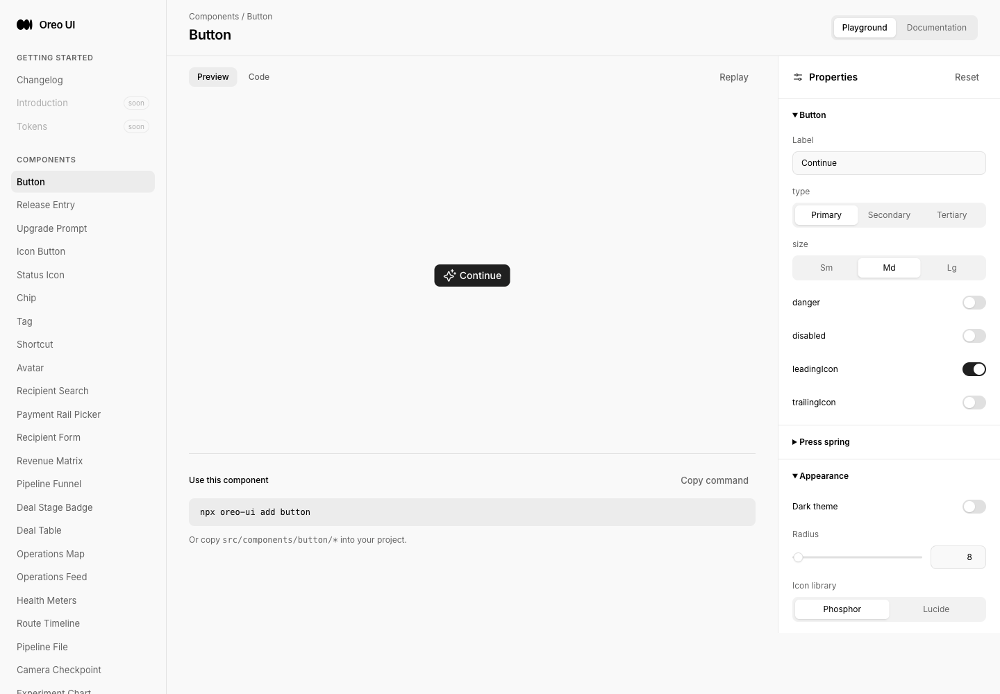
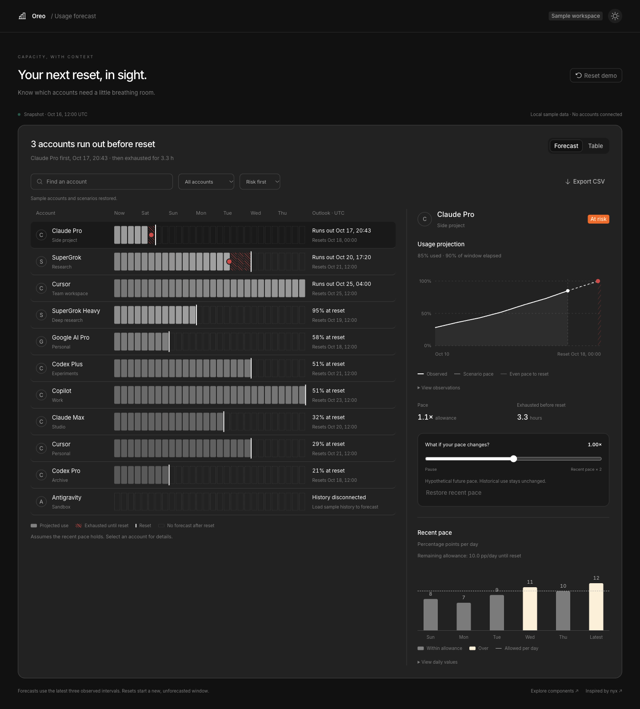

# Usage Forecast — nyx reference

Reference: https://x.com/Niyxuis/status/2110504674143150148

Baseline: `e2aa4f859413e749c984803bba7ad22d2fd050af` (fresh origin/main). Branch: `codex/usage-forecast-20261016`. Local preview: http://localhost:5237/usage-forecast. Original screenshots, browser interaction transcripts, recording, source hashes and downloaded CSV are retained here. All evidence is real Oreo UI with fictional local data, English locale, UTC labels and Chromium via Playwriter session 65. The snapshot time is fixed at October 16, 2026, 12:00 UTC; it is not a live provider reading.

## Reference and scope

The inspected source image has a dark account list with segmented future-use bars, an exhaustion dot, hatched time until reset, reset markers and dotted new windows. The selected account drives a cumulative projection and recent daily-usage chart. Adopted that information hierarchy and the forecast/table switch. Used original letter monograms in place of provider logos and mapped colors, borders, typography and radii to Oreo tokens. The source is a static image; no source interaction or motion is asserted.

Reusable components: `ForecastTimeline`, `UsageProjection`, `DailyUsagePace`, plus typed observations and `forecastUsage` / CSV helpers. Complete template adds account selection, search, status filtering, sorting, forecast/table modes, a per-account hypothetical pace slider, restore/reset, disconnected-data recovery using local samples, exact data disclosures and a real CSV download. All three views derive from one calculation. Changing a scenario under a status filter shows all accounts and pins the edited account, preventing the slider from switching to another account as its risk changes.

## Evidence map

The new route did not exist at baseline and redirected to the default component page. No earlier usage forecasting flow exists to capture; tablet/mobile and interaction before-states are explicitly unavailable, not fabricated from another product page.

| State | Before / peer | After | Coverage |
| --- | --- | --- | --- |
| Entry / complete page | [Actual missing route](before-entry.png) | [Dark](final-desktop-dark.png), [light](final-desktop-light.png) | 1440×1000 viewport; full-page originals |
| Medium width | No previous usage page | [900 light](tablet-light.png), [900 dark](tablet-dark.png) | Stacked detail panel below timeline |
| Phone | No previous usage page | [390 light](mobile-light.png), [390 dark](mobile-dark.png), [detail jump](mobile-detail.png) | 390×844; table/timeline scroll internally; body width verified 390px |
| View / selection | [Sales peer](peer-sales.png) | [Table](table-light.png), browser transcript | Selected account shared between forecast and table |
| Scenario | New action | [Paused pace](scenario-paused.png), interaction recording | Zero pace removes future exhaustion, retains historical bars; restore recovers initial projection |
| Disconnected / recovery | New account state | [Disconnected](disconnected.png), transcript | No fabricated forecast; local sample load restores chart and is explicitly labeled |
| Empty / recovery | Shared AgentWorkspaceState owner | [No matches](empty.png) | Clear filters recovers populated view |
| Components / invalid | Existing docs shell | [Timeline](docs-timeline.png), [projection](docs-projection.png), [pace](docs-pace.png), [invalid](docs-invalid.png), [API](docs-api.png) | Invalid data shows alert rather than zero-valued chart; toggle recovery exercised |
| Export | New action | [Actual browser download](exported-risk.csv) | Three filtered at-risk accounts, expected rates and UTC timestamps verified |
| Changelog | [Before](before-changelog.png) | [After](final-changelog.png), [entry](final-changelog-entry.png) — PR #63 | Existing release-entry pattern |

## Consistency review

| Lens | Target / same-role peer / owner | Result and evidence |
| --- | --- | --- |
| Entry behavior | Forecast/table controls and selected account; Sales Workspace filter/view pattern; canonical Button | Checked in actual previews. Native pressed buttons, same primary/secondary/tertiary owner. Detail stays local; phone has an explicit jump that focuses its destination. |
| Loading | Local in-memory snapshot | Not applicable: no async provider fetch. No synthetic loading spinner; live loading/retry integration unimplemented. |
| Empty states | No results, invalid observations and disconnected history; AgentWorkspaceState in automation and sales | Shared owner reused; empty and invalid captures inspected. Different messages/actions distinguish missing data from invalid data. No claim of exhaustive cross-product visual coverage. |
| Actions | Button, IconButton, native search/select/range, Tag; Sales Workspace | Checked actual dashboard and docs. Same-role controls reuse primitives; scenario range uses native keyboard support. Actual download tested. |
| Titled scrolling | Timeline/table versus Sales table/chart | Checked: horizontal scrolling is scoped to the data region and heading remains outside. No content passes behind a sticky overlay; decorative fade unnecessary. At ≤1150px detail stacks; mobile jump retains keyboard focus. |
| Icons / color | Shared Icon and semantic CSS tokens | Checked in both themes. Ordinary operation icons inherit secondary text. Exhaustion additionally uses dot/hatching and text; selection also has pressed state; no color-only status. |

| Before | After | Why |
| --- | --- | --- |
| Missing usage route | Complete reusable chart family and scenario template | Adds the reference's concrete account-capacity workflow. |
| Initial unsupported icon names | Existing `reset` and `arrow-down` glyphs | Typecheck and browser caught invalid glyphs; fixed before final captures. |
| Initial undefined large-card radius token | Existing medium-card token | Preserves the product radius scale rather than adding a one-off token. |
| Filter could remove the currently edited account | Scenario pins account and restores all-account visibility | Prevents a continuous slider edit from targeting a different account. |

## Calculation and verification

- Daily pace is cumulative-use delta divided by elapsed days across up to the latest three intervals. Scenario multiplier affects future pace, not observed bars. Inputs reject missing/reversed/out-of-window observations, decreasing use, non-finite values, invalid windows and data older than one day.
- Remaining allowance is `(100 - current use) / days until reset`. Exhaustion exactly at reset is not early exhaustion. A zero pace yields no future exhaustion unless already at 100%. Projection stops at reset; new-window cells remain explicitly unforecasted. Chart values cap visually at 100%; CSV retains the unbounded projection for inspection.
- `node docs/reviews/forecast-20261016/model-checks.mjs`: **36 assertions passed**, including rate/time calculations, equality at reset, zero pace, already exhausted, stale/invalid input, irregular observation intervals, CSV escaping and invalid timestamp handling.
- TypeScript + Vite production build passed. Existing large-bundle advisory remains. Browser exercised selection, filters, scenario stability, reset, table, empty recovery, disconnected recovery, docs invalid/recovery and responsive themes.
- Actual filtered CSV downloaded to the browser's normal Downloads folder and was copied here unchanged. Playwriter's `download.saveAs` failed to locate its temporary path; direct browser download still succeeded. No fabricated download evidence.
- Interaction recording uses local CDP screencast through Playwriter, since extension recording is unavailable in this setup. Original timestamped frames are compressed alongside the MP4. Dimensions are verified in the manifest. No new animation was added; frequent filtering, selection and numerical readouts update immediately. No before movie exists for this new route.
- Verification limits: local fixtures only; no provider credentials, live usage, subscription availability, quota policy, backend persistence, statistical confidence or production deployment. Screen-reader speech, other engines and physical phones are unverified.

## Capture history

`first-desktop-dark.png` is the initial failed render, superseded after the invalid glyph fix. `desktop-dark.png` predates the radius-token fix. `desktop-light.png` and `scenario-paused.png` predate the filtered-scenario stability fix; their layout and observed data remain useful. Final desktop captures and responsive screenshots are the current implementation. Historical originals are preserved.

## Delivery and recording index

PR: https://github.com/oreo-design/oreo-ui/pull/63. The PR records the reviewed source and merge revision. [Clean interaction recording](forecast-interaction-clean.mp4): 1440×1700, 22.04 seconds, original timestamps; reviewed sample frames show pause, restore and table switch without automation overlays. The earlier 29.08-second recording retains the cursor overlay and is superseded for presentation. Both original frame sets are preserved.
