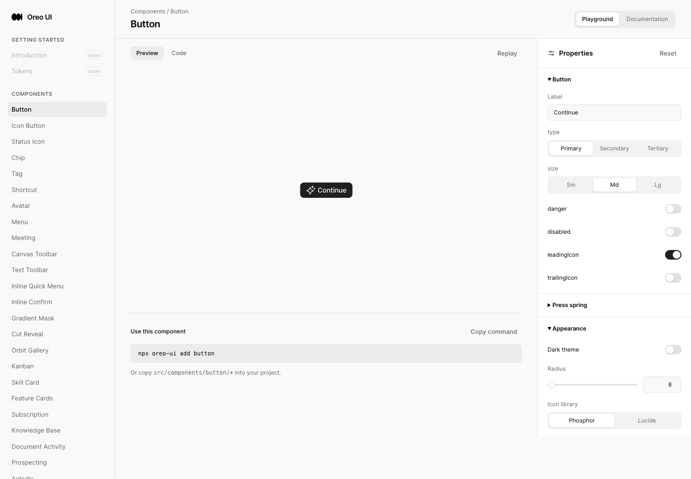
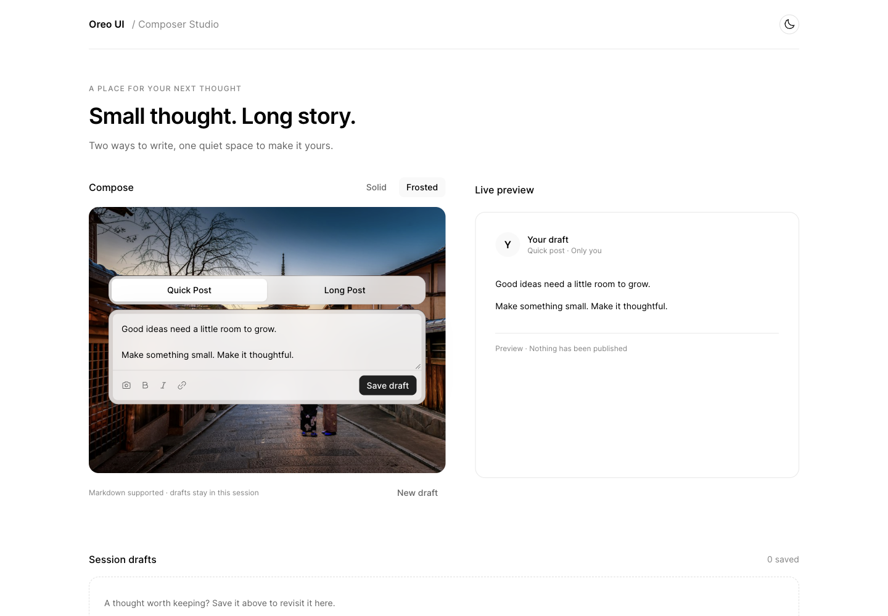
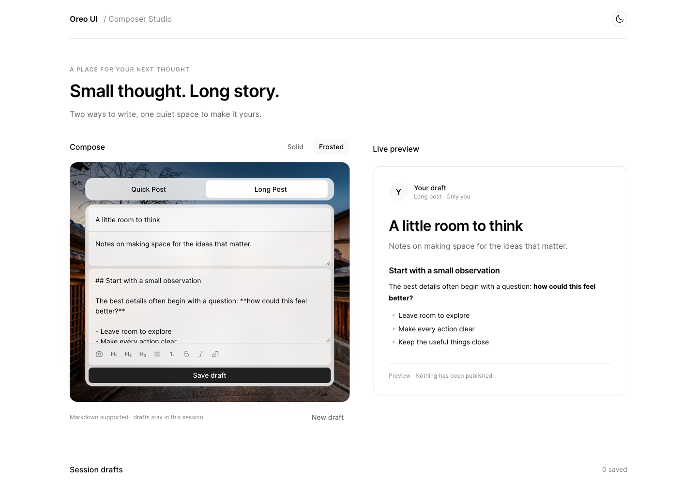

# Toggle Composer / Composer Studio review

## Delivery and scope

- Reference: [Greg Washington’s toggle composer video](https://x.com/gregmwashington/status/2110188748994675112).
- Baseline: `ddd85d939b5071c433d492098140a435638558b2` (main after PR #35).
- Reviewed implementation: `004f7607b10b96919a056f0270b67c496d26fcc8`. Captures were made continuously from its working tree before the implementation commit. Early stills precede the final indicator easing adjustment and draft-ID fix; neither changes their displayed layout. Final motion properties and draft behavior were checked separately in the logs.
- Routes: `/toggle-composer` (Playground and docs), `/composer-studio` (template).
- Scope: three reusable components plus a pure Markdown selection transform; one responsive template. Existing root checkout/WIP was left untouched. No new dependencies, icon names or global tokens.
- Validation: TypeScript `--noEmit` and Vite production build passed. Build retains the repository’s large-chunk warning. Browser interaction assertions passed (see logs). This records local fixture behavior, not deployed production or external publication.

## Reference breakdown and adaptation

The actual 24.37-second source video was inspected in the authenticated browser. Frames 1/2 show dark/light long composers; frame 3 shows dark long on a plain surface alongside a compact frosted quick composer. Originals are `reference-frame-1.png`, `reference-frame-2.png`, and `reference-frame-3.png`.

| Source element | Reusable implementation | Template behavior |
| --- | --- | --- |
| Quick Post / Long Post segment | `ComposerModeSwitch` | Native radio keys, focus indication, independent content retained |
| Inset headline / intro / body | `ToggleComposer` | Controlled fields; Quick footer save, Long full-width save |
| H1/H2/H3, lists, bold, italic, link | `ComposerFormattingToolbar`, `formatComposerText` | Markdown selection edits with focus restored; live Oreo Response preview |
| Image action | `onAttach` plus attachment slot | PNG/JPEG/WebP ≤5 MB, remove, save/restore image with draft |
| Plain / frosted surfaces; two themes | `surface`, existing theme tokens | Solid/Frosted controls and light/dark toggle |

The source’s mountain image is replaced by the existing Oreo Kyoto asset. This is a source-informed implementation, not a pixel-identical reproduction. The template adds a preview and session draft list; it does not imply a real publish service. The source’s changing form height is immediate here; only the active indicator moves. Link insertion creates an editable example URL, and formatting is Markdown rather than a rich-text engine.

## Before / after evidence

Environment: local Vite `http://localhost:5208`, Chrome through Playwriter session 39, English, no account required, sample fixture. Desktop viewport 1440×1000; narrow viewport 390×844 (full-page captures have taller output). Exact media dimensions/hashes are in `manifest.json`. New-page baseline was captured **before editing**: requesting `/composer-studio` actually normalized to `/` and displayed Button Playground. That same missing entry is the baseline for the new template, rather than pretending an earlier composer existed.

| Scenario | Before | After / evidence | Coverage |
| --- | --- | --- | --- |
| New template entry, desktop/light | [Actual old entry](before-entry.png) | [Quick / frosted](after-quick-desktop.png), [Long / frosted](after-long-desktop.png), [Quick / solid](after-solid-light.png) | Matched viewport and fixture environment; previous route missing |
| Component catalog and docs | [Previous catalog](before-entry.png), [Prompt Box peer](before-prompt-peer.png) | [Playground](after-playground.png), [Docs](after-docs.png) | Registration, disabled absent submit callback, docs-to-template navigation checked |
| Dark surface variants | No old composer page existed; baseline revision preserved above | [Long frosted](after-long-dark.png), [Long solid](after-solid-dark.png) | Both inspected; no matching old dark composer possible |
| Narrow Quick / Long | No old composer page existed | [Quick](after-mobile-quick.png), [Long](after-mobile-long.png) | 390px inspected; main scroll width equals 390px. Narrow old-entry capture not collected |
| Empty, validation and recovery | New state; no prior implementation | [Required-content error](after-validation.png), [Image error](after-image-error.png), [Recovered image and draft](after-saved-image.png) | Empty draft rejection, invalid file rejection, valid replacement, draft restore and delete checked |
| Keyboard and motion | New interaction; source video inspected | [Focus ring](after-keyboard-focus.png), `docs-motion.log`, `attachments-motion.log` | Arrow navigation, focus restoration, pointer 0.18s / keyboard 0s / reduced 0s confirmed. Recording blocked; no smoothness claim |
| Existing equivalent writing surface | [Writing Studio peer](peer-writing-studio.png) | New composer screenshots above | Same baseline-owned peer captured after implementation; its files unchanged |

All originals are retained; no screenshots are fabricated. Error and recovery captures intentionally contain edited fixtures, so they are state coverage, not a pixel-diff pair against the initial sample. Full-page media extends past the viewport. The source frames are reference evidence, not baseline product evidence.

## Consistency review

Reviewed rendered Prompt Box and Writing Studio alongside code for Button/IconButton, TextToolbar and Response. This is an Oreo-only review, not a cross-product claim.

| Lens | Shared owner / same-role consumers | Result and evidence |
| --- | --- | --- |
| Entry behavior | `site.ts`, App map, Sidebar, Playground registry | Same metadata/docs/template route mechanism as Canvas and Writing Studio. New route previously fell back to home; docs link now reaches template. |
| Loading | Local synchronous editing and session save | No remote load state to simulate. Image file selection creates a local object URL; no upload. Host owns async submission and can pass disabled. Existing Prompt Box’s running-agent state is a different product operation. |
| Empty / error / recovery | Prompt Box empty input; local Writing Studio sample; `ToggleComposer.error` | Empty placeholder and inline error keep the editing context. Preview and session-list empties use their existing titled panels rather than a full workspace loading/error screen. Tested required-content and unsupported-file recovery. |
| Action components | `components/button` and `components/icon`; TextToolbar and Prompt Box consumers | Existing primary save, secondary open/theme, tertiary formatting/delete; `tapScale=1` for frequent editing actions. Native radio selection has one Tab stop and arrow keys. Disabled absent callback verified. |
| Titled scroll surfaces | Writing Studio document/editor and new preview/editor | Page headings stay outside textarea scroll regions; textareas resize vertically and cap at 28rem. At narrow widths the complete preview follows the editor. No nested page-scrolling panel introduced. |
| Icon / color inheritance | Icon adapters and semantic CSS tokens | Existing camera, list, text-bold, text-italic, link, sun/moon, x and trash inherit current color. No literal reference colors copied; same light/dark semantic foreground/background pairs. Both adapters are already owned by Icon; runtime captured with default Phosphor, alternate Lucide rendering not captured. |

Concrete styling: card radius uses `--radius-card-medium`; control radius uses `--radius-control`; input padding .875rem (Tailwind 3.5 equivalent); footer gap/padding .5rem (2); shell inset .375rem (1.5). Frosted shell mixes the semantic elevated surface at 82%, inset fields mix base at 55%, with static 24px blur and an opaque fallback. These mix percentages are treatment-specific because Oreo has no equivalent frosted surface token. Template spacing uses the existing 1/1.5/2/3rem scale; its two-column layout collapses at 800px. No shared control owner changed because the reference-specific mode/field hierarchy is a new composition, while existing action and Markdown owners are reused.

## Motion review

| Before | After | Why |
| --- | --- | --- |
| Initial indicator used `var(--ease-out)` for on-screen movement | `toggle-composer.css:25`: transform only, 180ms `cubic-bezier(0.77, 0, 0.175, 1)` | Existing-position movement follows the repository animation standard’s strong ease-in-out curve; no matching shared token exists. CSS transition can retarget on rapid changes. |
| Source video morphs the form height | Immediate mode layout; only indicator translation animates | Avoid layout-property animation and text scaling in a frequent writing control. This is an explicit fidelity tradeoff. |
| Pointer and keyboard could share animation | Keyboard interaction sets pointer flag false; reduced-motion CSS removes transition | Arrow keys and reduced motion verified at 0s; typing, formatting, preview, theme and save stay immediate. |

**Verdict: Approve (code and interaction-state review).** No feel-breaking motion identified in the implementation. Only transform animates; no entry keyframes, blur animation, transition-all or moving hover effect. Standard pointer duration and curve were inspected in the browser. Temporal visual quality remains unverified because recording did not start; stills do not prove timing.

## Verification and limits

- `interaction.log`: content retention, selected-text bold and rendered preview, focus restoration, numbered multiline formatting, save/open/delete, validation/recovery, arrow-key selection, 390px layout.
- `attachments-motion.log`: unsupported image rejection, valid image recovery, remove/restore, keyboard/reduced properties, recording blocker.
- `docs-motion.log`: disabled absent submit callback, docs entry, final pointer curve/duration and immediate keyboard/reduced behavior.
- `build.log`: successful final production build. TypeScript final check exited successfully with no diagnostics.
- Strict Mode exposed a draft-ID side effect during QA; ID allocation was moved outside the state updater and save/restore checks rerun successfully.
- Shared authenticated Chrome produced wallet/composer extension messages and generic page errors (`session`, `parentElement`). Functional assertions passed, but the captured console is not clean and these logs are preserved; this review does not claim every message’s source was conclusively attributed.
- **Recording blocker:** Playwriter returned “Extension has not been invoked for the current page (see activeTab permission).” To recover, click the Playwriter extension icon on the task’s `localhost:5208/composer-studio` tab, then capture Quick↔Long pointer and keyboard transitions in this same evidence directory. No recording file was produced; no dimension/FPS verification is claimed.
- Not covered: production deployment, real publishing, persisted drafts across refresh, other browsers, physical touch device, screen reader narration, native platform or alternate icon adapter screenshots. No account/backend operations were required.
