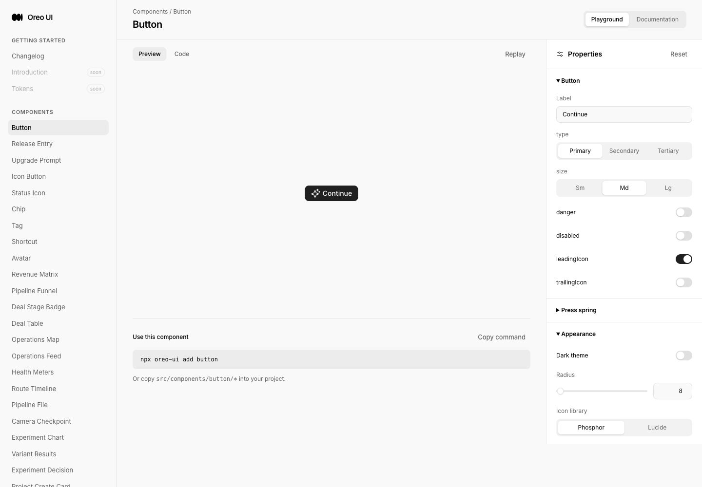
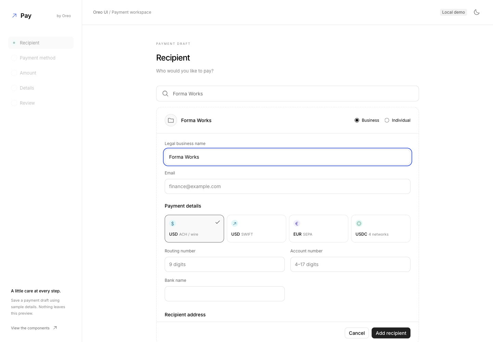

# Payment Workspace — Atikh Bana recipient flow

Reference: https://x.com/tikhbana/status/2110486416086159469

Baseline: `9e51dcaf01fbaf1c11b1660576c27c1ffe92d2a9` (fresh origin/main). Branch: `codex/recipients-20261016`. Preview: http://localhost:5236/payment-workspace. Original captures, browser transcripts, recording and source hashes live in this directory. All captures use real Oreo components with fictional local data, English locale, Chromium through Playwriter session 65. No live payment, account verification, durable persistence or deployment is claimed.

## Reference and implementation

The 22-second reference demonstrates searching for a recipient and creating one inline. Four browser frames at 3, 9, 15 and 20 seconds retain the actual source: search/create affordance; dashed, internally scrolling form; business/individual choice; ACH/wire, SWIFT, SEPA and USDC cards; conditional fields and address; fixed form footer; five-step payment navigation. The video was streamed in a native browser player, not downloaded. Public metadata is retained in `oreo-tikhbana-reference.json`.

Extracted `RecipientSearch`, `PaymentRailPicker` and `RecipientForm`. The complete template adds five local draft steps: recipient, funding source, amount, optional details and review. Earlier edits invalidate later completion. Form values survive identity and rail changes; cancel discards the local edit and returns focus to search. Submit validates only visible identity/rail fields and focuses the first invalid input. Account summaries are masked. Decimal parsing uses integer units, with two places for fiat and six for USDC. Saving creates a local draft; reload resets it.

## Before / after and coverage

The baseline `/payment-workspace` route did not exist and redirected to Button documentation. There is no previous recipient or payment workflow to fabricate as a before state. Security Review is a same-role stepper comparison, not the baseline of the new page.

| Scenario | Before / peer | After / evidence | Coverage |
| --- | --- | --- | --- |
| New entry | [Actual missing route](before-entry.png) | [Light entry](final-entry-light.png), [light form](final-form-light.png), [dark form](final-form-dark.png) | 1440×1000 viewport; full-page originals |
| Tablet | No previous page at baseline | [Light](tablet-form-light.png), [dark](tablet-form-dark.png) | 900×1000 viewport; narrower sidebar and fluid content |
| Phone | No previous page at baseline | [Light](mobile-form-light.png), [dark](mobile-form-dark.png) | 390×844 viewport; one-column fields, 2×2 rail cards, natural page scroll |
| Required-field error | New form state | [Errors / focus](form-validation.png), [saved recipient](saved-recipient.png) | Required-field rejection then recovery; first invalid email visibly focused |
| Amount / recovery | New step | [Precision error](amount-error.png), [review](payment-review.png), [saved draft](payment-saved.png) | Seventh USDC decimal rejected; 1250.123456 retained exactly; save/restart works |
| Edit / navigation | [Security Review](peer-review.png) | Browser transcript and interaction movie | Editing funding resets later steps; retained amount is reconfirmed; cancel returns search focus |
| Empty / component docs | New component, shared AgentWorkspaceState owner | [Search](docs-search.png), [empty](docs-search-empty.png), [rail](docs-rail.png), [form](docs-form.png), [API](docs-api.png) | Same docs shell, playground controls and API table |
| Search focus | New input | [Final focus](search-focus-corrected.png) | One focus ring on the composite search field |
| Changelog | [Before](before-changelog.png) | [After](final-changelog.png), [entry](final-changelog-entry.png) — PR #62 | Existing release-entry structure |

## Cross-surface consistency review

- **Entry behavior:** inspected the missing-route baseline and actual Security Review stepper. Reused `TreeStepper` for current/completed/pending navigation. Future steps are disabled; on mobile the same sequence is represented by explicit step count plus Back/Continue because the full navigation cannot fit.
- **Loading:** no asynchronous work in the new local fixture; no artificial spinner or fake payment submission. No network failure/retry state is applicable. Remote production loading is unimplemented and unverified.
- **Empty:** reused the existing `AgentWorkspaceState` owner for no matches when create is unavailable; actual empty playground captured. The create-capable version instead retains an inline action beside the failed search, as shown in the reference. Same-role consumers in automation and sales use the shared owner; those consumers were not changed. Exhaustive cross-product visual coverage is not claimed.
- **Actions:** reused `Button`, `IconButton`, native input/radio semantics and focus tokens. Primary add/save, secondary cancel/back and tertiary edit preserve existing hierarchy. `tapScale={1}` avoids added motion in this frequent form flow. Selected rail has a check and border as well as color; future navigation is actually disabled.
- **Titled scroll surfaces:** new form uses a persistent heading and footer outside a 55dvh scrolling body on desktop, matching the reference's inline editor context. Phone removes the inner height limit so fields scroll with the page. Docs use the existing DocsPage / playground owners. This is intentionally inline rather than replacing the existing modal editor pattern for unrelated list pages.
- **Icon/color inheritance:** shared `Icon` and semantic theme variables; currencies use existing palette roles. No copied source colors or new global token overrides. New template classes use `payflow-*`; the first implementation accidentally reused Project Workspace's `pw-*` namespace, caught visually and corrected before delivery. Existing Project Workspace files are unchanged.

## Interaction evidence and verification

`recipient-interaction-final.mp4` records opening an existing recipient, changing rail, keyboard radio navigation and cancel/focus return. It is a local Playwriter CDP screencast with original timestamps; extension tab capture was unavailable in this browser setup. Original frames remain compressed here. Dimensions/duration are recorded in the manifest. Representative frames were inspected. No new animation/timing behavior was introduced; the original reference's camera motion was not implemented. No before interaction movie exists because the route had no corresponding action.

- `node docs/reviews/recipients-20261016/model-checks.mjs`: 33 assertions covering active-field validation, both identities, all rails, masked destinations, decimal precision, zero/negative/exponent rejection, upper boundary and exact USDC units.
- Browser: all four rail panels; business/individual value retention; create/save/cancel; funding change; invalid amount recovery; review/save/start again; native radio arrow navigation; responsive/light/dark; docs and empty state. No uncaught application errors observed; development analytics logs are expected.
- Build: TypeScript + Vite passed. Existing large-bundle advisory remains.
- Format checks deliberately do not verify ownership, bank/routing/IBAN checksums, wallet networks, balances, exchange rates or fees. Country/network options are illustrative. No live financial backend is connected.
- Screen-reader speech, other browser engines, real phones and full remote integration are not verified. Form validation capture precedes the accessible-label correction (visual appearance unchanged); accessible names now stay stable when error descriptions appear.

## Historical captures

Preserve originals: `initial-desktop-light.png`, `form-desktop-light.png`, `search-create.png`, `form-errors.png` are superseded exploratory captures from before the namespace correction. `recipient-interaction.mp4` and `interaction-frames.json.xz` precede the composite-search focus-ring correction; the final movie also predates the final specificity fix. Use `search-focus-corrected.png` for the final single-ring treatment. The movies still demonstrate the same workflow. No historical media was overwritten. Source hashes in `manifest.json` identify the final implementation independently of commit metadata.

## Delivery

Task PR: https://github.com/oreo-design/oreo-ui/pull/62. Changelog uses this actual PR number. Final source revision and merge result are recorded by the GitHub PR; the manifest pins implementation files by SHA-256.
