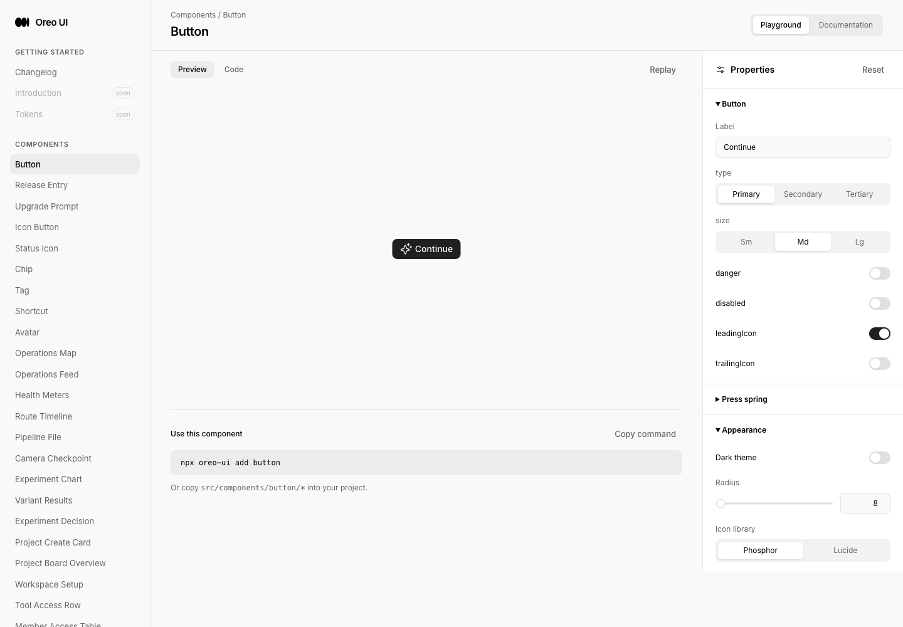
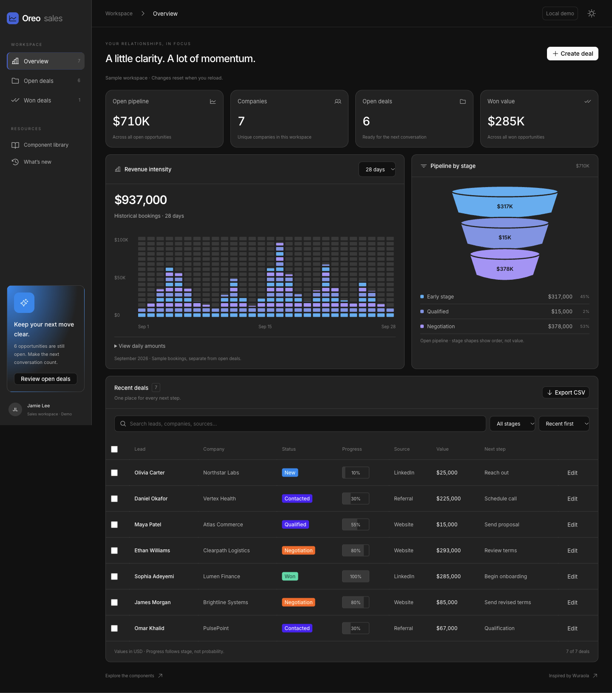

# Sales Workspace — Wuraola reference

Reference: https://x.com/Wuraoladesigns/status/2110621316835573992

Baseline: `321e716f147cfc318977f544794700092efb4b62` (fresh origin/main). Task branch: `codex/sales-20261016`. Local preview: http://localhost:5235/sales-workspace. Source file hashes and original capture dimensions are in [manifest.json](manifest.json). All evidence uses real Oreo components with fictional local data, English locale and desktop Chromium through Playwriter session 65. No account, CRM connection, persistence or production deployment is claimed.

## Reference and scope

The 23.516-second reference video presents a charcoal CRM dashboard with four metrics, a pixel revenue matrix, a three-tier funnel and a recent-deals table. It uses staged reveals, counting values and camera pans/zooms; no real user workflow is demonstrated. Original browser frame captures at 0/6/12/20/23 seconds and public metadata are retained here. Adopted the dashboard hierarchy, blue/purple segmented visualization, stage summary and dense deal rows. Replaced Arc branding/mascot with Oreo identity and an original text insight. Did not transplant the video's camera moves or animate financial readouts.

New reusable exports: `RevenueMatrix`, `PipelineFunnel`, `DealStageBadge`, `DealTable`, plus typed data and summary/CSV helpers. Complete `/sales-workspace` template includes Overview/Open/Won views, all-workspace metrics, 7/14/28-day historical bookings, stage/search/sort controls, controlled selection, create/edit, validation, bulk win, one-step undo and actual CSV download. Historical bookings are explicitly separate from editable opportunities. Funnel shapes encode stage order only; amounts and numerical shares encode value.

## Before and after

Before implementation `/sales-workspace` did not exist and redirected to Button documentation. There is no previous CRM page to compare with the new layout. The existing Invoice Workspace is a same-role comparison, not a fabricated baseline for this route.

| Scenario | Before / peer | After / evidence | Coverage |
| --- | --- | --- | --- |
| New route, desktop | [Actual missing-route result](before-entry.png) | [Final light](final-desktop-light.png), [final dark](final-desktop-dark.png) | 1440×1000 viewport, full-page originals |
| Tablet | No prior sales page; same baseline revision | [900 light](final-medium-light-exact.png), [900 dark](final-medium-dark-exact.png) | 900×1000, stacked charts / two-column metrics |
| Phone | No prior sales page; same baseline revision | [390 light](final-mobile-light.png), [390 dark](final-mobile-dark.png), [editor](mobile-editor.png) | 390×844; full content; table scroll confined to its region |
| Validation/recovery | New action; peer uses Base UI dialog | [Required-field error](editor-error.png), [created decimal-valued deal](created-deal.png) | Missing names and negative amount rejected; $12,345.67 retained; save closes editor |
| No matches | [Invoice empty state](peer-empty.png) | [Sales empty state](empty-deals.png) | Shared centered `AgentWorkspaceState`; clear filters restored results |
| Data inspection | New component | [Daily data disclosure](daily-data.png), [final seven-day chart](final-seven-days.png) | $181,000 for seven days; exact observations in semantic table |
| Component previews | New routes | [Revenue](final-docs-revenue.png), [Funnel](docs-pipeline-funnel.png), [Badge](docs-deal-stage-badge.png), [Table](docs-deal-table.png) | Interactive controls and source registration; [API](docs-api.png) |
| Invalid/empty chart | No comparable previous component | [Invalid dataset](docs-invalid.png), browser transcript | Invalid → empty → ready exercised; no fake zero chart on invalid data |
| Changelog | [Before](before-changelog.png) | [After](final-changelog.png), [entry](final-changelog-entry.png) | Existing release-entry pattern reused |

## Functional validation

- `npm run build` passed; the repository's existing large-chunk warning remains. [Build log](build.log).
- [Focused logic check](logic-check.mjs): 22 assertions; run `node --experimental-strip-types docs/reviews/sales-20261016/logic-check.mjs`. [Result](logic-validation.log). Covers $710,000 open pipeline, $285,000 won, stage totals, stage mutation, zero/invalid values, cents, revenue periods and CSV escaping/formula neutralization.
- Browser exercised create, edit to Qualified, company search, select visible, bulk win, undo, no matches/recovery, Negotiation filter, descending value sort and CSV export. The actual browser download is [exported-deals.csv](exported-deals.csv): Ethan $293,000 then James $85,000, exactly the two visible records.
- Browser download `saveAs` encountered the extension relay's missing temporary file; the actual file in the browser's Downloads folder was read and copied intact into this evidence package.
- Escape closes the Base UI dialog and returns focus to Create deal; focus outline inspected. Mobile Open deals navigation and mobile edit dialog exercised. Repeated filtering/period changes update immediately.
- [Browser state/log transcript](browser-evidence.jsonl) records snapshots after operations. Old peer tabs accumulated Vite connection errors when site metadata restarted the preview server. Fresh target navigations and subsequent interactions were checked without runtime errors. These historical development errors are not production verification.

## UI consistency review

Scope: Oreo Web sales components/template, docs registry/navigation and one Changelog entry. Actual peer Invoice Workspace was inspected at rest and in no-match state; owners `invoice`, `automation`, `button`, `tag`, `command-search` and their existing workspace consumers were read. No cross-product or whole-library consistency claim.

| Lens | Target and peer / canonical owner | Result | Evidence and reason |
| --- | --- | --- | --- |
| Entry | Sales/Invoice create and edit; Base UI Dialog, Button/IconButton | Checked | Existing peer rendering and code; target validation, Escape and focus return verified. Dedicated wide sales sidebar is justified by an overview with metrics, rather than the invoice-only rail. |
| Loading | Local records in Sales and Invoice | Not applicable | Both initialize synchronous fixture data; no async request or refresh/loading state was added. |
| Empty | Sales/Invoice no matches; `AgentWorkspaceState` | Checked | `peer-empty.png`, `empty-deals.png`; centered title, explanation and applicable recovery action. Invalid revenue uses the same owner's error variant. |
| Actions | Create/save primary; export/review secondary; edit tertiary; `Button` | Checked | Canonical components reused; neutral icon controls; named checkboxes. Bulk controls appear only with selection. |
| Titled scrolling | Sales/Invoice content boundary | Checked within captured scenarios | Opaque sticky topbar, titled card headers outside their horizontal table scroller; daily-data header opaque/sticky. No redundant fade. Mobile page has no horizontal overflow (body/main inspected at 390px); table alone scrolls. |
| Icons/color | Neutral controls and semantic stage labels; `Icon`, `Tag` | Checked | Both themes captured; chart palette mapped to existing blue/purple/progress tokens, dark mixtures improve contrast. Status always includes text; progress explicitly denotes stage rather than probability. |

Corrections: initial dark chart used near-white text palette values as fills; mixed existing palette tokens for readable blue/purple fills. An initial `preserveAspectRatio=none` chart stretched axis text, most visibly with seven days; moved axis labels to HTML at fixed typography while only the bars resize. Initial chart entrance replayed on view changes; removed it, leaving only the persistent metrics mount animation. Final captures supersede those earlier visual states.

Spacing/radius/typography map to existing rem scales, `--radius-control`, `--radius-card-small`, `--radius-card-medium`, semantic text/border/background tokens and shared WorkspaceMetric. SVG coordinates are intrinsic diagram geometry, not copied product tokens.

## Motion review

House animate recipe and review-animations standards applied before commit.

| Before | After | Why |
| --- | --- | --- |
| Reference camera pans, long staged blur and counting values | Only metrics mount: opacity + translateY(4px), 220ms, cubic-bezier(.23,1,.32,1) | Brief orientation on page entry; financial data stays readable and does not count up. `sales-workspace.css:432–444`. |
| Initial chart entrance reran when Overview remounted | Chart is static; filters, keyboard controls and dialogs update instantly | High-frequency/keyboard actions do not replay decoration. `sales-workspace/index.tsx` charts section. |
| Moving entrance for every user | Reduced preference uses opacity-only 120ms and no transform | `sales-workspace.css:445–458`; computed animation `sw-fade`, duration `0.12s`, transform `none` inspected. |

**Approve.** No remaining feel-breaking motion finding: only transform/opacity animate, no count-up, layout animation, scale-zero, ease-in or repeated keyboard-triggered effect. Hover styling is fine-pointer gated. Mount keyframes cannot conflict with repeated action state. Existing button primitives use `tapScale={1}` in this data workspace.

[Clean interaction recording](interaction-clean.mp4) (1440×1000, 3.64s) covers actual docs navigation, entry, period selection, dialog and keyboard dismissal. [Reduced-motion entry](reduced-clean.mp4) (1440×1000, 0.40s) captures the brief fade; [longer reduced-motion reload](reduced-motion.mp4) (3.60s) also retained. Original timestamped frames are in matching `.json.xz` files. CDP captures only changed frames; static intervals retain their real durations. These motion captures predate the axis-only typography correction, which did not change motion. They are not final chart typography evidence. Recordings were inspected frame by frame; no 60fps or cross-browser performance claim.

The normal extension recorder lacked active-tab permission in this session, so Playwriter's local CDP screencast was used. First recordings include a transient automation toolbar during hard navigation and are retained as historical originals (`interaction.mp4`); clean recordings use the real SPA sidebar entry. Some medium/mobile full-page tool screenshots included unused canvas to the right; body/main inspection confirmed no product overflow. Native CDP captures with exact 390px/900px framing replace them; originals remain. `*-framed.png` are viewport-only attempts, not full-page proof.

## Evidence limits and delivery

Final captures are `final-*`; medium `*-exact.png` files supersede the corresponding wider-canvas captures. `after-*`, `docs-revenue.png`, the first motion captures and functional-state screenshots preserve intermediate rounds; the changed chart labels in them are superseded. Functional controls were not changed by that typography correction. No browser/network-error simulation was added because there is no backend. No previous Sales route or pre-change Sales interaction existed; baseline evidence is the real fallback route. Mobile browser capture is desktop Chromium at a mobile viewport, not a real-device claim.

Task-scoped PR/main integration is authorized. PR: https://github.com/oreo-design/oreo-ui/pull/61. Implementation commit: `bffece0` (subsequent changes add the Changelog entry and evidence metadata). Delivery identity is recorded by the PR containing this index; capture source hashes identify the implementation independently of later evidence/Changelog metadata commits. No deployment claim.
