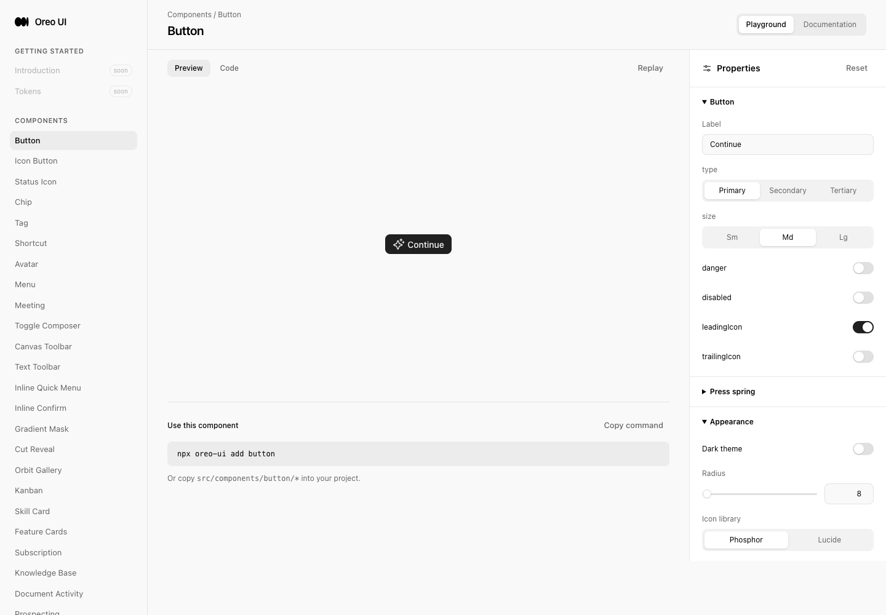
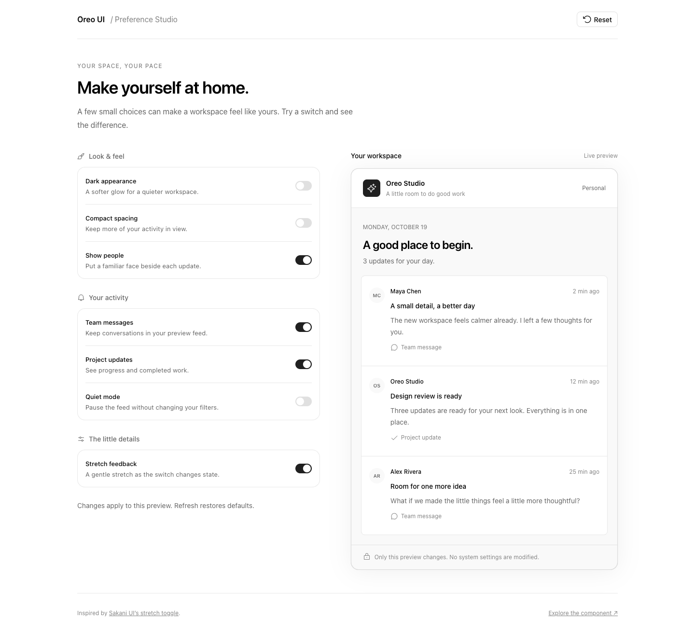

# Stretch Switch / Preference Studio review

## Scope and source

- Source: [csakani / @samosemudiamhe](https://x.com/samosemudiamhe/status/2110425458806235278), “Stretch toggle component with Sakani UI”. The actual video and [author documentation](https://www.sakaniui.com/docs/components/switch) were inspected in Chrome using Playwriter.
- Extraction: a compact on/off control whose leading edge moves first, trailing edge follows, and thumb returns to a circle inside the track. `reference-off.png`, `reference-frame-2.png` and `reference-stretch-docs.png` preserve the observed source. Still frames alone do not prove motion.
- Oreo implementation: opt-in `Switch variant="stretch"`; existing default consumers retain the original appearance and animation. Independent implementation; no source-library dependency or copied source code.
- Template: `/preference-studio` is an authored context for this control, not a screen claimed to appear in the source video. `/switch` includes documentation and playground controls.

## Revisions and capture environment

- Baseline: `785384cc78fc45966484a98f7472848ba679afc9`.
- Reviewed implementation: `81fa1856592648dd41208a5502b33737bebc3afd`. Final captures reflect this implementation; the last edit only clarified the accessible-name prop comment.
- Evidence date: 2026-10-15, Asia/Shanghai. Local Vite preview at `http://localhost:5209`; real Oreo components with local fixture data, no account or backend mutations.
- Playwriter session 45, managed Chromium, light theme unless named dark, English locale/content. Desktop viewport 1440×1000, medium 900×1000, mobile 390×844; full-page images can be taller than the viewport. Boundary checks at 701×900 and 700×900.
- Reference browser: authenticated Chrome, Playwriter session 39. Source captures have their own dimensions; they are not before/after product screenshots.
- Original image dimensions, SHA-256 hashes and supersession labels: [manifest.json](manifest.json).

## Scenario evidence

| Page / state | Baseline | After | Result / limit |
| --- | --- | --- | --- |
| New template entry | [before-entry-managed.png](before-entry-managed.png): requesting `/preference-studio` reached existing Button home because the route did not exist | [after-template-light-final.png](after-template-light-final.png) | Same desktop viewport and light theme; complete new template. No previous preference page existed. |
| Existing Settings peer | [before-settings-peer.png](before-settings-peer.png) | [after-settings-peer.png](after-settings-peer.png) | Same General page, viewport and fixture. Existing Default permissions switch still works with pointer and Space. Lower controls covered by the existing customization panel are not visually verified. |
| Dark + compact + people hidden | No corresponding old template; baseline entry above | [after-template-dark-final.png](after-template-dark-final.png) | Theme, density and people changes reflected in the preview. |
| Quiet / resume | No old template | [after-quiet-final.png](after-quiet-final.png) | Centered recovery reuses AgentWorkspaceState; resume preserves category selections. |
| All categories off / restore | No old template | [after-empty-final.png](after-empty-final.png) | Distinct empty copy and Show all activity action restore the feed. |
| Responsive | No old template at these sizes; baseline revision retained | [after-medium-final.png](after-medium-final.png), [after-mobile-final.png](after-mobile-final.png) | Two columns at 900px, one column below/equal 700px. No horizontal main overflow at 900, 701, 700 or 390px. |
| Switch docs + states | No old Switch documentation route; existing owner was used within Settings | [after-docs-final.png](after-docs-final.png), [after-docs-states-final.png](after-docs-states-final.png) | Default, stretch, disabled on/off, read-only and RTL specimens. Existing customizer partially overlays the right gutter. |
| Playground | Existing shared Playground shell shown in baseline entry | [after-playground-final.png](after-playground-final.png) | New Switch registration, controlled value, variant, disabled and read-only controls. |
| Motion / reduced motion | Baseline default Switch code and Settings peer | [qa-final.log](qa-final.log), [regression.log](regression.log) | Pointer 180ms / trailing delay 40ms; keyboard and reduced motion 0ms / 0ms. Rapid double/triple activation tested. Recording unavailable; logs are behavioral evidence, not a substitute for a video. |

Inspected final desktop light/dark, medium, mobile, empty, docs, Settings peer and baseline entry images. No clipping or unintended horizontal overflow found in these captures. Quiet, playground and full states captures are retained; interaction assertions cover them, but not every pixel of every capture was independently reviewed.

## Consistency review

| Lens | Shared owner / same-role consumers | Evidence and decision |
| --- | --- | --- |
| Entry | App page map, site metadata, Sidebar, DocsPage and Playground | Actual baseline navigation, final docs-to-playground navigation, source inspection. New links follow existing component/template entries. Standalone template follows the existing studio-page role. |
| Loading | Synchronous local fixture | No fetch or artificial loading state introduced. Real network/offline errors and account workflows are not applicable to this template. |
| Empty / recovery | `components/automation/AgentWorkspaceState` | Same centered icon/title/description/action owner is reused. Quiet and category-empty scenarios checked in runtime; existing automation consumer was inspected in code, not exhaustively replayed here. |
| Actions / state | `components/switch`, SettingsRow, Button | Existing Settings General page compared live before/after, Settings demo consumers inspected in code. Stretch is an optional variant in the shared owner, not a second boolean control. Reset and recovery use canonical Button; pointer, labels, Space, read-only, disabled and RTL checked. |
| Titled scroll surfaces | DocsPage and standalone document scrolling | Reuse docs shell; template uses normal document flow without a new nested titled scroll area or overlay. Medium/mobile captures checked; no special scroll fade is needed. |
| Icon / color inheritance | Icon adapter, semantic color/radius/shadow tokens | Both icon adapters already provide used names; default Phosphor rendered in captures. Lucide runtime comparison is a coverage gap. No new colors or icon library introduced. |

Metrics reuse the canonical 34×20px switch with 16px resting thumb and 14px travel. These exact px values come from the existing owner, not arbitrary source measurements. Template color, border, radius and shadow use existing variables; spacing follows the project's rem scale. Layout-specific 70rem width and 700/900px breakpoints serve the new two-column template. Compact feed padding changes from 24px to 12px vertically; normal spacing remains the default.

The one behavior correction also affecting default consumers is read-only enforcement: the installed Base UI beta allowed an external wrapping label to activate its hidden input. The wrapper now cancels the state change at `onCheckedChange` when readOnly is true. Pointer/label/Space checks verify it; enabled default Settings consumers remain interactive.

## Motion review

Review standard: repository `.claude/skills/review-animations`, including its documented strong on-screen movement curve and rounded clip-path use. No new mount or hover motion.

| Before | After | Why |
| --- | --- | --- |
| Existing transform-only default thumb | Default unchanged; opt-in rounded clips in `src/components/switch/switch.stretch.css:1` | Preserve existing consumers while allowing the reference's independently traveling edges. A simple scale would distort end caps. No width/height/layout animation. Clip-path compositing and frame rate were not profiled; no GPU-only claim. |
| Initial draft reduced-motion override retained a 40ms delay | Positive transition rules live solely inside `prefers-reduced-motion: no-preference` at `switch.stretch.css:32` | Browser inspection confirms both duration and delay are zero under reduced motion. |
| Label-generated native clicks bypassed root pointer capture | Event-source handling in `src/components/switch/switch.tsx:42` | Pointer labels receive stretch feedback; keyboard resets pointer motion and stays immediate. |

**Interruptibility & timing:** 180ms strong ease-in-out `cubic-bezier(.77,0,.175,1)` and 40ms trailing offset, 220ms total. CSS transitions retarget current clip positions. Rapid two/three-click checks preserve final state. This is toggle travel, not symmetric press/hold and release timing.

**Accessibility:** optional motion for occasional settings actions; keyboard and reduced-motion movement disabled. Existing focus styling, named controls and supporting descriptions retained. Disabled/read-only prevent changes. RTL mirrors the thumb container.

**Decision: Approve implementation.** No identified feel-breaking regression in inspected states or behavior checks. Continuous motion fidelity and frame pacing remain an explicit recording/profiling coverage gap.

## Validation and remaining coverage

- TypeScript no-emit check passed (empty successful output); production build passed. Build retains the existing large-chunk warning; see [build.log](build.log).
- [qa-final.log](qa-final.log): appearance, density, people, filtering, quiet recovery, all-off recovery, reset, pointer/label/keyboard/reduced-motion behavior, disabled/read-only, RTL and responsive widths.
- [regression.log](regression.log): rapid activation, read-only external label and Space, default uncontrolled Switch. [peer.log](peer.log): existing Settings consumer pointer/Space and restoration.
- [qa-final.js](qa-final.js), [regression.js](regression.js): exact local Playwriter scenarios, not added application test dependencies.
- `git diff --check` passed. Default switch variants file unchanged; no dependency changes.
- Startup logs contain resource 403s and the long-lived peer's connection-refused history. Interactive assertions passed and Vite reconnected; resource failures were not attributed or claimed fixed by this UI change.
- Recording failed even with Playwriter's managed browser: “Extension has not been invoked for the current page (see activeTab permission).” Exact failure preserved in [baseline-motion.log](baseline-motion.log). Recovery requires invoking the Playwriter extension on a visible task-owned tab, then capturing default/stretch on/off, rapid reversal, keyboard and reduced motion. No video was fabricated. This evidence gap does not block the authorized merge.
- No real-account, persistence, screen-reader speech, WebKit/Firefox, touch-device or production deployment claim. User changes are fixture-only and reset on refresh.

## Historical captures

All original captures are retained. `after-template-light.png` and non-`final` after images (except the new peer comparison) are superseded by final captures for acceptance. They predate the read-only, accessible-name or reduced-motion corrections and must not be used as proof of final interaction behavior. Reference images and baseline images remain original. Later follow-ups belong in this directory and index.

## Key pair

Before requesting the new template:

After:

