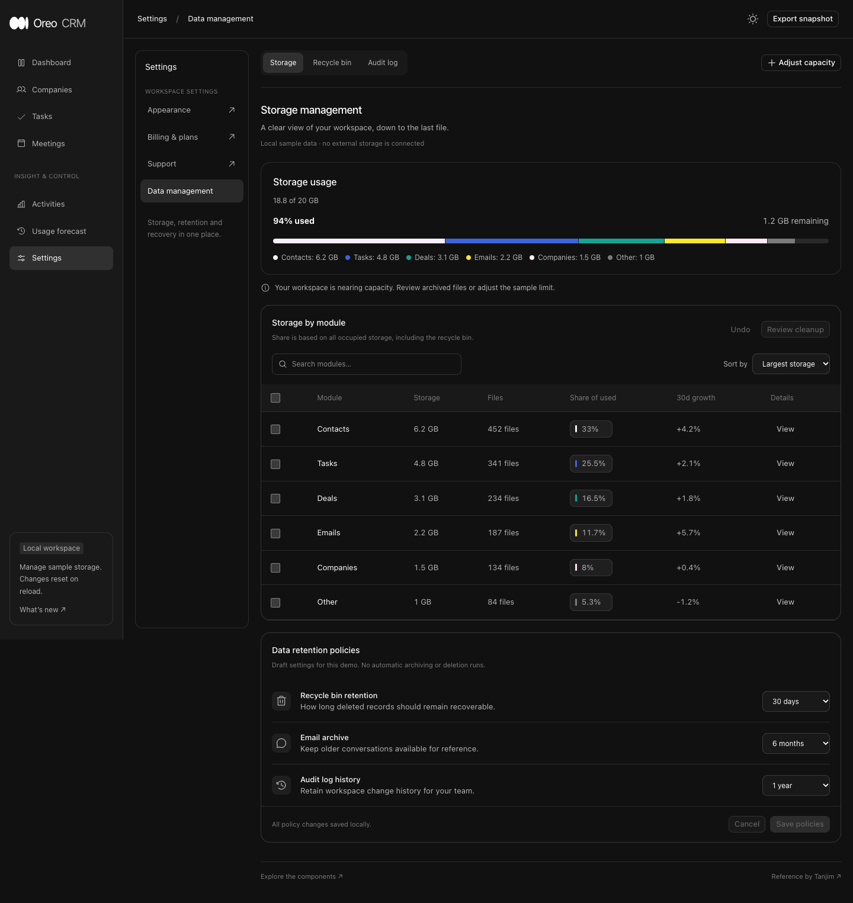

# Storage Manager — review index

## Pre-edit grounding
Reference: https://x.com/Tanjim38/status/2110794332525715550. Actual source photo inspected at native 2900×2244 in browser (`reference.png`); reference itself crops right/bottom. Dark CRM shell, application rail and settings rail, Data management tabs, capacity bar and legend, selectable module rows, retention settings. Source totals conflict: headline 18.8/20 GB vs listed modules totaling 6.78 GB, and percentages do not match. Implementation derives every value from one data model instead of copying inconsistent numbers.

Baseline: 2e97b4abf8b58b6f5e0f07ea34a402ad5c2155bd, fresh origin/main. Primary checkout has unrelated settings WIP; isolated worktree used. New /storage-manager route falls back to Button docs (`before-entry.png`, 1440×1080/light/English). Preview localhost:5261; deterministic local fixtures, not production.

| Target | Peer / canonical owner | Reuse decision |
| --- | --- | --- |
| Segmented capacity | document-activity/DocumentStorage, document-workspace; actual playground captured | Extend existing DocumentStorage with opt-in detailed header, legend values and additional semantic tones. Keep default consumer rendering unchanged. StorageUsageCard adapter validates module data. |
| Module table | company/CompanyTable and dashboard-suite record table, source inspection | New StorageModuleTable composition adds controlled multi-selection, exact capacity share, growth, sorting host and accessible details. Shared Button, Icon and checkbox behavior. |
| Retention rows | settings/rows SettingsRow and row-primitives RowShell/RowLabel; actual settings peer | Reuse row shell/label, add named native duration select and colored semantic icon. No duplicate typography owner. |
| Shell / navigation | dashboard-suite and SettingsNav, source inspected | Two-rail layout from reference at wide screens; compact navigation on narrow screens. Only task-relevant local tabs implemented. Other product destinations use existing real Oreo links. |
| Dialog / errors | dashboard-suite Base UI Dialog and automation/AgentWorkspaceState | Existing controls, focus return, centered empty/error; opaque dialog header/footer separate scroll body. |

Scope: three components and complete local Storage Manager template. Storage, Recycle Bin and Audit Log tabs; search/sort/selection, module detail, reviewed cleanup into recycle bin, restore and undo, capacity scenario, editable retention draft/save/cancel, JSON export. No billing, actual purge scheduler or live storage mutations. Immediate operations, no new animation or simulated network loading; data available synchronously. Uncaptured new states have no prior equivalent; baseline preserved. Six-lens final coverage below will separate runtime checks and gaps.

## Implementation and verification
Added StorageUsageCard, StorageModuleTable and RetentionPolicyRow, plus `/storage-manager`. Three API/playground entries, route metadata and sidebar entries included. DocumentStorage receives optional detailed/title props and four extra tones; old consumers keep their compact rendering. Its before/after playground captures are byte-identical (SHA-1 e631497d9f4f5228d2a8443bf0b3945af944bcfa).

| Before | After | Why |
| --- | --- | --- |
| Reference headline/modules/shares disagree | 18.8 GB modules / 20 GB quota = 94%; computed shares | One authoritative byte model |
| Compact document storage only | Opt-in detailed summary, remaining quota and segment amounts | Preserve old default and reuse segmented-meter owner |
| Early dark screenshot missing yellow segment, muted green | Existing brown-text and status-success tokens | Palette has no yellow token; fix verified visually in v3 |
| Decimal sum announced 18.799999999999997 GB | Detailed meter rounds to byte precision (9 decimal GB places) | Avoid floating-point noise while bytes remain integer in model/export |

## Evidence map
All captures: actual local components, localhost:5261, Playwriter session 10, Chromium, English, deterministic fixture. Desktop 1440×1080 unless noted; full-page images may be taller. Existing session uses direct browser connection after earlier extension limitation. No live account/service or production claims.

| Scenario | Before | After / result |
| --- | --- | --- |
| New route | [before-entry](before-entry.png), Button fallback at preserved baseline | [dark desktop](after-dark-v3.png), [light desktop](after-light.png); same viewport; intentional dark default differs from old light fallback |
| Shared document storage | [before](before-document-storage.png) | [after](after-document-storage.png), identical capture |
| Product settings peer | [settings](peer-settings.png), RowShell/RowLabel | [retention controls](after-light.png); canonical row typography, responsive trailing select |
| Narrow / medium | No narrow fallback capture; exact baseline retained | [390×844 light](after-mobile-light.png), [390×844 dark over-capacity](after-mobile-over-capacity.png), [900×1000 dark](after-medium.png); internal table overflow, no page-wide overflow visible |
| Cleanup review / recycling | New workflow; no prior state | [review](after-cleanup-review.png), [recycle bin](after-recycle-bin.png); 32 Contacts files / 0.4 GB moved, occupancy stays 18.8 GB |
| Purge / undo / restore | New workflow | Runtime assertions: purging batch reduces occupied GB to 18.4; Undo restores 18.8; Restore recovers original 452 Contacts files and 6.2 GB, empties bin. Separate purge and restore stills not captured |
| Capacity scenario | Existing BudgetMeter source semantics | [mobile capacity dialog](after-capacity-mobile.png), [over quota](after-medium.png); 10 GB limit shows 188% and 8.8 GB over, files retained |
| Detail / dismissal | Base UI Dialog same-role owner | [module detail](after-module-detail.png); Escape dismisses, focus returns to View Contacts. Disabled/unmounted trigger falls back to heading by code; fallback not separately exercised |
| Search / sort | New module table | [empty search](after-empty.png); Clear search recovers; sort by name puts Companies first |
| Retention / export | New local data flow | Cancel resets 90-day draft to 30; save 7-day preference; [downloaded snapshot](storage-snapshot.json) verified 18,800,000,000 occupied bytes equals sum and retention bin=7 |
| Playgrounds / docs | Old route fallback | [table](after-table-playground.png): individual and select-all update controlled IDs; empty toggle works; Code serializes public import and props. [usage](after-usage-playground.png), [API](after-api-v2.png). Policy native select updates days property, disabled switch disables control |
| Changelog | [before](before-changelog.png) | Final PR-number entry/capture pending |

## Six consistency lenses
| Lens | Result | Evidence / limit |
| --- | --- | --- |
| Entry/return | Checked | Local navigation and dialogs exercised, Escape/focus returned; linked external product routes verified registered by source, not all followed |
| Loading | Not applicable | All fixture data is synchronous; no fake async loading or new loading timing |
| Empty/error | Checked / partial | Shared AgentWorkspaceState for search and empty bin; recovery exercised. Invalid module/capacity render branches source reviewed and model validation tested; invalid UI capture not included |
| Actions | Checked | Existing Button/IconButton, tapScale=1, native named selection; shared destructive variant only for purge, review precedes mutation |
| Titled scrolling | Checked / partial | Table sticky opaque header, dialog opaque header/footer outside body; mobile dialog inspected. Long-content scrolling recording not captured |
| Icons/color | Checked | Existing Icon vocabulary; neutral operation glyphs; segment and share swatches use same semantic colors. Initial unsupported clock/mail names corrected to clock-history/chat. No shared glyph registry modified |

No new animation: immediate actions, no custom transitions or asynchronous waits. Source is static. Physical devices, exhaustive screen-reader traversal and scroll recordings remain unverified; stills do not prove motion. Scoped Oreo comparison only, no cross-product consistency claim.

## Historical captures and limits
`after-dark.png` is a failed blank capture (unsupported icon names, fixed). `after-dark-v2.png` is superseded by v3 after token correction. Original files retained. `after-api.png` precedes minor breadcrumb spacing correction only. Other captures remain representative after focus fallback hardening. New states did not exist at the baseline; no fabricated before evidence. Build/tests and media coverage are distinct from merge status.

Validation: TypeScript/Vite build passed, existing bundle-size warning remains. Five focused model tests passed: invalid/duplicate modules, selected estimate, recycle occupancy invariance, restore exactness, purge and immutable undo snapshot. See [build](build.txt), [tests](tests.txt). No dependency changes.

## Representative before / after
Existing route fallback:

Complete new page in context (dark default):

